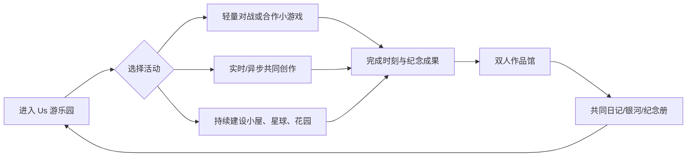
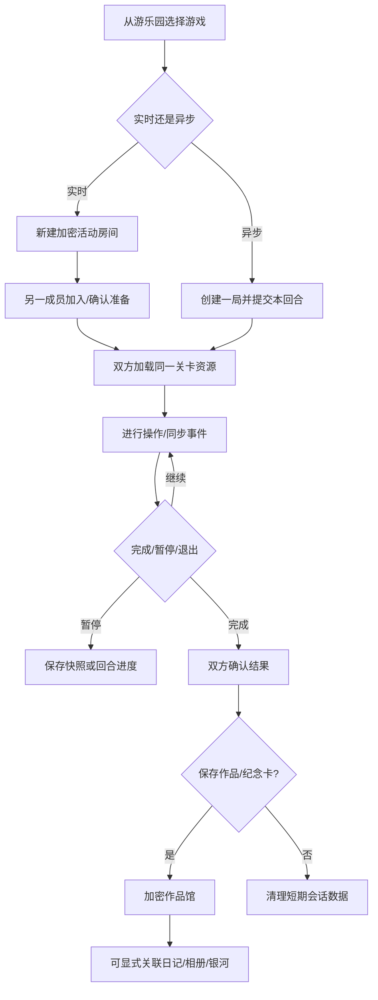
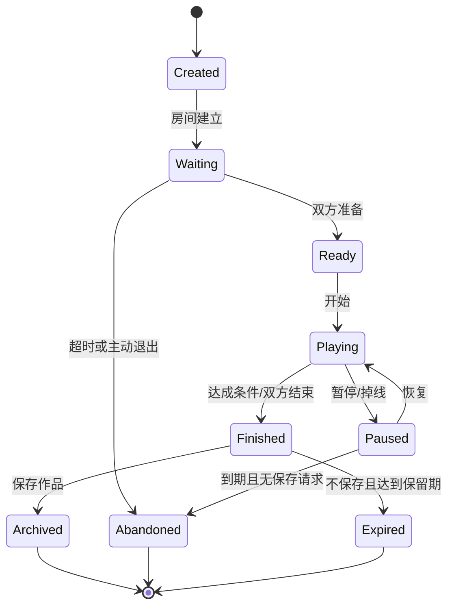
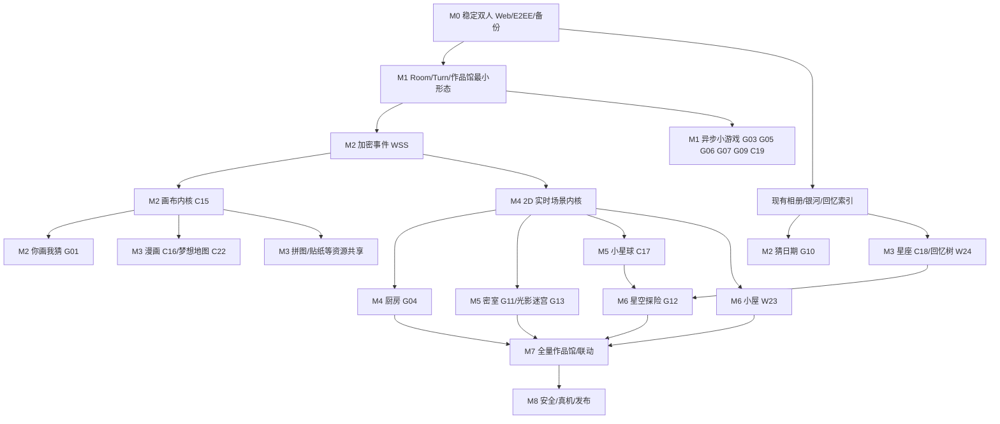

# Us · 我们的小世界｜双人游戏与共创系统完整开发计划书

> **文档版本**：V1.0  
> **编制日期**：2026-11-26  
> **项目仓库**：https://github.com/nankai-mz/us-little-world  
> **实施基线**：`codex/web-two-person`，核对时 HEAD `afbfc5d6340d27927cbc036d392990a334ffaa8d`（2026-11-21），`package.json` 版本 `1.2.11`  
> **目标平台**：PC Web / 移动浏览器 / PWA，保持两位固定成员、私人数据端到端加密、双端协作  
> **文档定位**：完整产品需求（PRD）＋技术架构（TDD）＋任务分解（WBS）＋里程碑＋验收清单。所有 24 项均纳入最终范围，不表示必须同时上线。  
> **推荐保存路径**：`docs/US_TWO_PERSON_PLAY_AND_CREATION_ROADMAP.md`

---

## 0. 执行摘要

**项目愿景**：将 Us 从「记录回忆的双人手账」升级为「两个人可以一起玩、一起创造、长期建设，并把作品和故事收藏起来的私人游乐园」。形成完整闭环：



**四条实施原则**：

1. **复用现有能力**：不替换既有 React 19、Vite、Node.js 24、SQLite、客户端密码库、用户/设备验证、文件加密、离线缓存、现有银河与相册。新功能优先挂载到既有 Web 同源 API。
2. **一次开发，多处复用**：画板笔刷与笔迹同步服务于你画我猜、无限画布、漫画、梦想地图；图块操作服务于拼图、连连看；场景对象与道具系统服务于厨房、密室、小屋、星球和花园。
3. **两种时间模式**：实时房间支持同时在线和在场感；异步回合模式支持错峰使用、暂停、继续。不能把双方必须同时在线作为默认要求。
4. **私密、不施压、可恢复**：默认无公开排名、在线监控、惩罚签到；作品与聊天/地图关联须由用户明确选择；敏感事件和照片继续客户端加密；游戏引擎故障不能损坏已有日记。

### 0.1 本计划明确覆盖的 24 项

- **G01–G10：轻量小游戏**：你画我猜、双人拼图、心有灵犀、双人厨房、五子棋、谁更了解谁、Emoji 猜故事、连连看、幸运盲盒、回忆猜日期。
- **G11–G14：双人合作/养成**：非对称双人密室、星际探险、光影迷宫、双人养花。
- **C15–C22：创造工坊**：无限画布、双人漫画、小星球编辑、共创星座、小说接龙、音乐明信片、双城天空拼图、共同梦想地图。
- **W23–W24：长期共建**：双人小屋 2.0、回忆树。

**总范围不缩水**：下文每项都包含最小可玩版本、后续增强、数据连接、测试门槛和任务归属。交付采取分层发布，先完成稳定底座，再依赖复用能力逐步开放全部 24 项。

---

## 1. 现有仓库基线与差距

### 1.1 经代码核实的现状

| 现有内容 | 路径/现状 | 复用方式 |
|---|---|---|
| React/Vite 与双人 Web 入口 | `web/App.tsx`、`web/HostedWeb.tsx`、`web/routes.ts` | 新增 `play` 里的游乐园二级路由，保留登录、移动端导航与锁定行为 |
| 同源 HTTP API 与身份校验 | `src/server/web-entry.ts`，`/api/login`、`/api/session`、`/api/space` | 沿用网站会话与设备认证，引入**同源 WebSocket** 作为实时通道，补充严格房间鉴权 |
| SQLite 存储与事务 | `src/server/web-repository.ts`，`node:sqlite` | 添加房间/事件/作品存储及索引；保持单实例数据库约束，规划 schema migration |
| 加密协议、空间密钥与设备 | `src/core/crypto.ts`、`src/core/service.ts`、`src/core/web-device.ts` | 派生「活动/作品子密钥」；不新增明文游戏内容通道 |
| 回执、增量同步、离线队列 | `src/server/web-sync.ts`、`web/recordOutbox.ts`、`web/cipherCache.ts` | 用于作品归档、异步玩法的可靠同步；实时绘画另建事件传输，不强行复用普通日记逐条写入 |
| 选餐/衣橱 | `web/MealDecision.tsx`、`web/Wardrobe.tsx` | 厨房菜谱奖励与现有选餐联动；服饰贴纸与衣橱共享只能显式授权 |
| 回忆银河/纪念册 | `web/MemoryGalaxy.tsx`、`web/MemoryBook.tsx`、`src/core/galaxy.ts` | 星座编辑器/回忆猜日期直接引用授权照片；**现有银河主要是静态星图，并非完整 3D 世界** |
| 题库/问答/宠物 | `web/QuestionRoom.tsx`、`src/core/questions.ts`、`src/core/domain.ts` | 心有灵犀、谁更了解谁复用题库与匿名揭晓逻辑；小屋延展已有 Pet |
| 生产构建与恢复 | `npm run check:web`、`npm run package:web`、`docs/WEB_DEPLOYMENT.md` | 新游戏接入 CI、Playwright、发布包、快照及灾备流程 |

**重要边界**：Web 分支已有双账号、PWA、密文同步与离线机制，但**没有统一游戏大厅/实时房间服务/通用画布引擎/完整关卡系统**；也不能把已有选餐、衣橱、银河和纪念册重新标为「待开发」。当前仓库 `main` 仍为旧小程序基线；新功能应从最新 `codex/web-two-person` 派生，评审后才合入正式发布分支。最新可见提交为 `afbfc5d`，如开工时 HEAD 变化应重新审阅差异。

### 1.2 新增功能与既有功能的边界

- **心有灵犀 G03、谁更了解谁 G06**：重构现有问答为带回合、揭晓、主题卡片的玩法；不是再建一个完全独立题库。
- **双人厨房 G04**：使用现有「今天吃什么」菜品与偏好作菜谱素材，但不把真实过敏信息交给未经授权的第三方。
- **共创星座 C18、回忆猜日期 G10**：引用现有记忆 ID、照片 ID、相册权限与银河星点索引，不复制图片明文。
- **双人小屋 W23**：保留 Pet 状态模型，引入家具/碰撞/场景系统；不另起重复的宠物数据库。
- **作品馆**：作为跨项目统一成果库；游戏成绩不会强制存档，私密成品仅经明确保存进入共同时间轴。

### 1.3 首发前置条件（阻断式）

如果公网生产环境尚未完成 HTTPS、真实双手机配对、远程恢复演练与备份，请先完成既有 `docs/WEB_DEPLOYMENT.md` 中的放行项。新游戏研发可以在**独立测试空间和测试库**进行，不以未审定代码覆盖私人生产数据。

---

## 2. 产品信息架构与用户路径

### 2.1 一级与二级导航

保持原五个一级入口：首页、时光、互动、计划、我的。**互动**进入「双人游乐园」，新增四个可探索分区：

```text
/app/play                       # 游乐园广场：继续上次活动、房间与邀请
/app/play/games                 # 小游戏屋 G01–G14 中适合独立局的玩法
/app/play/create                # 创造工坊 C15–C22
/app/play/world                 # 我们的世界 W23、W24；小星球、花园等入口
/app/play/gallery               # 作品馆：完成作品、历史版本、回顾
/app/play/rooms/:roomId          # 双人房间外壳（内部加载具体游戏）
/app/play/games/:gameId          # 单项游戏介绍/新建/历史
/app/play/create/:toolId         # 单项创作工具介绍/新建
/app/play/works/:workId          # 作品详情、版本、导出、再编辑
/app/play/world/house            # 双人小屋
/app/play/world/planet           # 共创星球
/app/play/world/garden           # 双人养花与回忆树
/app/memories/galaxy             # 保留原回忆银河入口
```

路由与已有 `web/routes.ts` 共存，不重写原有日记、配对和安全设置。每个页面独立异步加载模块，手机与桌面使用同一业务逻辑但不同布局。

### 2.2 游乐园首页布局

- **顶部**：欢迎语＋双方可选的在场指示（**仅房间内临时显示**），继续上次活动按钮。
- **中部四区域**：「小游戏屋」「创造工坊」「我们的世界」「双人作品馆」。
- **今日推荐**：随机挑选一个低门槛玩法，不设置连续打卡惩罚。
- **进行中的活动**：明确显示「等对方回合」「可以继续」「已完成」「同步待确认」。
- **空间访问**：成员登录与设备解锁是必要前提，禁止仅凭房间 URL 读取内容。

### 2.3 单项游戏通用使用路径



### 2.4 通用游戏房间 UI

- 房间标题、双方准备状态、邀请方式（只在已绑定的两成员之间生成分享链接/内部消息）。
- 单击「开始」「暂时离开」「继续」「结束」；断线时显示明确状态而非假装对方在线。
- 必须有「对方未在线也能玩吗？」说明；若支持异步，提供转异步选项。
- 右上角可调：音效默认关闭、减少动态效果、低画质/省流量、触控辅助。
- 每个游戏有帮助与完整游戏规则，可从任何阶段暂停。
- 双人协作里避免“谁拖后腿”“感情得分低”等评价或惩罚。

---

## 3. 24 项功能开发总表

说明：工作量以**单人有效开发日**估算，含该功能的逻辑、基本 UI、单元和核心 E2E，不含**通用平台开发、定制美术大规模制作、服务器上线验收**。预计区间用于比较难度，不是 Codex 的完成承诺。

| ID | 名称 | 首版玩法与成果 | 模式 | 依赖基础 | 里程碑 | 估算人日 |
|---|---|---|---|---|---|---:|
| G01 | 你画我猜 | 一人画一人猜，私人题库，保存画作 | 实时 | 房间＋笔刷 | M2 | 4–7 |
| G02 | 双人拼图 | 共同拖块、复原授权照片、留纪念卡 | 实时/异步 | 作品媒体＋拼图引擎 | M3 | 5–9 |
| G03 | 心有灵犀 | 双人秘密作答、同时揭晓 | 异步 | 回合/题库 | M1 | 2–4 |
| G04 | 双人厨房 | 分工准备食材、做订单、解锁菜谱 | 实时 | 2D 场景＋实时 | M4 | 9–15 |
| G05 | 双人五子棋 | 双人落子、悔棋申请、局史 | 实时/异步 | 回合系统 | M1 | 2–3 |
| G06 | 谁更了解谁 | 喜好竞猜、解释与评论 | 异步 | 题库 | M1 | 2–3 |
| G07 | Emoji 猜故事 | 以 emoji 描述共同经历 | 异步 | 回合＋回忆引用 | M1 | 2–4 |
| G08 | 双人连连看 | 共同消除，分工加成 | 实时 | 2D 图块引擎 | M3 | 4–6 |
| G09 | 幸运盲盒 | 双方放入秘密惊喜/任务、开盒 | 异步 | 胶囊/回合 | M1 | 3–5 |
| G10 | 回忆猜日期 | 旧照片猜日期/地点，故事揭晓 | 异步/实时 | 加密相册 | M2 | 3–5 |
| G11 | 非对称双人密室 | 两人看到不同线索，合作解谜 | 实时/异步关卡 | 关卡+实时 | M5 | 12–20 |
| G12 | 迷你星际探险 | 双宇航员、收集星尘、合作开门 | 实时 | 2D 场景＋关卡 | M6 | 15–25 |
| G13 | 双人光影迷宫 | 双角色互补能力、10 关 | 实时 | 2D 物理+关卡 | M5 | 10–18 |
| G14 | 双人养花 | 共同培育、不惩罚断签 | 异步 | 世界状态 | M3 | 5–9 |
| C15 | 无限共同画布 | 笔刷、照片、便签、贴纸，多人同步 | 实时/异步 | 绘图＋事件协议 | M2 | 10–18 |
| C16 | 双人漫画工作室 | 4/6 格分工、气泡、画作 | 异步/实时 | 画布组件 | M3 | 7–12 |
| C17 | 共同创造小星球 | 地形/建筑/纪念物件放置 | 异步优先 | 场景编辑器 | M5 | 12–20 |
| C18 | 共创星座编辑器 | 选真实照片星、连线、命名与故事 | 异步优先 | 银河/画布 | M3 | 4–7 |
| C19 | 小说接龙 | 轮流写章节、剧情骰子、导出 | 异步 | 回合＋文本编辑 | M1 | 3–5 |
| C20 | 音乐明信片 | 曲目信息、封面、文字、音乐链接 | 异步 | 作品馆 | M2 | 3–6 |
| C21 | 双城天空拼图 | 双方各上传一张天空，生成明信片 | 异步 | 相册合成 | M2 | 3–5 |
| C22 | 共同梦想地图 | 无限愿望板、照片/标签/连线 | 实时/异步 | 画布 | M3 | 5–8 |
| W23 | 双人小屋 2.0 | 宠物走动、家具摆放、功能物件 | 实时/异步 | 场景＋Pet | M6 | 15–25 |
| W24 | 回忆树 | 回忆长叶、周年开花、照片果实 | 异步 | 统一回忆索引 | M3 | 4–7 |

**总功能开发估算：144–246 人日**。另加共享平台、安全/性能与发布准备 **35–65 人日**、素材与美术根据复杂程度 **20–50 人日**；这些工作在有些阶段可并行。建议一个人兼职持续开发时按 **12–24 个月甚至更长** 规划完整范围，优先完成 M1–M3 的可用玩法；有 Codex 辅助仍需人工审核、真机测试和美术验收。

---

## 4. 每项功能的可执行 PRD（第一组：G01–G10）

### G01 · 你画我猜：私有梗题库

- **目标**：把共同照片、食物、地点、梗和自定义词语变成 2 人互动题目。
- **V1**：选择难度/题库，A 为画者 B 为猜者；画者看到题目，在 Canvas 绘图；猜者只能看到笔迹、输入答案；时间到或猜对显示结果，下一局互换角色；支持重连继续。
- **交互**：钢笔/橡皮/颜色/粗细/撤回上一笔/清空（清空需确认）；移动端触摸优化；局内临时光标不等于在线监视。
- **内容**：自定义词库与私人回忆题库，只有对方被授权的记录可入选；默认只用公共词库，避免照片题目直接泄露答案。
- **存档**：画作可保存为作品馆条目，可经两人选择关联当天日记；不自动保存全部聊天猜测。
- **验收**：两人 3 局轮换角色、延迟 200 ms 操作仍有序；画者不能提交猜测；断线恢复笔迹不重复；对方不能读取画者明文题目直到揭晓。

### G02 · 双人拼图：从相册选一张照片

- **V1**：仅从双方有权查看的图片中选取，支持 3×3、4×4、6×6；同一块不可被两个设备同时占据；支持不同时在线接力完成。
- **增强**：旋转拼块、形状拼图、隐藏封面、合作计时挑战、照片完成时显示故事。
- **技术**：本地解密后切割渲染，不上传明文拼图切片；存储原始照片 ID 与加密的拼图位置数组，服务器只为同一块操作分配顺序。
- **验收**：横竖照片尺寸一致、跨端拼块位置同步、最后一块不重复判定、完成仅产生一份纪念卡；失去私人照片权限的设备不进入对应房间。

### G03 · 心有灵犀：异步作答揭晓

- **V1**：双人收到同一个问题，分别写答案，双方都提交才揭晓；可以跳过和解释，保留历史回合。
- **增强**：排序题、图片选项、共同偏好题、双向猜测；只展示有趣差异，不给“关系总分”。
- **技术**：复用 `src/core/questions.ts`；如果需要**真正防提前阅读**，不能简单依靠已有共享密钥下的密文，应额外设计承诺-揭晓/独立临时密钥机制并审查恢复路径。
- **验收**：两端异步回答、提交并发、跳过、撤回状态明确；在原业务规则下如有提前解密可能，文案须准确说明。

### G04 · 双人厨房大作战

- **V1**：共享 2D 厨房场景；两人分别拿取/清洗/切配/烹饪/装盘；每局 3–5 分钟，5 种食材、8 个订单模板、2 张厨房地图。
- **分工**：固定厨房站点使两人必须传递食材；限制移动速度和搬运数量，避免单人包办。未就绪时可进入练习教程。
- **增强**：不同地图、合作评分、连击动画、特殊料理、宠物小助手、完成菜谱同步给「今天吃什么」。
- **安全/状态**：以浏览器运行轻量逻辑，后端转发加密操作；**不声称有防作弊的服务端权威判分**。异步不适合动作模式，提供「练习/暂停」。
- **验收**：两人操作时原料不复制、订单完成一致、不同网络延迟不导致无限卡住；低帧率下控制可用；掉线后可恢复到最近一次一致快照或明确结束。

### G05 · 双人五子棋

- **V1**：15×15 棋盘，先手轮换、落子合法性、胜负判定、悔棋需对方同意；允许异步对弈、历史局面回放。
- **增强**：主题棋盘、悔棋次数协议、计时可关闭，避免催促。
- **同步**：回合模型含 `turnOwner`、步数和棋谱；加密记录更新受 `expectedRevision` 约束。
- **验收**：越界/已占位置不能下；同时提交不重复；五连横竖斜判断正确；异步恢复顺序正确。

### G06 · 谁更了解谁

- **V1**：A 给出“关于我”的题目和标准答案，B 猜测后揭晓，双方互换；题材包括生活习惯、喜好、旅行和约会。
- **增强**：图片题、排序题、手写解释卡、共同知识卡。
- **隐私**：私人日记不能被后台自动提取为答案；仅经作者选择将信息做成题目。
- **验收**：不会在未揭晓时向对端下发标准答案的明文；历史答题按两人授权范围保存。

### G07 · Emoji 猜故事

- **V1**：创作者从 Emoji 面板按顺序拼 3–12 个图标，附加隐藏答案或共同记忆链接；对方猜是哪次经历，揭晓后进入对应日记。
- **增强**：限时变体、线索次数、手写表情包（授权贴纸）。
- **同步**：异步一次创建/一次猜测/一次揭晓；不能猜到不属于自己的私人记录。
- **验收**：Emoji 组合序列跨浏览器一致，特殊 Unicode 表情不会破坏数据，揭晓链接只指向有权限的记录。

### G08 · 双人连连看

- **V1**：公共图案（贴纸/食物/小宠物）制作 8×6 棋盘，遵循至多两次转折的连线规则；两人可同时选择一对，操作按 server sequence 排序。
- **增强**：道具、双人连击、季节主题、私人照片图案（须确保双方已有照片权限）。
- **验收**：相同棋盘种子在两端产生完全相同的布局；冲突的两次消除不会双重计分；重新连接时状态可追上。

### G09 · 幸运盲盒

- **V1**：双方可以放入文字惊喜、约会提议、任务卡、照片预览；指定立即开盒或由另一方手动确认开盒；可以拒绝任务和删除自己未揭晓内容。
- **增强**：主题抽签、限时盲盒、节日包装、拆盒音效（默认静音）。
- **技术限制**：普通日期限制属于应用规则；有空间密钥的一方理论上可绕过 UI 提前读取。若需密码学保密揭晓应设计独立协议。
- **验收**：未绑定设备不能读取、取消后不会被他人继续打开、重复点击不会产生多份结果。

### G10 · 回忆猜日期

- **V1**：从有权限的共同历史照片抽取，隐藏拍摄日期与标题；另一人选择年月或日期范围；揭晓后展示真实日记故事。
- **增强**：旅行地点竞猜、随机流星联动、主题赛季、相近年份提示。
- **隐私**：不能将相册 EXIF、GPS 等额外信息未经作者同意外发给题库；私人照片不自动进入共同房间。
- **验收**：无照片、仅一张照片、日期不完整、同日多图均可正常处理；历史记录删除后不会成为失效的可见题目。

## 5. 每项功能的可执行 PRD（第二组：G11–G14）

### G11 · 非对称双人密室：你看不到我的线索

- **定位**：两人同时看到不同的房间、纸条和密码；必须口头或文字合作，不能仅凭各自屏幕解谜。
- **V1**：提供 3 个主题关卡，每关 5–8 个可触发机关（密码箱、图案镜子、旋转盘、线索书、灯）；两个固定角色分别获得 A/B 视图；关卡有检查点、提示、暂停和恢复。
- **可配置关卡数据**：关卡 JSON 声明房间对象、可点热点、前置条件、角色可见性、正确操作序列、提示、完成触发；敏感线索在客户端解密后根据角色显示。
- **互动细节**：点击物件放大；物件有打开/关闭/锁定状态；解开机关后两端同步小动画；完成关卡生成带两人名字的通关明信片。
- **增强**：季节限定剧本、用户自制线索关卡、银河照片解密线索、自定义角色。
- **验收**：A/B 两端实际可见线索不同；对方关键线索不因普通 UI 预加载而可见；重复触发机关幂等；断线返回检查点；支持 360px 手机屏和键盘替代操作。**如果客户端持有全部共享密钥，就不能声称能从恶意本地客户端彻底隐藏“对方线索”**，该机制以游戏体验为目标。

### G12 · 两人的迷你星际探险

- **定位**：与「回忆银河」相联动的双角色星际冒险，而非重写一个重型 3D MMO。
- **V1**：俯视 2D/2.5D 星球地图，A/B 控制不同颜色宇航员；移动、收集发光物、压力板双人开门、推动箱子、传送；3 个星球、每个星球 3 关；关卡开始与结束有镜头过场。
- **资源**：先使用原创/许可素材的低多边形或像素插画；地图瓦片与背景装饰分层；渲染细节按设备性能适配。
- **反馈**：非竞争，双方均须到达出口才完成；星尘作为纯装饰性解锁资源，不允许购买或负面惩罚。
- **回忆联动**：可由双方主动挑选已共享照片作为星球纪念碑，触碰弹出对应故事；绝不自动暴露私人日记。
- **实时规则**：客户端预测移动，服务器按 room sequence 中继加密输入；断线暂停或进入原地等待状态；不需要声称可抵抗本地作弊。
- **验收**：多人位置以合理插值同步，不发生严重漂移；双方开关一致；弱网下可暂停/恢复；手机双摇杆或单摇杆+交互键可用；默认关闭高成本粒子特效。

### G13 · 双人光影迷宫

- **V1**：两人各有不同能力：光之角色点亮桥梁、影之角色通过阴影门；提供 10 关，由静态逻辑谜题逐步加入轻量实时协作。
- **核心对象**：墙、地板、光源、反光镜、阴影门、双人按钮、传送门、出口。场景碰撞使用统一 2D 场景引擎，光照可先用遮罩实现，不必逐像素物理光线追踪。
- **增强**：可拖动镜子、双人计时挑战、合作制作关卡、故事章节。
- **验收**：关卡配置有静态校验；每关至少一条可行解（人工+自动路径用例）；光照与碰撞在两端一致；设备低帧率不改变谜题结果。

### G14 · 双人养花

- **V1**：一个共享花盆，双方选择种子、水、日照、装饰；记录合作行为，累计经验解锁 5 种花、3 个成长阶段；可手动选择停止培育或重新播种。
- **产品原则**：**不枯死、不扣好感、不因不登录惩罚**；成长是纪念，而非责任负担。
- **联动**：开花时自动生成可选择保存的「花朵纪念卡」，也能作为小屋盆栽或梦想地图贴纸。
- **同步**：低频事件与 Pet 一样可以使用事务+revision，初期不需要实时 Socket。
- **验收**：双方同时浇水不丢增量；长时间不上线不会出现负数或死亡；花盆存档可从恢复包和数据库快照重建。

---

## 6. 每项功能的可执行 PRD（第三组：C15–C22）

### C15 · 双人无限画布（整个计划的核心基础设施）

- **V1 目标**：一个支持无限平移/缩放的加密协作画布，两人同时或错峰放置笔迹、图片、文本、便签、贴纸、线段和简单形状；有框选、移动、旋转、分组、撤销/重做、保存版本与导出 PNG。
- **表现**：粉白色纸张、胶带、拍立得、木纹桌面；可自由调整背景尺寸/纹理。不要对绘图主操作使用过重动画。
- **数据对象**：`stroke`（点列、颜色、宽度）、`text`、`sticky`、`imageRef`、`sticker`、`shape`、`connector`、`group`；每个对象有稳定 ID、作者、变更版本、局部坐标和图层。
- **实时**：本地立即渲染笔迹，按 50–100ms 批量发送**加密操作**；同一画布两端合并；每 200–500 个操作或定期创建客户端加密快照；长时离线改为变更队列和冲突提示。
- **撤销规则**：首先撤销**本用户最近一笔**，避免误删对方内容；删除对方对象建议双人确认或明确的共享编辑权规则。
- **增强**：协作光标、手写体/图钉资源、轨迹播放、画布模版、时间旅行和高分辨率分块导出。
- **安全**：照片引用保留原附件 ID 与权限，不把原图明文嵌入广播；两个不同成员的操作都必须带设备身份；**通用画布是后续 G01/C16/C22 的前置**。
- **验收**：两人同屏绘制 5 分钟无乱序丢笔画；1000 个对象仍可缩放与搜索；手机触控、触笔和鼠标无明显冲突；断网重连恢复；删除/撤销/恢复版本可复核；内存稳定无 Object URL 泄漏。

### C16 · 双人漫画工作室

- **V1**：4/6 格漫画模板；作者分别领取格子，插入自画图、贴纸、角色、气泡、文字；可轮流编辑或共同完成不同格；添加封面和结尾，导出长图/PDF。
- **基础资源**：三种角色基础体型、10 种表情、8 个场景背景、可调气泡和标题条；优先制作原创素材。
- **增强**：分镜过场、章节漫画、配音（仅用户上传的原创录音）、随机故事指令。
- **数据**：每格引用 C15 画布文档或场景组件；最终漫画为父作品，子格为子作品，维护作者和修订历史。
- **验收**：A 编辑第 1 格、B 编辑第 2 格不互相覆盖；气泡自动换行；打印按顺序输出；离线编辑时冲突可显式处理；导出不包含未授权私人照片。

### C17 · 共同创造小星球

- **V1**：一个可旋转展示的「微缩星球」场景，先以 2.5D 网格/等距地块实现：地表、湖泊、山、树、房屋、纪念碑、路灯；两人轮流或异步摆放对象。
- **成长逻辑**：不与真实打卡频率绑定。装饰通过共同完成小游戏或主动领取解锁；禁止让付费或连签成为唯一来源。
- **回忆绑定**：每个纪念物可以显式关联一个 `memoryId` 或 `photoId`；点击物件打开已有加密故事，而不是复制明文。
- **性能**：默认只渲染可见区域；对象数大于阈值时 LOD 或静态缩略展示；有全 2D 降级。
- **增强**：季节变化、可探索小径、星球昼夜、双人角色造访、不同主题地形。
- **验收**：同一位置冲突明确，家具位置在两端一致；已绑定照片被删除时显示占位而非异常；200 个物件和移动端仍可打开；断线后可继续编辑。

### C18 · 共创星座编辑器

- **V1**：从现有回忆银河按年/标签/搜索筛照片星，选择 3–20 颗，拖动位置、连线、给星座命名、写故事，保存为银河中的独立星座入口。
- **与已有实现衔接**：复用 `MemoryGalaxy.tsx`、`src/core/galaxy.ts`；不重新实现照片加载、E2EE 或新相册。
- **增强**：双人同步连线、不同颜色星线、星座明信片、沿连线路径飞行、打印星图。
- **验收**：只展示当前设备有权查看的照片；删除或撤销授权后的星点不残留内容；星点坐标布局可重建；回到原时间轴时保留筛选状态。

### C19 · 双人小说接龙

- **V1**：双方各写 100–1000 字一段，轮流接龙；可插入剧情骰子（人物/地点/转折）；支持章节、草稿、本轮提交、撤回未确认章节、章节评论、导出 TXT/Markdown/PDF。
- **增强**：世界观卡片、角色档案、分支结局、AI 辅助（显式授权所选文本）。
- **同步**：采用异步回合和服务端原子 revision，先不要引入实时逐字协作；以后可复用 C15 的协同文本能力。
- **验收**：严格轮流、断线草稿可恢复、异步通知仅应用内、自定义 Unicode 文本可靠、导出顺序正确。

### C20 · 音乐明信片

- **V1**：双方填写歌曲名、演唱者、官方外部链接、封面（使用授权图片或用户自行拍摄）、“为什么推荐”；选择 1–3 张照片组合成卡片，收藏成双人歌单。
- **版权与隐私**：**不擅自下载、抓取、存储或播放受版权保护的完整音频**；优先跳转官方音乐服务。第三方链接跳转前有域名提示；歌单、配文和私人封面在本应用中加密。
- **增强**：时间线音乐卡片、回忆照片关联、音符贴纸、共享听歌约定（不做后台状态监控）。
- **验收**：没有音乐服务账号也能保存文本卡片；无效链接明确拒绝；不会因为内嵌第三方播放器泄露私密相册内容。

### C21 · 双城天空拼图

- **V1**：两人各自上传当天天空照片，选择上下拼、左右拼、圆窗两种拼贴模板，写一句话，合成为双城明信片。
- **增强**：同一天对比、共同天气主题相框、按月份天空墙、动画翻转。
- **隐私**：原始图片在浏览器处理时移除 EXIF/GPS，上传前加密；城市信息默认手填且可不提供；绝不自动在后台读取地理位置。
- **验收**：手机横竖照片均可适配；只有一方提交时保留草稿；双人提交后生成唯一成品；断网后不丢已上传图片。

### C22 · 共同梦想地图

- **V1**：基于 C15 无限画布做特殊模板：照片、文字、便利贴、线条、进度标签、地点贴纸、愿望目标和目标日期；双方可以规划未来想一起完成的事。
- **数据**：引用现有「愿望清单」记录作为图上的卡片，完成后可选择生成一条回忆；同一愿望不要存两份失同步的状态。
- **增强**：旅行路径连接、里程碑、主题色、画板模板、年度复盘。
- **验收**：愿望状态双向同步、两人同时编辑不丢卡片、隐藏私人愿望不可在共享画布中自动出现、低性能模式也能完成编辑。

---

## 7. 每项功能的可执行 PRD（第四组：W23–W24）

### W23 · 两个人的小屋 2.0

- **产品定位**：游乐园的持续建设空间与轻量导航，不是必须在线挂机的模拟人生。
- **V1**：2.5D/俯视小屋，两人可放置至少 20 件家具；宠物有待机、走路、吃饭、睡觉、互动动画；家具可拖动、旋转、吸附网格；保存布置版本和家具清单。
- **交互联动**：点击冰箱→「今天吃什么」；衣柜→「今天穿什么」；书架→共同日记；窗户→回忆银河；留声机→音乐明信片；画架→无限画布。
- **增强**：季节装饰、屋内协作小游戏、宠物带出旧回忆、访客拍照、建筑扩张、小游戏成就解锁家具。
- **技术**：复用 Pet 领域状态；新建 `RoomScene` / `Furniture` / `InteractionHotspot`，家具布局以操作日志＋周期快照保存，渲染用 PixiJS 或轻量 Canvas 方案；避免一上来上完整 3D 物理系统。
- **验收**：双方并发摆放不会无提示覆盖；手机手势和页面滚动不冲突；宠物状态仍遵循原有低压力规则；关掉动效仍可从家具菜单进入功能。

### W24 · 两个人的回忆树

- **V1**：从现有共同记录索引派生树叶、花和果实：一个时期一条枝，日常记录成长叶片，纪念日开花，挑选的照片化成果实。用户可手动筛选哪些内容进入树，不要求所有日记自动公开。
- **操作**：点击叶子展开关联日记，点击果实查看照片；年份过滤、随机一片叶子、生成年度树图。
- **增强**：四季切换、风吹树叶、落叶回顾、与双人养花/小屋花园合并。
- **技术**：树形渲染来自**客户端已经授权并解密的记忆索引**；记录内容不复制，树布局采用稳定种子；低配/减少动效模式以可访问的树形列表代替动画。
- **验收**：1、100、1000 条记录表现合理；删除日记后叶子索引自动失效；私人叶子仅本人设备可见；年份索引与时间轴一致。

---

## 8. 共用基础平台（优先级高于任何具体游戏）

### 8.1 模块划分与目录建议

不要立刻移动所有旧文件。采用**增量目录**，新功能写入 `src/features/` 与 `web/features/`，旧模块按接触面逐步拆分：

```text
src/
├── core/                        # 已有 E2EE、账户、回忆领域
├── server/
│   ├── web-entry.ts             # 现有 HTTP 服务入口
│   ├── web-repository.ts        # 现有 SQLite，单实例
│   ├── activities/              # NEW：room session / membership / state
│   ├── realtime/                # NEW：WSS handshake, relay, ack, retry
│   ├── works/                   # NEW：作品版本、快照、引用
│   └── migrations/              # NEW：SQLite schema migration
└── features/
    ├── play-core/               # 游戏协议、回合机、结果及房间角色
    ├── canvas-core/             # 绘图对象、笔刷、合并、渲染命令
    ├── puzzle-core/             # 拼块/连连看
    ├── scene-core/              # 关卡、热点、角色、物件、碰撞
    ├── asset-core/              # 资源清单、版本、可用性和许可
    └── creation-core/           # 作品格式、导出、版本历史
web/
├── App.tsx                      # 保留；游乐园导航逐步外移
├── routes.ts                    # 新增游乐园路由
├── features/
│   ├── playground/              # 游乐园广场与游戏卡片
│   ├── room/                    # 准备室、在场、邀请、断线状态
│   ├── drawing/                 # G01/C15/C16/C22 共用画板
│   ├── puzzles/                 # G02/G08/G10
│   ├── coop-games/              # G04/G11/G12/G13
│   ├── mini-games/              # G03/G05/G06/G07/G09
│   ├── creation/                # C17–C22
│   ├── world/                   # G14/W23/W24
│   └── gallery/                 # 作品馆
├── components/play/            # shared actions, dialogs, status
└── styles/playground.css       # 独立设计令牌与主题
```

测试目录按 `tests/features`（单元/集成）与 `e2e/playground`（双浏览器）分别管理，小游戏与非游戏核心测试共用 CI，但可单独运行。

### 8.2 游戏大厅与房间服务

职责分离：

- `RoomService`：新建/加入/恢复/退出房间、两个固定参与者、房间租约、房间状态和权限。
- `TurnEngine`：适用于五子棋、小说接龙、盲盒、猜题、养花等低频回合玩法。
- `RealtimeGateway`：同源 WSS，处理加密绘画、角色移动、笔迹/光标/位置更新，自动重连和补发。
- `ActivityStore`：活动头信息、加密操作日志、快照、完成结果、生命周期清理。
- `WorkService`：创建、修订、发布、归档、导出作品，关联已有日记和照片。
- `PresenceService`：只在当前房间生效；非持久化，退出后自动消失；不向主页输出“对方在线时间”。
- `ResourceManager`：素材和贴纸、字体可用性、授权信息、指向私人照片的权限检查。

**同一个活动房间**：包括 `roomId`、`spaceId`、双方成员 ID、参与状态、活动有效期、版本、一个加密 payload。具体游戏名称/分数/坐标/消息正文尽可能放进加密 payload，避免成为服务端可见的元数据。后端需保留路由与权限所必需的最少元信息。

### 8.3 实时与异步两类协议

| 维度 | 异步回合 | 实时操作 |
|---|---|---|
| 传输 | 现有 HTTPS `/api/space` 扩展 action | 同源 WSS（`/ws/play`） |
| 存储 | 加密记录 + `expectedRevision` | 加密操作日志 + ack + 定期客户端快照 |
| 断线 | 本地草稿和 outbox | 重连、补发未确认 op、根据序号重放 |
| 冲突 | 轮流权、乐观锁、明确重选 | 对象级操作合并/序列号处理 |
| 协作体验 | 可错峰使用 | 同屏低延迟 + 可选在场光标 |
| 优先适用 | G03、G05、G06、G07、G09、G10、G14、C19 | G01、G04、G08、G12、G13、C15、W23 |

**谨慎对待同一份内容被两种协议同时修改**：必须为每个活动指定权威写入模式；进入实时编辑时建立编辑租约/版本戳，退出后提交最终快照，异步客户端不能静默覆盖直播中的状态。

### 8.4 端到端加密与实时协作的设计约束

1. 每个活动派生独立子密钥：`K_activity = HKDF(K_space_version, salt=roomId, info="Us/play/v1")`。实际的 HKDF 字节编码、salt 与 info 需要固定规范并写测试向量；不能复用现有 AEAD nonce。
2. 每个操作使用成熟 AEAD（维持当前 XChaCha20-Poly1305）加密，AAD 绑定 `spaceId`、`roomId`、`opId`、`deviceId`、`keyVersion`、协议版本。每条操作使用随机 nonce；不可在同密钥下重复。
3. 服务器验证**真实站点会话、已登记设备、空间成员、房间权限、请求体大小、频率、opId 唯一性**，但不读取操作内容。不能单靠浏览器提交的 `userId`、`deviceId` 或房间 URL 判断身份。
4. 游戏事件如果存在数字比分/题目答案，**服务器看不到明文时无法独立裁定玩家是否作弊**。本项目只有两人，默认合作/娱乐；结果由双方客户端独立校验或双方确认，不宣传“严格公平赛事系统”。
5. 服务端只转发密文不等于完全不泄露信息：IP、时序、房间创建时间、密文大小、参与关系可见。操作过于细密会通过流量推断游戏行为；有需要可批次化与填充。
6. 两人断线/撤销设备/空间关闭后不能再访问新记录；旧设备曾解密的内容无法技术性追回。共享密钥轮换后，旧房间需结束、重协商或明确按旧版本只读处理。
7. 不把原始照片字节放入 WSS 事件。通过现有加密照片存储，再在加密操作中引用 `photoId`，接收端按自己的授权加载。
8. 适配 IndexedDB 兼容性，维护 WebKit **字符串载荷而非仅 Blob** 的已验证兼容路径；服务端故障时不要误标记为已同步。

### 8.5 房间 WebSocket 设计（首版）

握手流程：`GET /ws/play` 同源升级 → Cookie 与 Origin 验证 → 短期设备 nonce 签名 → 双人空间成员/设备授权 → `room.join` → 客户端密文操作交换。

协议应支持消息：

```text
room.join / room.leave
room.state (authoritative metadata, no content)
room.ready / room.pause / room.resume
op.submit / op.ack / op.replay
snapshot.offer / snapshot.ack
ping / pong / presence.ephemeral
room.completed / room.expired
```

连接重建后发送最后已确认的 `seq` 与 `snapshotVersion`，服务器返回缺失操作。对于操作日志过期的房间，必须让客户端重新取得**受认证的完整快照**；不可以静默进入空白房间。

**防滥用与容量**：房间最多 2 人；同一设备在线连接设上限；单条加密操作上限初始 32 KiB，笔画增量按 50–100ms 合并；大附件走已有受控照片服务；限制日志增长并由客户端协商快照。全局内存与连接数设置上限。生产服务器保持单实例，现有进程内 Session 不支持无状态扩容。

### 8.6 协作状态合并策略

- **五子棋/故事/盲盒**：单记录有序回合，服务器对外部版本与回合编号做原子比较，但不需要知道具体玩法内容。
- **画布对象**：每对象独立 `objectId`，操作包括 `create/update/delete`；每个更新携带对象版本及前一版本引用。并发同对象移动引导用户解决，禁止无提示覆盖。
- **连续笔画**：按作者设备和笔画 ID 增量追加，天然可合并；笔刷撤销记录为“撤销某对象”操作，勿直接删除已确认历史。
- **文本段落**：初版锁定轮流编辑；多人同步文字以后可以引入 Yjs，但必须对 **Yjs 更新加密封装**。Yjs 本身不是 E2EE。
- **高频动作游戏**：先由客户端处理角色动作与碰撞，按规则版本、固定 tick/seed 复现；偏差过大时重置到共同签认的快照。无需尝试让加密服务器处理明文物理状态。

### 8.7 作品馆与统一记忆关系

作品馆必须包含：`workId`、类型、标题、创作者、双方权限、加密内容、封面（加密）、更新/发布时间、历史版本、引用的照片/日记/星座/家具对象。**作品归档与作品分享到共同回忆是两个不同操作**：完成后先进入作品馆，再询问是否关联时间轴。这样不会让每一局小游戏自动污染日记。

作品删除应处理引用：如果日记引用该作品，显示占位与权限说明而不是崩溃。支持导出 PNG、PDF、JSON 或 Markdown 中适合该作品的格式；**每一种导出都清楚提示明文风险**。

## 9. 数据结构、存储与接口设计

### 9.1 TypeScript 领域类型草案

> 下列代码是**新模块的合约草案**，不是现有仓库已经实现的接口；具体与 `src/core/types.ts`、当前 `Envelope`/`CipherRecord` 兼容性必须在任务 M0 中确认。

```typescript
export type RoomStatus = "waiting" | "ready" | "active" | "paused" | "completed" | "expired";
export type ActivityMode = "realtime" | "asynchronous";

export interface ActivityRoomMeta {
  id: string;
  spaceId: string;
  memberIds: [string, string];
  status: RoomStatus;
  mode: ActivityMode;
  protocolVersion: 1;
  keyVersion: number;
  roomRevision: number;
  lastSeq: number;
  createdAt: number;
  expiresAt: number;
  // 游戏玩法类型、题目、得分、坐标等优先放在加密文档中。
}

export interface ActivityOpHeader {
  protocolVersion: 1;
  roomId: string;
  opId: string;
  deviceId: string;
  keyVersion: number;
  clientSequence: number;
  // serverSequence 在服务器接收后生成。
}

export interface EncryptedActivityOp {
  header: ActivityOpHeader;
  envelope: Envelope; // 复用 src/core/types.ts 的加密封装
}

export type CanvasObject =
  | { id: string; kind: "stroke"; points: Array<[number, number, number]>; color: string; width: number }
  | { id: string; kind: "text"; x: number; y: number; value: string; fontSize: number }
  | { id: string; kind: "sticky"; x: number; y: number; value: string; theme: string }
  | { id: string; kind: "image"; x: number; y: number; photoId: string; width: number; height: number }
  | { id: string; kind: "shape"; x: number; y: number; shape: string; style: Record<string, unknown> }
  | { id: string; kind: "connector"; sourceId: string; targetId: string; color: string };

export interface WorkDocument {
  id: string;
  spaceId: string;
  createdBy: string;
  kind: "drawing" | "comic" | "story" | "postcard" | "constellation" | "dream-board" | "world" | "game-result";
  sourceRoomId?: string;
  encryptedPayload: Envelope;
  encryptedPreview?: Envelope;
  linkedRecordIds: string[];
  linkedPhotoIds: string[];
  revision: number;
  createdAt: number;
  updatedAt: number;
}

export interface GameDefinition {
  id: string;
  version: number;
  minPlayers: 2;
  maxPlayers: 2;
  supportsAsync: boolean;
  sceneType: "form" | "canvas" | "grid" | "world";
  estimatedMinutes: number;
  assetManifestId: string;
}
```

注意：`WorkDocument.kind` 在上例为了可读性显示为类型字段；**持久化数据库的明文索引里不应默认公开该字段**。服务端必须先完成授权，再把密文交给客户端解密，由客户端确定真实作品类型。最小化明文元数据是本项目的重要产品约束。

### 9.2 SQLite 扩展建议

当前 SQLite 采用 schema 2 且 `documents`/`photos` 已工作；不要无测试地改动表结构。推荐逐步加入 schema 3（执行前备份、测试升级/回滚）：

```sql
-- SQL 草案；迁移文件实施前须审查 SQLite 版本、索引与既有 schema。
CREATE TABLE IF NOT EXISTS activity_rooms (
  id TEXT PRIMARY KEY,
  space_id TEXT NOT NULL,
  header_json TEXT NOT NULL,
  revision INTEGER NOT NULL DEFAULT 0,
  created_at INTEGER NOT NULL,
  expires_at INTEGER NOT NULL
);
CREATE INDEX IF NOT EXISTS activity_rooms_space
  ON activity_rooms(space_id, expires_at);

CREATE TABLE IF NOT EXISTS activity_ops (
  room_id TEXT NOT NULL,
  seq INTEGER NOT NULL,
  op_id TEXT NOT NULL,
  device_id TEXT NOT NULL,
  envelope_json TEXT NOT NULL,
  created_at INTEGER NOT NULL,
  PRIMARY KEY(room_id, seq),
  UNIQUE(room_id, op_id)
);
CREATE INDEX IF NOT EXISTS activity_ops_op
  ON activity_ops(room_id, op_id);

CREATE TABLE IF NOT EXISTS activity_snapshots (
  room_id TEXT NOT NULL,
  version INTEGER NOT NULL,
  through_seq INTEGER NOT NULL,
  envelope_json TEXT NOT NULL,
  created_at INTEGER NOT NULL,
  PRIMARY KEY(room_id, version)
);

CREATE TABLE IF NOT EXISTS works (
  id TEXT PRIMARY KEY,
  space_id TEXT NOT NULL,
  author_id TEXT NOT NULL,
  envelope_json TEXT NOT NULL,
  revision INTEGER NOT NULL,
  updated_at INTEGER NOT NULL
);
CREATE INDEX IF NOT EXISTS works_space_updated
  ON works(space_id, updated_at DESC);

CREATE TABLE IF NOT EXISTS work_versions (
  work_id TEXT NOT NULL,
  revision INTEGER NOT NULL,
  envelope_json TEXT NOT NULL,
  created_at INTEGER NOT NULL,
  PRIMARY KEY(work_id, revision)
);
```

数据库中暂不明文存放绘画笔迹、游戏正确答案、故事章节或照片缩略图；`envelope_json` 存储客户端加密后的 AEAD 封装。`room_id` 和大小等元信息仍会暴露给服务器。**照片仍通过现有 `encrypted_files`/`photos` 路径保存，作品通过 ID 引用它们**。

### 9.3 HTTP API 草案

沿用已有 `POST /api/space`，新增带命名空间的 action；写入操作必须有 `requestId` / `operationId` 供幂等查询。

| action | 用途 | 服务端核对 | 数据返回 |
|---|---|---|---|
| `play.createRoom` | 建立房间 | 两人空间有效、设备授权、配额 | roomId / 状态 |
| `play.joinRoom` | 参与既有活动 | 已绑定成员、设备挑战 | 房间元信息 |
| `play.getRoom` | 取房间状态 | 账号空间与 room 归属 | 头信息与密文快照指针 |
| `play.submitTurn` | 异步提交一回合 | revision、回合令牌、写入幂等 | 更新版本 |
| `play.listRooms` | 当前/历史活动 | spaceId 过滤、分页 | 仅授权的活动头信息 |
| `play.pauseRoom` | 暂停 | 当前房间成员 | 状态、revision |
| `play.closeRoom` | 结束 | 两人确认或规则允许 | 结束回执 |
| `play.putSnapshot` | 保存加密快照 | 合法设备、连续序号、大小 | 快照编号 |
| `play.getOps` | 重连补数据 | room 权限、合法游标 | 加密操作数组 |
| `works.save` | 保存作品版本 | 空间成员、revision、照片引用权限 | workId/revision |
| `works.list` | 列作品 | 私人/共同权限、分页 | 密文作品索引 |
| `works.get` | 取作品 | 归属与可见范围校验 | 加密作品 |
| `works.delete` | 删除/回收 | 作者/协作授权、操作确认 | 墓碑与结果 |
| `works.linkMemory` | 加入日记/银河 | 两个目标记录权限均合法 | 关联更新回执 |

建议新 API 的输入 JSON 使用 schema 校验（例如 Zod/Valibot 等**经验证的依赖**），对每个 `type`/`id`/数组长度/对象字段进行严格限制。不要让服务端把用户提供的 JSON 字符串拼接成 SQL。

### 9.4 实时消息封装（示例）

```typescript
// 发送前：设备端加密本地操作
interface ClientPlayMessage {
  action: "op.submit";
  roomId: string;
  header: ActivityOpHeader;
  envelope: Envelope;
}

// 服务器确认：只返回序号与操作引用，不返回内容明文
interface PlayAck {
  action: "op.ack";
  roomId: string;
  opId: string;
  serverSequence: number;
  acceptedAt: number;
}

// 接收端拿到密文事件后在本地解密并合并
interface PlayRelay {
  action: "op.replay";
  roomId: string;
  serverSequence: number;
  header: ActivityOpHeader;
  envelope: Envelope;
}
```

### 9.5 作业结果和回忆的引用合约

```text
GameResult
  → finalWorkId（可选；经双方确认）
  → thumbnailPhotoId（可选，私人加密缩略）
  → sourceMemoryIds[]（可选，校验授权）
  → derivedFromRoomId（仅历史追踪元数据）
```

场景示例：拼图完成 → 生成 `game-result` 作品 → 双方选择添加到共同日记 → 可在银河/纪念册引用这张成果；如果是个人画作，可以保持私人，不应自动把它变成共享照片。

### 9.6 数据保留与备份

- 未完成的短期房间：建议默认保留 30 天并可手动延长；必须通过用户设置确认，不静默删除正在进行的作品。
- 已完成未收藏结果：提示 30 天后自动清理；纪念作品进入作品馆则按常规持久备份保存。
- 高频操作日志：达到快照核验门槛且两端确认后可压缩；保留有限版本以便恢复，不能在只有一端确认时永久删除唯一操作日志。
- 作品与游戏数据进入现有每日 SQLite 快照；恢复演练加入双人游戏房间、作品版本、撤销设备后权限的测试。
- 大图片、动画、场景素材独立于私人 SQLite 数据的**公开资源清单**；私人创作与照片仍加密。
- 删除、撤销和恢复：按照现有 Web 恢复工具的版本/沿袭约束处理，避免旧快照重新开放已删除的私人内容。

---

## 10. 统一游戏引擎与 UI 实现建议

### 10.1 技术分层，不为每项独立选框架

| 功能类型 | 主要技术建议 | 原因 |
|---|---|---|
| 卡片、问答、棋盘状态 | React + TypeScript + CSS | 复用现有 UI、无额外渲染依赖 |
| 鼠标/触控手绘、无限白板 | Canvas 2D + 自定义对象模型；必要时接入适配画布库 | 笔刷、擦除、缩放与点击拾取可控；优先实测，不假定单库能解决 E2EE |
| 贴纸、2D 场景与精灵 | PixiJS（作为候选），按原型评估 | 精灵批次渲染、动画、指针交互适合厨房/小屋/迷宫 |
| 简单物理/碰撞 | 确定性格子碰撞优先，后评估 Matter.js 等 | 避免引入不必要的复杂物理模拟 |
| 微缩星球或银河增强 | Three.js / React Three Fiber（单独懒加载） | 3D 是增强，不要求所有游戏都加载 WebGL |
| 动效 | Motion / CSS；复杂时间线可选 GSAP | 优先可跳过、低帧率可降级 |
| 文本实时协作 | 初版修订锁；未来可选 Yjs 加密更新 | 在 E2EE 下需要自行设计授权与加密封装 |
| 多人同步 | 现有 HTTP + 新建 WSS 中继 | 当前 Node 同源架构可复用登录 Cookie 与设备校验 |

**技术评估要求**：每加一个图形/网络依赖，先审核许可、体积、Node/浏览器兼容、移动端真实帧率、安全公告、包体增长和降级策略。不要求用框架时不强行使用框架。

### 10.2 通用游戏状态机



每个状态必须有严格的用户可见文案。不要在网络丢失后把本机假状态显示成「双方已完成」。

### 10.3 双人行为与体验规范

- **对方输入状态**：仅房间内显示“正在绘画/正在思考”；可关闭；不记录长期在线时长。
- **声音**：默认静音；仅原创音效/许可素材；保留全站音量滑块。
- **动画**：弹窗 150–250ms，翻页约 300–500ms；长镜头提供跳过按钮；`prefers-reduced-motion` 不影响操作流程。
- **屏幕**：桌面双栏、手机单列，画布采用可伸缩视口；避免因浮动按钮遮住系统键盘。
- **错误**：统一四态：本地未提交、已发出待确认、服务器已接收、对端已同步；任何状态都不得混用“保存成功”。
- **反馈**：协作型游戏支持“再来一次/保存作品/回到大厅”；竞争型五子棋不使用情感评分。
- **玩具化装饰**：纸胶带、像素星星、印章、手账、渐变光；视觉精致但不阻塞交互。

### 10.4 最小资源资产清单

| 资产 | 数量（建议起步） | 复用范围 |
|---|---:|---|
| 通用按钮/弹窗/状态组件 | 12–18 | 全部 24 项 |
| 手账背景与贴纸 | 30–50 | C15/C16/C22/作品馆 |
| 笔刷与调色盘 | 6–10 | G01/C15/C16 |
| 2D 物件精灵 | 30–50 | G04/G11/G12/G13/W23 |
| 家具及宠物动作 | 20 家具 / 6 动画 | W23/G14 |
| 拼图/棋盘/连连看 UI | 3 套 | G02/G05/G08 |
| 行星与星座装饰 | 15–25 | G12/C17/C18 |
| 音效 | 12–18 个 | 可选，默认静音 |

素材来源维护 `asset-manifest.json`：ID、版本、许可、来源、自制说明、尺寸、透明通道、适配级别、哈希。禁止直接抓取商业游戏图片和音乐作为正式包内素材。

---

## 11. 详细开发阶段与里程碑

> 以下 M0–M8 为实施顺序，不与历史 Web 计划的 M0–M4 编号等同。所有日期均为**建议相对周次**，依赖实际可用时间和验收，不宣称自动开发或后台交付。

| 阶段 | 目标 | 主要交付 | 通过门槛 | 估算人日（平台含） |
|---|---|---|---|---:|
| **M0** | 上线前底座审查 | 固定 Web 分支、正式测试库、备份、发布门禁、数据迁移说明 | 原 Web 体验无回归；真机/HTTPS 关键测试通过 | 5–8 |
| **M1** | 统一游乐园/异步回合 | 游乐园广场、房间/作品架构、G03/G05/G06/G07/G09/C19 | 双人异步、跨设备、权限、换机恢复 | 17–28 |
| **M2** | 实时协议/画布基础 | WSS + C15 画布＋G01 画猜＋G10＋C20＋C21 | 真实双端绘画同步、断线补发、作品导出 | 25–41 |
| **M3** | 拼图与回忆/创作连接 | G02/G08/G14/C16/C18/C22/W24 | 图片权限、对象并发、星座引用与打印通过 | 34–52 |
| **M4** | 实时 2D 厨房 | G04 + 通用 2D 角色/物件引擎 | 两人同步并完成固定订单；掉线安全 | 15–24 |
| **M5** | 关卡系统与合作解谜 | G11/G13/C17 | 3 个密室主题/10 个迷宫关卡/星球编辑 | 37–60 |
| **M6** | 星空探险与双人小屋 | G12/W23，整合 Pet | 角色、家具、照片入口稳定；手机性能达标 | 39–63 |
| **M7** | 全量作品馆整合与精修 | 统一回忆联动、体验规范、素材、无障碍、长时间回归 | 24 项均能玩或创作，作品可恢复 | 15–28 |
| **M8** | 生产发布与维护 | 安全复审、数据容量、备份演练、灰度、故障回退 | 双人真机与独立恢复通过 | 8–14 |

**阶段性完成品**：M1 完成后已有 6 项新/升级玩法；M2 完成后已有画布与首个实时游戏；M3 完成后形成内容与作品馆联动；M4–M6 完成复杂场景与长期世界；M7–M8 才是 24 项全量发布的总验收。阶段估算与逐项估算有复用交叉，不应将两张表简单相加作为报价。

### 11.1 依赖关系图



### 11.2 各阶段可验证的具体成果

**M0：** 代码分支冻结点、当前仓库数据与配置备份、`npm run check:web`、`npm run test:web:e2e`、发布包哈希、两人真机关键闭环、沙盒库和清理脚本、数据向前迁移与回滚说明。

**M1：** 简单异步游戏完整实现；创建一次活动、对方进入、交换回合、完成、归档一份作品。至少一款游戏复用现有问题与存档逻辑，确保 `TurnEngine` 不依赖具体题库。

**M2：** WSS 仅两人、加密操作可同步；绘画手写多端一致；长期连续画笔后快照压缩；作品可 PNG 保存；如果对方离线，画布仍可独立操作，联网后明确合并状态。

**M3：** 两人拼图与连连看可以一起完成；漫画和梦想地图复用画布；星座、回忆树引用原相册；引入统一作品版本管理、缩略图与失效引用占位。

**M4：** 能完整进行一局双人厨房，包括不同职责、开始/结束/暂停/掉线，不出现食材重复或双份结算。

**M5：** 可扩展关卡 schema、关卡编辑/校验工具、3 个密室主题、10 个光影迷宫关卡、小星球地形/摆放原型。

**M6：** 星际探险与小屋共享 2D/2.5D 场景引擎；素材受控，移动端低画质选项和数据异常恢复齐备。

**M7：** 所有作品能够在作品馆按主题筛选、删除、归档、导出、打开原关联日记；跨功能视觉与交互一致，作品数据经冷启动和数据库恢复可读取。

**M8：** 安全/性能/无障碍/E2EE 审查与真实公网发布；建立故障回滚和定期备份保留策略；先灰度双人内测，确认没有资料损坏后开放所有功能。

---

## 12. Codex / GitHub Issues 工作包

任务采用可小步提交的 Issue，建议在 GitHub 创建 Milestone 标签 `M0`…`M8`，Issue 标签 `foundation`、`security`、`realtime`、`play`、`creative`、`world`、`test`。不要让一个 Agent 一次改写 24 个模块。

### 12.1 共用底座任务（优先按顺序）

| Task | 工作 | 关键文件/组件 | 验收 |
|---|---|---|---|
| FND-01 | 检查最新 Web HEAD 与现有生产部署/备份状态，确定迁移基线 | `docs/WEB_DEPLOYMENT.md`、`src/server/web-entry.ts` | 旧用例通过、版本与回退点明确 |
| FND-02 | 创建 `playground` 游乐园路由和入口、卡片布局 | `web/routes.ts`、`web/features/playground` | 375px 与桌面均可用、直接刷新不 404 |
| FND-03 | 定义 GameDefinition、Room、Turn、Work 类型与 JSON schema | `src/features/play-core` | 有可复用静态协议测试 |
| FND-04 | 实现活动房间 Repository 与 schema 迁移 | `src/server/migrations`、`web-repository.ts` | 旧 schema v2 → 新版本保留数据、回滚可演练 |
| FND-05 | 实现双人异步回合接口与活动状态机 | `src/server/activities` | 轮次合法、幂等、越权拒绝 |
| FND-06 | 实现作品馆最小能力与加密作品版本 | `src/server/works`、`web/features/gallery` | 增查删、权限、版本、导出 |
| FND-07 | 设计 E2EE roomKey 派生与操作加密测试向量 | `src/features/play-core/crypto` | nonce/AAD、密文篡改与密钥轮换用例 |
| FND-08 | WebSocket 同源鉴权/设备挑战/Origin/房间限额 | `src/server/realtime` | 未登录、撤销、第三账号拒绝 |
| FND-09 | WSS op ACK、重连重放、快照、限流和压缩 | `src/server/realtime` | 5000 ops、断线、重复包、乱序验收 |
| FND-10 | 通用画布模型：笔刷、对象、图层、撤销/重做 | `src/features/canvas-core`、`web/features/drawing` | 同机触摸/鼠标/触笔输入与导出 |
| FND-11 | 同步光标、双端绘图和本地离线合并 | `web/features/drawing`、WSS | 两端笔迹重放一致、撤销规则明确 |
| FND-12 | 拼图/连连看通用网格引擎 | `src/features/puzzle-core` | 状态 seed 一致、两端不重复计分 |
| FND-13 | 2D 场景、角色、碰撞、交互对象与关卡 schema | `src/features/scene-core` | 两人输入一致、关卡配置无效时拒绝 |
| FND-14 | 原创素材清单与授权/体积检查 | `asset-manifest.json`、build tools | 资源可追踪、无无授权商业素材 |
| FND-15 | 作品引用日记/照片/银河、导出和修订审计 | `creation-core` + 原 `UsService` | 删除后占位、无越权、文件一致性 |
| FND-16 | 游乐园测试夹具：双浏览器、断网、快照恢复、权限 | `e2e/playground` | 测试独立临时库、不包含真实私密数据 |

### 12.2 24 个功能的独立 Issues

| Issue | 功能 | 依赖 | 完成产物 |
|---|---|---|---|
| PLAY-01 | G01 你画我猜 | FND-08/10/11 | 3 局双端画猜 + 画作归档 |
| PLAY-02 | G02 双人拼图 | FND-12/06 | 真实授权照片拼图 + 结果卡 |
| PLAY-03 | G03 心有灵犀 | FND-05 | 异步双端回答/揭晓 |
| PLAY-04 | G04 双人厨房 | FND-08/13 | 可重玩厨房订单关卡 |
| PLAY-05 | G05 五子棋 | FND-05 | 双端棋谱、胜负、悔棋 |
| PLAY-06 | G06 谁更了解谁 | FND-05 | 出题/竞猜/解释 |
| PLAY-07 | G07 Emoji 猜故事 | FND-05/15 | 故事猜谜、权限回忆链接 |
| PLAY-08 | G08 连连看 | FND-08/12 | 共同消除与同步结果 |
| PLAY-09 | G09 幸运盲盒 | FND-05/06 | 放入、开盒、清理 |
| PLAY-10 | G10 回忆猜日期 | FND-05/15 | 授权照片竞猜与故事回顾 |
| PLAY-11 | G11 非对称双人密室 | FND-08/13 | 3 个可完成主题 |
| PLAY-12 | G12 星际探险 | FND-08/13/15 | 3 星球×3 关可完成 |
| PLAY-13 | G13 光影迷宫 | FND-08/13 | 10 关与断线检查点 |
| PLAY-14 | G14 双人养花 | FND-05/06 | 5 花种、成长纪念卡 |
| CREATE-15 | C15 无限画布 | FND-10/11 | 实时共创、版本、PNG 导出 |
| CREATE-16 | C16 漫画工作室 | CREATE-15 | 4/6 格排版与 PDF 导出 |
| CREATE-17 | C17 共创小星球 | FND-13/15 | 微缩场景、照片纪念碑 |
| CREATE-18 | C18 星座编辑器 | FND-15/CREATE-15 | 银河选择连线、星座存档 |
| CREATE-19 | C19 小说接龙 | FND-05/06 | 轮流章节、骰子、导出 |
| CREATE-20 | C20 音乐明信片 | FND-06/15 | 歌曲信息与明信片 |
| CREATE-21 | C21 双城天空拼图 | FND-06/15 | 两人图片合成和归档 |
| CREATE-22 | C22 梦想地图 | CREATE-15/FND-15 | 共享愿望画布 |
| WORLD-23 | W23 双人小屋 2.0 | FND-13/15 | 家具编辑、Pet、功能物件 |
| WORLD-24 | W24 回忆树 | FND-15 | 年份回忆树及列表降级 |

### 12.3 每个 Issue 的统一 Definition of Done（DoD）

1. 有需求说明、UI/状态图、数据格式、误操作与失败路径。
2. 含权限/双人身份/E2EE 的单元测试、两端 E2E 与断线重试测试。
3. 有 `prefers-reduced-motion` 和鼠标、触摸、键盘三类输入能力；无法触控的入口有替代操作。
4. 数据格式保持旧记录兼容；迁移执行前生成数据库备份并测试回滚。
5. 不记录用户明文、口令和图片到服务端日志或测试报告。
6. 创建或删除的作品与照片不会残留孤儿引用；恢复后仍可访问正确版本。
7. CI 成功；README、产品帮助、隐私说明与 `docs/` 版本说明更新。
8. 功能开关可关闭；对旧登录、日记、照片、备份、恢复无回归。

---

## 13. 测试策略与验收矩阵

### 13.1 五级测试模型

| 级别 | 目的 | 方法 | 放行条件 |
|---|---|---|---|
| L0 静态校验 | 类型、Schema、素材许可证、无危险依赖 | TypeScript、ESLint/构建、资源脚本、依赖审计 | 新增警告和阻断错误为 0 |
| L1 领域单元 | 棋谱、拼图、匹配算法、回合状态、加密序列 | Vitest + 固定种子/随机化测试 | 每个规则有正常/非法/边界用例 |
| L2 服务集成 | 授权、版本锁、幂等、加密同步、DB migration | 临时 SQLite、模拟双成员/三方入侵 | 无越权，事务失败回滚，无重复结果 |
| L3 双浏览器 E2E | 双人交互、断线、重连、导出、离线 | Playwright：Chromium/Firefox/WebKit；两个独立 context | 核心两端路径通过，未授权拒绝 |
| L4 真实公网设备 | 触摸、性能、后台、证书、网络、恢复 | Android Chrome/iOS Safari/桌面 Edge，在真实 HTTPS 下 | 关键功能符合可用性、无重大隐私风险 |

现有 `npm run check:web`、`npm run test:web:e2e` 继续作为回归入口，新增 `test:play:unit`、`test:play:integration`、`test:play:e2e` 和 `test:play:perf`，这些**是计划中的命令名，不能在未实现前声称已存在**。

### 13.2 24 项最小验收对照

| ID | 核心验收行为 | 关键失败/边界用例 |
|---|---|---|
| G01 | 画者出题、猜者实时收笔迹、角色交换、保存画作 | 断线补绘、画错撤销、猜者提前看题 |
| G02 | 拼块共同操作、还原真实授权照片、显示故事 | 同块争抢、私人照片无权、缺失附件 |
| G03 | 双方提交才揭晓、可跳过/评论 | 重复提交、撤回答案、应用层保密说明 |
| G04 | 两人完成订单、食材不复制、超时可暂停 | 弱网角色不同步、局中掉线、低帧率 |
| G05 | 棋谱/输赢/悔棋协商正确 | 双下、越界、网络重发 |
| G06 | 一人出题另一人猜、交换身份 | 私人信息误入题库、提前泄露 |
| G07 | Emoji 组合与答案正确、跳转授权回忆 | 非法 Emoji、记录已删、跨权限 |
| G08 | 两端消除同一盘、连线合法、结算唯一 | 同时消同对、断线重发 |
| G09 | 盲盒创建、确认开启、可拒绝任务 | 未授权成员、过期、反复开盒 |
| G10 | 日期竞猜与故事揭晓、权限正确 | 无照片、日期缺失、EXIF 泄露 |
| G11 | A/B 线索不同、合作通关、检查点恢复 | 误提示、重复机关、断线 |
| G12 | 双人角色移动、开门协作、星球进度 | 性能降级、碰撞漂移、密钥轮换 |
| G13 | 10 关均可达终点、角色能力互补 | 无解配置、掉帧、输入重放 |
| G14 | 共同养花、成长纪念卡、不惩罚缺席 | 并发加水、长期闲置、负属性 |
| C15 | 双人同画布、撤销/移动/导出/版本 | 1000 对象、断线重合、删除他人内容 |
| C16 | 4/6 格漫画协作、气泡布局、PDF | 同格争抢、缺图、换字体 |
| C17 | 小星球放置 200 个物件、链接旧回忆 | 同位置冲突、低配设备、照片撤权 |
| C18 | 真实记忆星连线、保存星座、回原日记 | 失效星点、私人跨端、缩放恢复 |
| C19 | 轮流章节、剧情骰子、顺序导出 | 空章节、过长文本、冲突覆盖 |
| C20 | 音乐卡片可无播放器打开、链接可控 | 外链钓鱼、版权、不必要第三方数据请求 |
| C21 | 两方天空合成一张卡、可归档 | 单方缺席、EXIF、横竖裁切 |
| C22 | 愿望画板与原愿望状态一致 | 私人愿望误曝光、冲突更改 |
| W23 | 家具摆放/宠物状态/交互入口稳定 | 低帧率、家具重复、离线修改 |
| W24 | 回忆树索引与时间轴一致，可列表替代 | 私人叶子、1000 条、记录删除 |

### 13.3 非功能性指标（测量方法须统一）

**建议初始性能目标，不代表当前实测：**

- 手绘本地笔迹出现时间：典型桌面浏览器和中端手机触控 P95 ≤ 50ms；云端同步完成时间在两人良好网络下 P95 ≤ 1.5s；大幅度弱网时明确“同步中”，不谎称实时。
- 异步游戏提交：收到服务端 ACK 后可重新打开；重复发送同 `operationId` 不重复生成回合。失败时回合保留在本地。
- 绘画：单页 1000 个对象、普通笔刷、连续使用 20 分钟，移动端可保持基本可操作（目标 ≥30fps），记录设备和绘制条件。
- 小屋/厨房/星际：目标中端手机 30fps，桌面争取 60fps；性能不足时降低粒子数、场景细节、模糊滤镜并暂停非必要动态。
- 内存：反复进入/退出游戏 20 次后无持续泄漏趋势，图片 Object URL 与 GPU 纹理应释放。
- 同步：双方连续 100 次加密操作和 10 次中断恢复后，最终可重放状态一致；随机扰乱重发顺序后不重复应用操作。
- 安全：第三成员、另一成员私人记录、已撤销设备的越权读取结果为 0；服务端日志和异常报告明文泄漏为 0。
- 恢复：加密数据库快照＋两个独立成员的密钥恢复包在隔离环境均可恢复，并验证已有删除与设备撤销没有回退。
- UI：360px 手机、桌面大屏、屏幕键盘、深浅主题、减少动态效果下均可完成核心操作。

### 13.4 测试夹具与数据

- 测试一律使用**两个人工测试账号＋一个拒绝访问账号**，独立 SQLite 临时数据库与随机房间 ID，禁止复制真实日记和私人照片到 CI。
- 绘画测试数据包含：1/100/1000 笔，长按笔迹、离散触点和极大坐标；对网络事件进行乱序、丢失、重复、延迟模拟。
- 媒体测试包含透明 PNG、带 EXIF 的 JPEG、横竖图、错误 MIME、无效图片、超过大小限制的图。
- 房间测试包含：一端离线 30 秒、会话过期、服务重启、设备撤销、客户端更新、空间关闭、密钥版本变化。
- 导出测试：打开离线 PNG、PDF、Markdown/JSON 归档，不允许把只读演示数据或另一人的私人记录混入。
- 自动化截图只保存合成素材，测试日志不保存网站密码、恢复密钥或未经加密的画布内容。

---

## 14. 安全、隐私、可靠性与运营

### 14.1 威胁模型

| 风险 | 缓解措施 | 剩余边界 |
|---|---|---|
| 公开 URL 被第三人访问 | 登录、固定双账号、成员/设备授权、房间 ID 不作为凭据 | URL 本身仍可被获知 |
| WebSocket 伪造设备 | Cookie + Origin + 签名挑战 + 每房权限 + 限流 | 被攻陷的已授权设备仍是风险 |
| 画布或故事被服务器读取 | 客户端加密操作与快照，服务端只转发密文 | 服务器可看到时间/大小/房间元数据 |
| XSS/依赖投毒 | CSP、禁止不必要第三方脚本、固定依赖、PR 审核、构建哈希 | Web 客户端代码被攻陷时可能接触解锁中的密钥 |
| 误删/多端写坏 | 乐观锁、可重放日志、撤销墓碑、快照、备份、隔离恢复 | 备份本身需安全保存并定期实演 |
| 关卡作弊/提前读答案 | 合作体验优先、必要时双方确认；真正盲答另设计承诺揭晓 | E2EE 共享空间密钥并非强对抗保密 |
| 从公开题库抽到私人回忆 | 候选图库只取当前可读内容，作者显式发布 | 作者本人仍可截图分享 |
| 外部地图/音乐/AI 处理 | 默认关闭，逐次提示并授权选定数据；用官方链接替代抓取 | 第三方处理规则由第三方决定 |
| 服务器磁盘损坏 | 每日一致性快照、异地密文备份、容量告警、独立恢复演练 | 密钥丢失时 E2EE 内容不能恢复 |

### 14.2 公私范围与作品协作

- `private`：仅作者可解密；不能直接加入双人房间。需要共享时**显式重新加密为新的共享作品**，并提醒不能强制撤回对方已下载副本。
- `shared`：两人授权设备可查看，其他用户不能查；共享作品的任何外链不得直接绕过账号认证和设备确认。
- `sharedOnly` 设备：按现有 Web 设备权限限制，不可借“协作作品的照片引用”意外取得私人媒体。
- 局内临时笔迹和幽灵光标在退出后可清理；房间聊天内容默认不归档。
- 作品馆需要明确「我自己保留 / 放入共同作品馆」的选择；新增活动不要自动把图片发布到共同相册。

### 14.3 SQLite 单实例与升级约束

- 现有 Node 进程持有 SQLite 同步连接、进程内会话与挑战，因此首次上线维持**单 Node 实例**；不要为了实时房间增加无协调的多副本部署。
- WebSocket 增加常驻连接负荷：需要按房间事件频率量测 Node 主线程耗时和 SQLite 阻塞；当事件日志频率显著提高时，改为批量写入、后台 Worker 或可靠任务队列。
- 数据库 schema 2 升级前先生成并验证 SQLite 快照；新 schema migration 必须事务化并给出前滚/回滚兼容策略。
- 如未来需要多实例、高并发或巨大资产库，再评估 PostgreSQL、对象存储及 Redis/消息总线，而不是在 2 人规模下先行架构升级。

### 14.4 产品公平性与体验

- 不统计“每周谁更主动”“在线多久”“响应速度排名”等关系压力指标。
- 不设计连续任务扣分、虚拟植物死亡或情绪评分。
- 每个合作游戏提供暂停、退出、重试和不想玩的替代入口。
- 胜负类游戏只展示单局结果和可选私人历史，不推断关系质量。
- 分享惊喜或情节题时允许拒绝、跳过与删除个人输入。

---

## 15. 发布、灰度与回退策略

### 15.1 开发环境

推荐仅在当前仓库验证过的 Web 分支派生新工作分支：

```bash
# 按当前仓库最新实际 HEAD 执行；示例分支名可以调整
git fetch origin
git switch codex/web-two-person
git pull --ff-only origin codex/web-two-person
git switch -c feat/playground-foundation

npm ci
npm run check:web
npm run test:web:e2e
```

**说明**：`npm run dev` 是原本的本地预览入口，不能验证真实双账号实时房间；集成测试应使用 `npm run serve:web` 或独立测试启动脚本，配置的是**合成账号和临时数据库**。

### 15.2 发布命令（沿用现有 Web 工程）

```bash
npm run check:web
npm run test:web:e2e
npm audit --audit-level=high
npm run package:web
```

生产发布应逐批启用功能开关：`playground` → `async_games` → `shared_canvas` → `realtime_games` → `creative_worlds`。如果数据库 schema 向前变化，先演练恢复和版本回退，不允许只回退 JS 而让旧版读取不兼容新库。

### 15.3 三环境策略

| 环境 | 成员与数据 | 功能开关 | 用途 |
|---|---|---|---|
| 本地 CI | 合成账号/临时 SQLite/素材 | 全量测试开关 | 稳定自动化回归 |
| 隔离预发布 | 两个测试账号、独立持久卷、独立 HTTPS 源 | 按阶段试验 | 真机体验与故障恢复 |
| 私人生产 | 两个正式账号、独立持久卷/异地备份 | 只开放已验收模块 | 日常真实使用 |

### 15.4 灰度流程

1. 新功能默认隐藏，完成单元/集成 E2E。
2. 将发布包部署预发布，执行 `/healthz`、`scripts/check-web-origin.mjs` 以及登录/房间冒烟。
3. 两人试玩至少三次：一次同在线、一次错峰、一次模拟断线。
4. 验证 E2EE 记录、画布重连、数据库恢复和旧回忆功能未损坏。
5. 仅打开单个模块的生产开关；观察真实使用反馈，保留回退版本。
6. 复杂实时游戏与场景引擎单独灰度，不与数据库重构同次发布。

### 15.5 回退触发器

立即停止新增游戏数据写入并关闭受影响功能：出现越权、密文无法解密、多人编辑导致不可恢复状态、数据库迁移错误、错误照片权限、无法恢复的作品丢失。使用旧发布目录 + 兼容数据库版本或核验过的恢复候选回滚。**撤销、删除、空间关闭**状态必须按现有恢复手册核对，不能因回滚恢复已经移除的权限。

---

## 16. 工程风险、优先决策和取舍

| 编号 | 风险 | 优先级 | 预防/应急 |
|---|---|---|---|
| R01 | 24 个玩法各自实现实时通信导致维护失控 | 极高 | 首先 FND-08/09，复用 RoomService 和加密事件协议 |
| R02 | 绘图事件与 E2EE 冲突 | 极高 | 操作与快照统一加密、服务端仅校验授权与序号、添加测试向量 |
| R03 | 双人协作并发覆盖作品 | 极高 | 回合乐观锁、画布对象版本、操作日志与可恢复快照 |
| R04 | 新功能破坏旧密钥恢复 | 极高 | 使用既有信封格式并保留旧记录，迁移前备份/回归 |
| R05 | 真实手机游戏帧率不足 | 高 | 2D 优先、按需加载、LOD、减少动效、列表替代入口 |
| R06 | 关卡和美术创作时间被低估 | 高 | 使用少量原创主题包、先出三关试作品，再批量生产 |
| R07 | 公共 API 可被第三方请求触发创建房间 | 极高 | 会话+设备+成员+房间资源逐层验证、配额、拒绝第三方 |
| R08 | 复杂游戏房间遭断线导致进度损坏 | 高 | 固定检查点、op ack、幂等重发、客户端本地保存 |
| R09 | 大量图片使 SQLite 快照膨胀 | 中高 | 定期容量报告、缩略/引用、考虑未来对象存储，确保备份可恢复 |
| R10 | 画布编辑器在 iOS Safari 不可用 | 高 | 真机触控测试、命中容差、回退纯表单/列表路径 |
| R11 | 图形/音乐素材版权不清 | 高 | 原创或清晰授权素材；音乐仅保存链接和自创文字 |
| R12 | 开发周期过长而首发无可用成果 | 高 | 按 M1→M8 逐步交付，先上线轻量玩法和作品馆 |
| R13 | 高级盲答/时间锁被误宣传 | 高 | 标记为应用业务规则，另行安全协议评估 |
| R14 | 默认动画干扰日记与日常使用 | 中 | 游乐园动效独立、可关闭、避免影响主要导航 |
| R15 | 游戏状态存活过长，元数据积累 | 中 | 房间 TTL、完成归档、分阶段压缩/清理且可恢复 |

### 16.1 明确的开发决策

- **决策 A**：只做两位成员，暂不做通用多人大厅/好友体系/公开排行榜。
- **决策 B**：使用现有 Node.js/SQLite/HTTPS 架构，一开始不迁移 CloudBase、Postgres 或微服务。
- **决策 C**：先完成异步游戏和画布公共核心，再做高同步压力的动作游戏。
- **决策 D**：复杂 3D 场景默认延后至轻量 2D/2.5D 可用后评审升级；完整 3D 不影响 24 项的玩法覆盖。
- **决策 E**：作品既可以保持私人，也可以经用户明确操作分享到共同空间。
- **决策 F**：保留照片、日记、银河、纪念册既有记录作为唯一素材来源，不生成平行回忆数据库。

---

## 17. 第一轮可立即交给 Codex 的任务说明

以下 Markdown 可单独复制进 Codex 的任务输入：

> **任务名称：Us 双人游乐园 Phase M0–M1：基础架构与六种异步玩法**
>
> 仓库：`https://github.com/nankai-mz/us-little-world`；基线分支：`codex/web-two-person`；执行前先确认最新 HEAD 和工作区状态。
>
> **严格要求**：不要修改/上传生产环境密钥、真实用户数据库和照片；禁止自行设计加密算法；不要改写已能工作的 Auth、E2EE、PWA、备份和原有日记/银河流程。先阅读 `src/core/crypto.ts`、`src/core/service.ts`、`src/core/types.ts`、`src/server/api.ts`、`src/server/web-entry.ts`、`src/server/web-repository.ts`、`web/routes.ts`、`docs/WEB_DEPLOYMENT.md`。
>
> **本轮交付**：
> 1. 构建 `playground` 首页与四区域导航，并加路由测试。
> 2. 新增 Room/Turn/Work 领域类型，设计最小权限模型与 Schema migration。
> 3. 实现异步活动的创建、加入、回合、暂停、结束、历史和作品归档；复用现有加密服务。
> 4. 首先实现 G05 五子棋、C19 小说接龙作为两种不同的状态机范例；再实现 G03 心有灵犀、G06 谁更了解谁、G07 Emoji 猜故事、G09 幸运盲盒。
> 5. 作品馆最小版能显示并打开上述游戏成果；作品只有在用户明确确认后进入共同手账。
> 6. 为第三个未授权账号、撤销设备、跨空间房间、重复提交、断线、换机与旧数据库升级编写自动化测试。
> 7. 维护 `docs/PLAYGROUND_IMPLEMENTATION_STATUS.md`，写明已完成、尚未完成、失败原因、复现命令及回滚步骤。
>
> **本轮不得实现**：实时 WebSocket、完整 3D 星际、小屋大量美术、生产服务器部署、24 项全部功能一次性生成。
>
> **验证命令**：`npm run check:web`、`npm run test:web:e2e`；新增测试也需在 CI 中执行。对未运行的测试不得声称通过。每一步用小 PR 交付，不合并未审定数据库迁移。
>
> **最终输出**：改动文件表、API/SQLite schema、测试与覆盖矩阵、两浏览器操作录屏或合成截图、后续 FND-07/08/09 实时协议实施设计。

### 17.1 第一周推荐拆分

| 次序 | 具体工作 | 退出条件 |
|---|---|---|
| D1 | 建立分支、锁定 Web HEAD、检查 CI、备份和合成双账号环境 | 旧回归全部通过 |
| D2 | 完成游乐园入口、路由和空态/继续状态 UI | 手机、桌面直接访问正常 |
| D3 | 定义 Room/Turn/Work 合约、API 骨架、迁移草案 | 所有 action 有权限测试 |
| D4 | 五子棋可创建、落子、胜负、异步同步 | 双浏览器可完成一局 |
| D5 | 小说接龙提交/继续/导出、作品馆展示 | 一篇双人接龙可归档 |

D1–D5 是**建议拆分**，实际完成速度取决于当前 CI、数据库迁移和可用时间；宁可把一个工作包做扎实，也不为了赶时间跳过安全和双设备验收。

---

## 18. 发布判定与最终完成定义

### 18.1 阶段发布判定

- **M1 可发布**：6 个异步玩法可玩、旧日记与照片无回归、两人配对正常、数据库快照可恢复。
- **M2 可发布**：双人实时画板/画猜稳定；WSS 未授权拒绝，网络重连无数据损坏；作品馆能保存并打开作品。
- **M3 可发布**：照片拼图、连连看、漫画、星座、花园/梦想地图/回忆树完整；照片权限和导出通过。
- **M4–M6 可发布**：厨房、密室、迷宫、星际、小屋全部在真实设备上可完成，不因客户端掉线导致不可恢复的进度损坏。
- **M7–M8 全部完成**：24 项全部有功能文档、真实双端可用入口、对应自动化测试、故障与退出行为、作品保存或明确无存档规则、性能降级、权限与恢复验收。

### 18.2 不可发布条件（绝对阻断）

出现任何以下问题均不得发布到真实私人生产环境：第三人读取活动数据、另一成员读取未共享私人照片、服务端日志出现日记或笔迹明文、密钥/恢复包暴露、数据库迁移损坏旧照片、离线操作误标已同步、备份与恢复无法通过、撤销设备重新拿到有权读取的最新密文、登录/房间跨空间鉴权失败。

### 18.3 结语与长期愿景

在 Us 中，一局你画我猜可以变成作品馆里的画，一次合作解谜能留下纪念照片，一本双人漫画会积累成连续故事，一颗树与一座星球会陪着两人慢慢生长。**玩法不是彼此独立的按钮，而是共同创造的入口；共同创造的成果，最终都能回到时光手账与回忆银河。**

---

## 19. 参考代码与进一步验证资源

### 当前仓库（阅读时以最新 HEAD 为准）

- 仓库：<https://github.com/nankai-mz/us-little-world>
- Web 分支：<https://github.com/nankai-mz/us-little-world/tree/codex/web-two-person>
- 当前基线提交：<https://github.com/nankai-mz/us-little-world/commit/afbfc5d6340d27927cbc036d392990a334ffaa8d>
- 已有综合 Web 设计文档：<https://github.com/nankai-mz/us-little-world/blob/codex/web-two-person/docs/US_WEB_DESIGN_AND_IMPLEMENTATION_PLAN.md>
- Web 部署与恢复：<https://github.com/nankai-mz/us-little-world/blob/codex/web-two-person/docs/WEB_DEPLOYMENT.md>
- 跨引擎测试证据：<https://github.com/nankai-mz/us-little-world/blob/codex/web-two-person/docs/WEB_ENGINEERING_REPORT_2026-11-20.md>

### 技术/交互参考（采用前需核对当前版本、许可证与 API）

- Excalidraw：<https://github.com/excalidraw/excalidraw> — 无限白板与交互模式参考。
- Yjs 文档：<https://docs.yjs.dev/> — 未来协同文本、CRDT 可选技术，**本身不等于加密**。
- PixiJS：<https://pixijs.com/> — 2D 互动场景与精灵渲染候选。
- Three.js：<https://threejs.org/> — 星球/银河三维增强候选。
- React Three Fiber：<https://r3f.docs.pmnd.rs/> — React 中的 Three.js 渲染封装。
- Motion：<https://motion.dev/> — 常规 UI 动效候选。
- MDN `prefers-reduced-motion`：<https://developer.mozilla.org/en-US/docs/Web/CSS/@media/prefers-reduced-motion> — 无障碍降级。
- Gartic Phone：<https://garticphone.com/> — 绘画接力概念参考；游戏规则、名称和美术必须原创。

**文档维护约定**：每完成一个里程碑，更新本文件的当前阶段和 24 项实现状态；每项功能改动必须同步 `docs/PLAYGROUND_IMPLEMENTATION_STATUS.md`、新增测试和版本变更记录。以上均为开发规划，不代表已经实现、部署或完成了这些 24 项功能。
