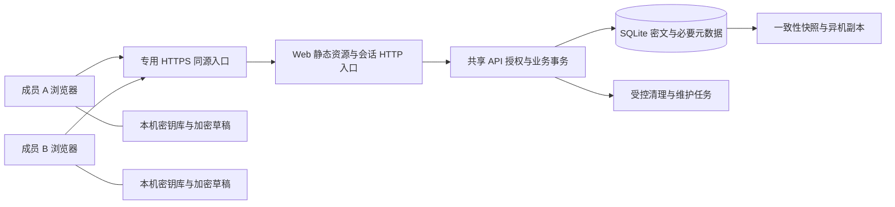
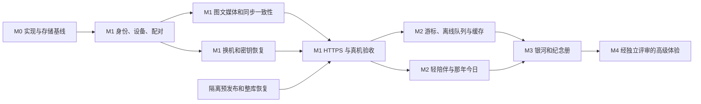

# Us · 我们的小世界｜Web 产品设计与开发计划书

| 项目 | 内容 |
| --- | --- |
| 文档 | 综合设计稿 v1.0，2026-11-16（Asia/Shanghai） |
| 平台 | 桌面与移动 Web。安装式 PWA 属于后续交付 |
| 实现基线 | `codex/web-two-person`，`e037767`。软件包版本 `1.2.11` |
| 方案输入 | Web 原生设计方案、Web 产品设计 V2.0、Web 审查与对标 `us.txt`，详见第 2 节 |
| 首发边界 | 一对成员、两个固定账号、允许跨设备。生产部署、迁移和新增功能均按本文分阶段验收 |

## 1. 产品总纲

Us 是两个人共同记录日常、收藏回忆和轻松互动的私密 Web 空间。打开首页能看到双方主动留下的近况，随时写下一段文字或几张照片。随着记录积累，同一份内容可以从时间轴、相册、那年今日、银河和纪念册重访。私人记录始终归本人，双方享有对等的日常使用权。

### 1.1 四条产品主线

| 主线 | 用户动作与可见结果 | 首个交付点 |
| --- | --- | --- |
| 参与 | 臻与悦分别登录，在两部手机上完成配对、核对设备安全码、进入同一空间 | M1 |
| 记录 | 共同或私人图文，一次写入、多端查看，弱网或冲突保留输入和明确状态 | M1 在线闭环，M2 离线持久队列 |
| 陪伴 | 主动分享心情、留一条想你、共同问答、商量吃什么或约会，双方可以异步完成 | 已有入口先回归，M2 增补 |
| 重访 | 从今日回看、时间轴与相册进入故事，随后用银河、纪念册或足迹重新组织同一组回忆 | M1 普通视图，M2 那年今日，M3 旗舰回看 |

### 1.2 范围和取舍

- 首个正式版先交付已有 Web 双人流程、安全边界、媒体一致性、数据恢复和 HTTPS 验收。在一个可靠存储与授权模型上增加日常功能，银河为首个重点视觉场景。
- 双人绑定为产品边界。陌生人社交、公开搜索、持续定位、在线监视、关系评分、补签惩罚、广告、支付托管均排除。互动可跳过，双方可选择何时参加。
- 共同与私人内容在浏览器加密并按范围授权。用户能看到保存、同步、可解密是不同状态。账号丢失和本机密钥丢失分别处理，恢复能力以演练结果为准。
- 24 小时刷新免重复解锁和臻／悦的成员显示属于用户已经确认的体验。显示昵称与稳定账号标识分开。锁定、退出以及共享设备场景需要明确行为。
- Web 是唯一的新交付面。小程序留作旧数据、加密格式和行为对照的来源。旧资料是否导入 Web 在切换前单独决定并演练。

### 1.3 文档索引

| 要解决的工作 | 章节 |
| --- | --- |
| 三份原文如何取舍、当前仓库已经做到哪 | 2–3 |
| 页面、状态、功能需求、组件行为和视觉验收 | 4–7 |
| 架构、身份与密钥、数据、API、同步、离线 | 8–11 |
| 回忆银河和先进互动的设计关卡 | 12 |
| 部署、数据迁移、恢复、测试和发布 | 13–14 |
| 工时、依赖、开发任务单、风险与第一批行动 | 15–17 |

## 2. 三份原始提案的综合评审

### 2.1 来源与可追溯性

| 编号 | 原始提案 | 主要贡献 | 本计划引用范围 |
| --- | --- | --- | --- |
| A | 《Us · 我们的小世界（Web 原生版）详细设计方案与实现计划书》 | 给出手账触感、同屏互动和密码学进阶的具体原型，细化 IndexedDB、Worker、设备认证等技术设想 | §§1.1、3.1–3.2、4.1–4.3、5.1–5.6、6.1–6.5、7.1–7.2 |
| B | 《Web 版完整产品设计方案与实施计划书（V2.0）》 | 给出产品定位、用户场景、信息架构、统一记忆、旗舰银河、兼容性和上线门禁 | §§0.2、1、3–6、7–11、12–18 |
| C | 差距分析与建议（原文件 `us.txt`） | 识别短流程陪伴和回忆重访的空缺，提出那年今日、一键想你、对方此刻和适配 Web 的轻交互 | 第三至第八节，尤其是第四节底座、第五节 P1–P3、第七节产品边界 |

C 明确以 `ab0a27a` 为代码基线，A 使用 v1.2.0，B 依据公开 `main`，且要求实施前核对实际分支。三份提案的现状表均需结合 `e037767` 阅读。引用中的竞品行为、技术兼容范围、性能数字和工程量是素材或提案目标。产品决策取自方案本身，当前实现和上线状态取自本地分支证据。涉及浏览器能力、外部供应商或依赖选型的候选方案，按开发时的官方资料与目标设备复测。

### 2.2 收敛后的关键决策

| 决策 | 提案依据 | 最终采用方式 | 放行依据或推迟原因 |
| --- | --- | --- | --- |
| **D-01 · Web 单一交付面** | A §3.1 主张移除历史构建，B §§0.2、7.3 主张保留迁移参照，C 第四节建议归档 | M0/M1 将 Web 构建、验证和交付从小程序链路独立。保留历史源、协议和备份样本供迁移与兼容验证，按迁移决策再安排仓库归档 | 保留可重建的历史版本，核对线上存量和共享模块调用后再清理 |
| **D-02 · 现有单对空间先上线** | A §4.3 自托管 Node 与设备验签，B §§7.1、8.3、9 设计 Fastify、Postgres、对象存储等，C 第四节给出托管和自建候选 | M1 复用 Vite/React/TypeScript、Node 与 SQLite，单实例持久化和同源 HTTPS。保留现有双账号、加密数据格式及空间绑定 | 两位真实成员的可靠交付先于框架切换。存储、同步耗时、容量和恢复时间达到后文触发条件时审议数据库、对象存储和多实例 |
| **D-03 · 将设备信任和便捷解锁分开设计** | A §§4.2–4.3 并列设备验签和 WebAuthn PRF，B §8.3 区分身份与内容密钥，C 第四节要求兼容与口令兜底 | 保留账号登录、本机口令、双方设备安全码和已确认的 24 小时本机记住解锁。上线阶段验证成员、设备和撤销边界，设备绑定增强按威胁模型选型。PRF 留给 M4 兼容性试验 | 新设备、新账号、过期、退出、手动锁定、同源标签页、已存密钥和密钥备份须分别验收。便捷解锁不改变导出等敏感操作的验证要求 |
| **D-04 · 离线能力分段交付** | A §4.1 IndexedDB/Outbox，B §7.4 离线分层，C 第四节 IndexedDB/OPFS 与应用壳 | M1 先保证在线写入、恢复和重试安全。M2 交付受控离线阅读、草稿/加密队列、恢复联网处理和 PWA 外壳。照片二进制缓存按配额分级，OPFS 按实测再议 | 当前 IndexedDB 只用于记住解锁，尚无一般缓存、持久 Outbox 或跨设备冲突处理闭环。先定义原子提交、幂等、版本冲突、设备撤销和清理 |
| **D-05 · 数据统一，入口逐步拆分** | A §3.2 领域组件拆分，B §§4、9.2、9.4 统一记忆和双体验，C 第六节桌面版式与时间线 | 日记、照片、清单完成和显式转成回忆的活动成为可关联内容，时间轴、银河、纪念页引用同一记录及媒体。按职责拆分页面和样式，先处理触及的流程 | 兼容历史内容、信封和支持的备份版本，各视图只读取有权访问的内容 |
| **D-06 · 轻度陪伴与重访优先** | C 第五节 P1 一键想你、对方此刻、那年今日，B §§3、5.1、5.11 异步互动，A §§5.3、6.1 情境氛围 | M2 交付站内想你、回送和那年今日。主动设定的时区及见面倒计时按使用需要排期。M3 接入银河等重访视图 | 有静音与失败反馈。推送、角标、桌面分享单独验证。区分服务端接收和对方主动回应 |
| **D-07 · 回忆银河为首个旗舰** | B §§5.5、6、10 银河交互、质量分级和回忆关联，C 第六节星空/转场，A §§5.1–5.3 手账视觉语汇 | M3 利用 M1 时间轴和 M2 回看入口接入银河星表，再加交互星图和照片揭晓。2D 或列表入口与主功能同交付 | 在真机上用不同数量星点验证性能、键盘、减少动效与私人内容隔离。拼贴、长动效和小屋升级按效益评估 |
| **D-08 · 日常决策从低成本工作流起步** | B §§5.3–5.4 吃什么/穿什么，C 第五节愿望、转盘和清单，A §6.3 双人转盘和兑现券 | 复用现有转盘与计划，M2 采用候选、两方偏好和显式存为回忆的选餐流程，小规模验证衣橱与穿搭。完整衣橱、等时蓄力、刮刮乐和兑现券再立项 | 验证分歧、无交集、跳过、撤回、权限和存档 |
| **D-09 · 低压力养成** | A §6.2 家具/小鱼干/宠物叼旧日记，B §5.6 功能物件导航，C 第五节 P2 互动联动与第七节无压力 | 保留糯米现有互动。M3 可选择旧回忆提醒或少量家居原型。完整 2.5D 场景、跨端布局和资源循环在 M4 独立评估 | 同步、低配替代入口及美术维护成本达标后再扩张。共同写作和翻阅的反馈由使用者自愿触发 |
| **D-10 · 高级协议先设计、再试验** | A §§6.4–6.5 承诺揭晓与 2-of-2，B §§5.7、8 威胁边界，C 第五节 P1 两类揭晓方案 | 首发给现有揭晓与开信的业务规则配准确文案。M4 为承诺揭晓、安全审查和双方协作开信单列试验。承诺后不可改答案要有可验证状态，题下留言可以独立于进阶协议 | 要处理拒绝或一直未揭晓、暂存秘密恢复、换设备和版本兼容。双人分片控制共同开启，日期限制另行设计。增加协议前需审查失败路径和对现有数据的影响 |
| **D-11 · 局部仪式感与外部服务可控** | A §§5.2–5.6 印章、音效和 PDF，B §§5.8–5.10、6、8.4 地图/AI/导出约束，C 第五至第七节 | 先选择拍立得和信封等可跳过的表现。始终提供按钮和列表入口。本地纪念长图、翻页手账、真实地图、共享音频、涂鸦、双人拍照等随 M3/M4 的分项选择推进 | 默认静音。地图和 AI 发出哪些数据由用户决定，须有预览/说明、降级和可撤回的授权。日历与天气只有在已有主链路之后评估，优先保留手填地点和可离线导出 |

### 2.3 需验证的原计划推断

- A §1.1 的老版本浏览器配额与照片数量计算只描述本机预览的一类风险。现有托管照片通过服务器存储，仍需分别验证浏览器密钥库、实际媒体缓存、服务端容量和极端情况下的恢复。以实际浏览器、数据集、存储模式及磁盘报告作为工程依据。
- A §§4.2、6.4–6.5 的固定性能数字和协议草图属于研究假设。Worker 是否能明显减少阻塞、WebAuthn PRF 能否覆盖设备组合、承诺何时生效与发布密钥，以及双方分片是否有作者留存风险，均需要专项验证。上线文案以实际受保护的边界为准。
- B §§7.1、10.4、12 的组件库、数据库、图形框架、星点目标和人日是选项或参考。纳入的目标写明设备、网络、数据集、测量方法及退出条件。按真实队列顺序分配人日，尽早验证上线、恢复和权限。
- C 第四节的推送、角标、分享入口和持久存储依赖浏览器、权限和安装方式。验收覆盖实装、拒绝权限、撤销及能力缺失。技术路线保留系统或应用内的可用入口。

## 3. Web 当前基线与差距审计

### 3.1 代码基线和证据等级

| 基线 | 内容 | 对本计划的影响 |
| --- | --- | --- |
| `ab0a27a` | 初始导入的 v1.2.0。浏览器静态本机模式使用 `MemoryRepository` 与 `localStorage`，微信部署有自己的 CloudBase 入口 | 解释 A/C 的现状，也提供领域代码、版式与迁移参照 |
| `cff118f` | 新增 Web 同源站点、两个预设账号、API 适配、SQLite 与 Web 集成测试 | 首次跨设备同步所需的服务端骨架已经提交 |
| `e037767` | 当前 `codex/web-two-person` 基线。完善成员显示、加入/新设备流程与 24 小时解锁。工作区根包仍标 1.2.11 | 对现有 Web 路径做加固与真机验收，避免把旧基线缺口重复计为从零开发 |

本次在 Node `24.13.0` 上运行 `npm run typecheck`、Vitest 全套及 Vite 生产构建。全套 12 个测试文件、99 个测试通过，Web 托管集成用例使用隔离临时数据库和本机回环。Web 生产构建输出至隔离目录，入口 JS 约 456 kB，gzip 约 150 kB。公网域名、反向代理、完整备份演练、两部手机和浏览器差异仍需正式验证。

### 3.2 按产品与工程能力对照

| 能力 | `e037767` 中可复核的行为 | 当前差距和复核项 | 主要证据 |
| --- | --- | --- | --- |
| Web 入口和工程 | `build:web` + `serve:web` 已独立启动可部署的托管应用。`main.tsx` 通过 HTML 标记选择托管或本机 App，默认 `dev` 是本机预览 | 统一日常使用与生产运维指引。Web 生产检查脚本、HTTPS 部署链路及真机证据待补。根 `build/release` 仍串微信任务，入口/按域拆分待做 | [package.json](../package.json)、[web/main.tsx](../web/main.tsx)、[scripts/serve-web.mjs](../scripts/serve-web.mjs) |
| 身份与网站会话 | 环境配置两个独立账号，首账号创建空间、次账号凭邀请码加入。服务端用账号名派生 `userId`、HttpOnly/SameSite=Strict cookie、HTTPS 下 Secure、严格 Origin 检查。会话进程内保存、有效期七天 | 用户名与空间绑定，配置改名要迁移身份。进程重启会要求重新登录。全站共享的固定尝试计数需按外围防护和账号/IP 限流方案验证。明确账号密码轮换、会话失效与网站故障恢复 | [src/server/web-entry.ts（第 16 行）](../src/server/web-entry.ts)、[README.md](../README.md) |
| 双人入网与设备恢复 | 单次过期邀请、成员上限、设备登记与双方按可信渠道核对安全码后发送/接收密钥。已入网账号的新浏览器可登记设备。私人旧记录依赖符合账号/空间的恢复包 | 重点验证重用/过期邀请、拿错对方/发送方安全码、重装浏览器、恢复私人旧内容、撤销、密钥轮换和换设备。服务端设备权限逻辑当前主要验证 `deviceId` 对应成员、空间及状态，设备凭据与网站会话的绑定要求另立验收 | [src/core/service.ts（第 136 行）](../src/core/service.ts)、[src/server/api.ts（第 116 行）](../src/server/api.ts)、[web/App.tsx（第 3099 行）](../web/App.tsx) |
| 24 小时本机解锁 | `us-web-unlock` IndexedDB 保存不可导出 WebCrypto 包装密钥与加密后的解锁材料。解锁有效期按成功输入口令计算，恢复时验证时间与账号对应的代次，跨标签变化触发锁定 | 保留已确认的 24 小时。验证浏览器存储异常、时钟变化、退出时离线、服务端会话失效、刷新和账号切换。审查 XSS/同源代码可以调用浏览器密钥接口的边界，确认本机锁定文案 | [web/rememberedUnlock.ts（第 3 行）](../web/rememberedUnlock.ts)、[web/App.tsx（第 321 行）](../web/App.tsx)、[web/HostedWeb.tsx（第 33 行）](../web/HostedWeb.tsx) |
| 密文与授权 | 文档和图片写入前客户端加密，私人与共享采用相应密钥。API 过滤对方私人记录，对照片按空间和归属校验。服务端可见支撑授权和同步的必要元数据 | 把实际可见的时间/成员/可见性/大小等字段落实到隐私说明和日志约束。验证对方私人记录/照片不会收到、密文篡改失败、撤销后新请求、网页注入风险及错误报告处理 | [src/core/crypto.ts](../src/core/crypto.ts)、[src/server/api.ts（第 487 行）](../src/server/api.ts) |
| 写入与同步 | 单 `POST /api/space` 动作入口。客户端约每 30 秒分页刷新，服务端检查 `expectedRevision` 并在冲突时拒绝覆盖。有动态刷新和本地并发保护 | 分页刷新尚非增量同步，已有冲突保护仍需完整用户分流。按失败前后顺序验证幂等和重复投递，按规模引入游标和删除语义。保留重试查询回执 | [src/core/service.ts（第 306 行）](../src/core/service.ts)、[src/server/api.ts（第 487 行）](../src/server/api.ts)、[web/App.tsx（第 477 行）](../web/App.tsx) |
| 记录和媒体 | 日记、共同/私人、照片、标签/收藏/留言等已存在。共同记录支持双方更新和移动到回收站，永久删除需是原作者。评论与收藏随记录版本写入。照片处理后预算为每张最多 500 KiB、每篇最多六张，已符合大小的源图可能保留元数据。SQLite 中有分立文档表和照片表，图片封装目前是字符串。Web 当前整张上传/下载，上传有回执和复查。共享服务端也支持分段 | 用弱网、元数据、体积与文件集做生产验证。记录引用与媒体写入跨步骤失败时要可重试、可定位缺图、可清理孤儿。记录可观察的扩容条件 | [src/core/photos.ts（第 1 行）](../src/core/photos.ts)、[src/server/web-repository.ts（第 4 行）](../src/server/web-repository.ts)、[src/server/api.ts（第 506 行）](../src/server/api.ts) |
| 浏览器模式和离线 | 本机示例和个人模式的数据库/密文文件用 `localStorage`，托管模式该 API 主要保存账号分区密钥库与设置等，照片密文主要留在服务器的 SQLite 数据库 | 大规模资料的 IndexedDB、离线冷启动、服务端确认前的持久队列、容量回清和 PWA 壳尚待实施。历史 demo 和个人模式迁移独立处理，避免混入双人空间 | [web/platform.ts（第 12 行）](../web/platform.ts)、[web/rememberedUnlock.ts](../web/rememberedUnlock.ts) |
| 备份、导出与退出 | 网站 v2 加密密钥恢复包与恢复密钥可重建设备侧内容密钥，托管记录和图片仍依赖服务端存储。明文导出当前以 JSON 记录和照片说明为主，关闭由双方确认并进入七天冷静期，Web 进程内每小时调度清理 | 交付服务器可恢复快照和单独保存的密钥恢复包，验证二者配对。补完整媒体和索引的便携导出、备份的一致性与恢复、到期清理/重启后补跑、快照保留和旧微信数据迁移演练 | [web/App.tsx（第 2948 行）](../web/App.tsx)、[src/server/web-entry.ts（第 39 行）](../src/server/web-entry.ts)、[src/server/lifecycle.ts](../src/server/lifecycle.ts) |
| 日常与探索 | 当前有首页在一起天数、纪念日倒计时、心情、随机回忆、日记照片、计划愿望、约会转盘、糯米、胶囊、足迹与本地报告，保留 120 话题及 24 道默契题。问答和开信有应用层约束，托管入口没有配置 AI 提供方 | 复用能直达的日常功能，补明确的传达状态、回访时的旧照片入口和宝藏重访。银河、完整离线、推送、硬保证盲答/时间锁和高级 AI 进入对应阶段。上线版显示实际可体验状态 | [web/App.tsx](../web/App.tsx)、[web/QuestionRoom.tsx（第 217 行）](../web/QuestionRoom.tsx)、[src/server/web-entry.ts（第 38 行）](../src/server/web-entry.ts) |

### 3.3 需要最先闭合的证据

1. **同一构建、两位成员、两部设备。** 各自在独立环境中登录，经邀请码和安全码完成入网，上传共享照片与私人记录，断线重试、退出与重登。记录浏览器、版本、构建标识、服务端版本、用例结果与复现时间。
2. **同一备份、一次全新恢复。** 在隔离环境恢复同源账号配置下的 SQLite 快照和设备密钥包，核对双方访问、历史条目、共同和私人样本、图片引用。保存总数、时间、失败原因和回滚验证，测试材料使用合成数据。
3. **同一权限规则、每条入口验证。** 对记录、照片、设备、同步与维护的实现和测试逐项比对。落实设备/会话、账号稳定标识、用户选择的私人范围和退出后的可恢复边界。上线前替换历史微信错误文案，把真实状态清楚呈现给双人成员。

## 4. 信息架构与关键使用路径

### 4.1 一级入口与页面归属

保留现有五个一级入口。手机底栏固定在安全区上方，桌面用左侧导航和主内容区域。时光详情、编辑器和沉浸视图保留原上下文的返回入口。表中路由为目标地址，现有内部页面状态在实现时分步迁移。

| 一级入口 | 首发内容 | 后续进入路径 | 目标路由 |
| --- | --- | --- | --- |
| 首页 | 臻、悦的显示名，在一起的天数、下个纪念日、自愿分享的心情、记录与最近共同回忆 | 那年今日、想你、今日问题与小屋卡片，按实际使用筛选快捷入口 | `/app/home` |
| 时光 | 时间轴、日记编辑和详情、相册、筛选搜索 | 胶囊、足迹、报告。银河作为时间轴和相册并列的内部视图，翻页纪念册随后进入 | `/app/memories`、`/app/memories/new`、`/app/memories/:id`、`/app/album`、`/app/memories/galaxy` |
| 互动 | 基础问答、转盘和宠物入口按实际验收状态开放 | 今天吃什么、今天穿什么、自定义问答、双人小屋，实时互动从独立房间进入 | `/app/play`、`/app/play/questions`、`/app/play/food`、`/app/play/wardrobe` |
| 计划 | 纪念日、愿望、约会 | 共同日历、手动导出至系统日历 | `/app/plans` |
| 我的 | 账号、连接与同步、设备与安全、备份与恢复、导出、回收站、空间关闭 | 主题、提醒、外部服务授权开关按对应能力开放 | `/app/settings`、`/app/settings/devices`、`/app/settings/backup` |

入口页为 `/`，配对与恢复共用 `/onboarding` 下对应步骤。在线深链接先验证会话、空间和本机密钥，再进入可见视图。M2 离线访问只读取此前联机验证、仍在有效期限内、同一账号和空间的本机缓存。目标失效或无法访问时回到时光并解释下一步。地址栏、页面标题和浏览器历史使用通用产品文案与不透明记录 ID。锁定时卸载已解密视图，返回键只恢复导航。手机编辑器支持系统返回和页面返回，存在未保存变更时先保存草稿或确认放弃，关闭后回到原筛选和滚动位置。

### 4.2 启动、配对与设备状态

| 当前状态 | 主屏和主操作 | 次操作与异常恢复 |
| --- | --- | --- |
| 尚未确定网站会话 | 「正在连接」及安静的占位，收到结果后显示指定页面 | 连接失败显示「重试连接」，保留用户当前输入 |
| 尚未登录或会话过期 | 输入网站账号、网站密码。会话过期提示重新登录 | 使用密码管理器、显示或隐藏密码。登录错误本地展示，同一错误文案覆盖账号及密码不匹配 |
| 已登录，尚未绑定 | 可创建的账号设置空间名、纪念日和本机口令。被邀请账号输入邀请码和本机口令 | 邀请过期、已使用或无效时提示联系对方生成新码。恢复入口供已有备份使用 |
| 已加入，等待共享密钥 | 展示本机设备安全码、一键复制、对方设备安全码输入及「接收空间密钥」 | 展示请对方在「我的 → 设备与安全」核验并发送的步骤。刷新可回到该状态。拒绝安全码不匹配的密钥包 |
| 已绑定，本机密钥库锁定 | 输入本机解锁口令。当前网站会话有效且可信浏览器仍在 24 小时记住期限内时尝试恢复 | 记住失败仍可手动解锁。提供恢复备份和换浏览器说明。提示网站密码与本机口令的用途 |
| 已绑定，新浏览器 | 优先「从加密备份恢复」。可选「登记设备，仅加入共同空间」 | 登记后使用双方安全码获取共享密钥。清晰提示此路径暂不可读取和写入已有私人空间，随时可切回恢复流程 |
| 已解锁 | 显示授权范围内的首页或原目标。「我的」可随时主动锁定 | 网站会话失效回登录。设备撤销立即阻止服务端继续访问，并给出恢复或重登记入口 |
| 关闭申请中或冷静期 | 申请中显示谁已确认。双方确认后显示只读、截止时间、导出和撤销入口 | 超过期限按服务端结果显示清理中或清理完成。退出回登录，不自动覆盖旧密钥库 |

邀请解决成员身份，设备安全码解决发送密钥的对象确认。界面分步展示「已加入」和「可以读共同记录」，安全码与网站密码、恢复密钥各有专用文案。双方应通过当面或已信任的渠道核验设备安全码，产品界面只提供复制和粘贴。初次使用成功路径结束时鼓励保存密钥备份，并引导创建第一条共同图文。第二位成员看到该记忆算完成首次配对。

### 4.3 移动端线框与状态反馈

手机首页让「记录」保持一屏可见，编辑器的可见范围放在主提交按钮可关联的位置。新功能依托真实状态显示入口。

```text
首页                         新建回忆                    等待空间密钥
┌─────────────────┐         ┌─────────────────┐        ┌─────────────────┐
│ Us        本机锁定 │         │ 返回    写一条回忆  │        │ 已加入双人空间      │
│ 臻  ♡  悦         │         │ 日期 [      ]     │        │ 我的设备安全码 [复制]│
│ 在一起第 N 天      │         │ 谁可见 [我们两人 ▾]│        │ 请对方核验并发钥匙   │
│ 下个纪念日 [编辑]   │         │ 标题 [      ]     │        │ 对方安全码 [      ] │
│ [写一条] [发照片]  │         │ 正文／照片／标签    │        │ [接收空间密钥]     │
│ 心情与最近共同回忆   │         │ 草稿已加密保存      │        │ [查看核验步骤]     │
│ 首页 时光 互动 计划 我的│      │ [保存]           │        │ [退出网站账号]     │
└─────────────────┘         └─────────────────┘        └─────────────────┘
```

| 服务器或本机状态 | 界面反馈 | 可继续的操作 |
| --- | --- | --- |
| 首次进入、尚无内容 | 时间轴和相册分别解释内容来源。首页展示写一条或加照片 | 新建、返回、完成设备配对 |
| 读取中、部分照片未到 | 初次加载显示稳定占位。单图保留原版位，正文先可读 | 查看文本、重试该照片、手动刷新 |
| 草稿存储已提交 | 「草稿已加密保存在此浏览器」 | 继续编辑、保存、稍后重开 |
| 发送中、回执暂缺 | 显示保存进度。结果未知时提示先查询记录状态 | 查询状态、刷新、复制未提交的内容。用同一操作标识重试已确认失败的操作 |
| 写入已确认、对端仍待拉取 | 本机提示「已保存」。同步区显示最近成功同步时间 | 对方前台刷新、主动检查同步 |
| 版本冲突、设备或密钥变化 | 明确说明「对方刚改过」「设备需要重新验证」「需要恢复私人密钥」中的实际状态 | 保留草稿、查看最新版本、复制文本或重新认证 |

### 4.4 可见范围与首页预览

进入新建入口时明确标出「我们两个人」或「只有我自己」。从共同相册或首页发照片进入时沿用共同范围，从本人私人区进入时默认私人。沿用草稿时显示草稿的真实范围，允许用户在写入前检查。私人文件标题、数量、照片和加入时间均从对方视图排除。用户只想回看某一类内容时，筛选存在于当前导航上下文，退出账号后由新账号重新选取。

## 5. 首发需求与验收条件（M1 / P0）

必须用两位独立的网站会话、正式目标浏览器及已配置 HTTPS 的隔离环境记录验收。所有标为首发的流程须能使用合成数据从空空间跑通。迁入历史内容的验收另走迁移流程。

### 5.1 P0-AUTH 登录、绑定、可信浏览器

- 只服务首对用户，预配置两个独立账号。臻、悦作为确认的显示名，通过内部稳定成员标识匹配，各自按登录身份显示「我」与对方。网站账号名、密钥身份和显示名分别管理。后续调整昵称只改展示资料。首发不强制增加自定义头像。
- 一位预配置成员完成初始创建，另一位凭一次性邀请进入。创建权限仅用于启动流程，完成配对后双方拥有同等日常创作和空间关闭确认权。已绑定账号在新浏览器登记设备无需重复申请邀请。邀请码过期或已使用时可由原操作人安全重开，已有成员关系保留。
- 保留同一可信浏览器 24 小时记住解锁。网站会话仍有效时刷新或关闭重开可以恢复。再次手动解锁开启新的 24 小时窗口，普通刷新和查看页面不延长期限。「此设备不记住」适合共享电脑，主动锁定和退出立即清除记住状态并通知同一浏览器其他标签页。
- 验收时 A 建立空间、B 使用新码加入、尝试重复邀请和错误安全码、正确交换密钥，以及 B 刷新等待页后继续接收。验证同一浏览器刷新、跨标签页锁定、24 小时到期、网站会话到期及浏览器拒绝持久化时的手动解锁。

### 5.2 P0-HOME 首屏和轻量分享

- 首页显示双方资料、开始日期及在一起天数、下个纪念日、各自选择共享的心情、最近共同回忆。开始日期以 `YYYY-MM-DD` 保存，开始当天按第 1 天计算。M1 拟以空间时区定义「今天」，首对成员默认用 `Asia/Shanghai`。沿用 2 月 29 日按年纪念在非闰年落 2 月 28 日的规则。双方都可从首页或「计划 → 纪念日」编辑开始日期。
- 首页突出「写一条」和「发照片」。两者进入同一编辑器，发照片可直接拉起选图。心情由本人选择发布，可清除，首页区分自己的和对方的，不根据访问或操作推断心情。
- 验收双方看到相同的天数、已分享心情、最近共同内容，自己的显示顺序与登录身份相符。私人记录不会进入最近共同内容或随机回忆。空空间能从首页两次点击内进入选图或文字编辑。

### 5.3 P0-MEM 时间轴、日记及相册

- 一条回忆包括标题、正文、发生日期、标签、可选心情、作者、可见范围、关联照片和版本。标题可由日期生成默认文本，允许发一张照片或写一句话。编辑时可预览当前范围。已有照片后换范围需走明确的重新加密流程，首发允许另存到目标范围并提示处置原记录。
- 共同回忆首发保留双方协作更新与软删除，只有原作者可永久删除本人条目。共同条目的正文改动保留历史版本，移入回收站前显示影响范围。评论和收藏标明成员并处理并发。私人回忆由本人可恢复的私人密钥加密，读取、搜索和导出范围检查保持一致。回收站内条目在恢复后重新进入常用视图。
- 时间轴、相册与详情读取同一回忆实体。相册支持浏览单张，详情能跳回原记录。搜索在浏览器内执行，对有权解密的数据匹配标题、正文、标签。按可见范围、月份、作者、收藏筛选。列表条目遮挡或缩略图失败不影响文字阅读和后续分页。
- 验收 A 保存共享和私人的图文各一条，B 只能从对应列表、搜索、相册和导出读取共享条目。在详情验证编辑、评论、收藏、回收站、恢复及删除权限。同一回忆的排序、标签和照片数在各视图一致。

### 5.4 P0-PHOTO 照片选择、上传与隐私

- 首发沿用每条最多六张的预算，源文件至多 25 MiB，兼容 JPEG、PNG、WebP，准备后的单张不超过 500 KiB。设备上校验真实格式，规范像素尺寸和方向，移除 EXIF 及定位元数据后再加密。HEIC 等格式若无法本机处理，提示用户导出受支持格式再选。一张失败时保留已成功选入的其他图。
- 编辑器为每张图展示准备、加密上传、已关联、失败和重试。移除仍在编辑的图需更新草稿关联。中途退出保留仍被有效草稿引用的照片，已取消且无其他引用的文件最终进入回收。编辑或删除一条记录时按照引用关系处理其附件。
- 相册按需加载缩略图，单图详情再读取所需内容。锁定、切账号和离开详情后释放已解密图像资源。上传前预览、移除与失败回退只影响当前选择，保留系统相册原图。
- 验收覆盖 iOS 和 Android 真机各录入横图、竖图、六张批选、超限图、受支持及不受支持格式、低速网络和中途取消。校验已传图不含位置元数据、可按既定方向阅读、重试后附件只出现一次，并核对另一账号无法读私人文件。

### 5.5 P0-SYNC 本机草稿、同步及冲突

- 编辑器在成功写入本机加密存储后才提示「已保存草稿」。未保存就系统返回、锁屏、存储配额不足时给出可恢复提示。M1 允许断网写已有入口内的加密文字草稿，连接恢复后由本人确认提交。M2 再提供可跨刷新恢复的离线记录缓存与待同步队列。
- 同一操作的提交、查询回执、重试沿用稳定操作 ID。保留当前修改以处理网络结果未知。仅在确认未保存或服务端支持幂等时重发。前台有周期刷新，恢复前台或在线后立即刷新，显示一次最近成功的同步时间。照片状态与正文保存状态分别反馈。
- 保存基于版本校验。发现同一记录更新冲突时显示最新版本与用户本次编辑，允许复制、手动合并或另存。双方的独立评论、参与状态和回答按各自成员标识合并。
- 验收断网后编辑、存储失败、上传中断、写入已成功但响应丢失、A/B 同时编辑、客户端在同步中退出及重新登录。检查数据无重复、修改无静默覆盖、冲突可恢复。

### 5.6 P0-RECOVERY 密钥恢复、数据备份与导出

- 「设备与安全」显示已登记设备、是否已核验以及可执行的撤销动作。主动锁定即卸载本机内容，撤销即阻止该设备后续服务端访问，客户端在收到失效结果时锁定。已确认设备可按约定接收未来密钥版本，历史共享记录保持可读。
- 「加密密钥备份」是恢复信封，搭配单独保管的恢复密钥恢复解锁能力。「服务端内容备份」覆盖记录、照片密文及必要元数据，供运维恢复。「导出可阅读的回忆」在本机再次确认，按选定范围导出文字、照片文件和清单。附逐项失败信息，若有缺图须明确显示为部分完成。把可读归档重新导入 Web 需另经迁移验收。
- 同账号恢复用于取回原私人密钥和共享历史。仅登记并领取共享密钥的浏览器需要明确限制私人区。备份验证失败时保留现有密钥和记录，提示账号不匹配、密码错误或所属空间失效等真实原因。从隔离环境证明服务备份和双方密钥备份可共同恢复后，才把新站点作为真实回忆的长期入口。
- 验收 A、B 各自清空隔离配置文件后恢复，交叉使用对方备份被拒绝，原浏览器与新浏览器读取相同的本人私人记录及共同照片。以单独新建数据库实例演练服务端恢复，并验证撤销后的旧设备不能重新读取新密文。

### 5.7 P0-LIFECYCLE 删除、关闭与退出

- 普通记录删除先软删除，回收站内确认后由作者永久删除。双方空间的关闭请求独立确认，显示发起者、确认进度和到期时间。双方确认后进入七天只读冷静期，支持读取、导出与符合条件的撤销。任一成员已建立新空间时，旧空间撤销不可覆盖新绑定。
- 到期先拒绝访问，由可重试维护任务清理记录、照片、设备信息与密钥包。备份中的旧内容按明确保留期自然过期，恢复服务时检查删除记录防止数据复活。已在成员设备解密或导出的副本仍由持有人处理。
- 验收覆盖单方请求仍可使用、双确认转只读、冷静期撤销、清理故障重试、到期后原访问被拒、用旧备份恢复后已删数据不会重新可见。一键退出网站会话和主动锁定在「我的」中分开显示。

### 5.8 P0-PLANS 纪念日及基础计划

- 支持纪念日标题、日期、是否按年重复，以及愿望和约会的最小字段。愿望包含状态与可选优先级，约会包含日期、可选地点、预算与备注。缺省提醒仅在站内展示。
- 验收在网站中新增和编辑纪念日，首页倒计时自动重算。A 建立一项愿望或约会，B 能在计划区看到，状态更新可同步，关闭期间所有修改入口进入只读。

## 6. 后续能力的产品规格

已有模块可在验证通过后分批开放。新模块先保留普通导航可达的基础操作，高级动效和外部服务按能力另开。

### 6.1 M2 日常使用与离线能力（P1）

| 需求 | 最小设计 | 必须验收 |
| --- | --- | --- |
| P1-OFFLINE 离线回忆 | 支持已同步密文的本机缓存、加密草稿和待同步列表，显示待传数量及单项的移除或重试。使用有限的本机可信期限，联网即校验授权。离线期间已缓存的可解密数据可能继续可读，到期需联网确认身份 | 无网刷新后可在可信期限内解锁缓存。多次上下线后无重复记录。浏览器清除或驱逐存储后给出明确提示。撤销设备恢复联网后失去访问，其待发内容停止提交 |
| P1-PLAY 自愿陪伴 | 保留每日问答、默契、转盘、自定义题及历史续答，复用 120 话题与 24 道默契题。追加自愿「想你」、可关闭站内提醒、那年今日与双方手工选择的城市或时区。旧答案按原题和日期回看 | A、B 异步提交同一题后分别保留双方答案。跳过不计缺席。仅在当前双方答完时由界面揭晓，明确其应用层边界。那年今日没有候选就隐藏。无访问时长、在线排行或自动定位 |
| P1-FOOD 今天吃什么 | 从现有约会转盘扩展为两人菜单。维护菜品、餐次、预算及硬性忌口，双方各选「想吃／可以／不想吃」。排除任一方硬性限制后，对共同接受项排序或抽签，采纳后可创建回忆。手录食材和本地规则菜谱待核心稳定 | 变更候选后旧投票需重新确认。重复和乱序提交结果一致。过敏和硬性拒绝项排除在外。无交集时让双方重选 |
| P1-WARDROBE 今天穿什么（原型） | 用少量加密衣物完成移动端分槽点选，支持局部分享、对方提出搭配、衣物所有者采纳或拒绝。天气先手填。根据使用反馈再排完整衣橱 | 衣物选取和投票同步。未授权衣物及照片不会出现在对方衣橱、建议或导出。撤回共享后停止后续读取，已取得副本由持有人处理 |
| P1-PET 糯米小屋 | 先复用喂食、抚摸、玩耍、休息与成长。M3 可试主题和少量家居，房间内冰箱、衣柜、书架、信箱提供对应功能入口。完整装修系统留给 M4 | 用户可以通过普通菜单进入同一功能。宠物离线不扣减、不死亡。互动每日上限和防重复有证据。正式共享装修另测布局并发 |
| P1-CAP 时光胶囊 | 保留按日期开启、仅到期双方确认和开后回看，并提供显式「打开信件」。到期限制和确认属于应用层约定 | 时区、到期前后、双方不同确认、刷新后状态和减少动效均通过。文案清楚写明持有相应共享密钥者的提前读取能力 |
| P1-FOOT 足迹与共同计划 | 先主动添加文字地点、日期和照片，可选手工坐标。地点按时间与城市筛选。用愿望模板或完成照生成时间轴回忆。共同日历和 ICS 导出可作为计划扩展 | 无定位权限仍能写足迹。完成事件只生成一次关联回忆。复杂地图和外部查询在 M4 独立验证 |
| P1-REPORT 月度与年度报告 | 本机按时间段计算共同记录、照片、完成愿望、地点、互动与纪念日。允许主动打印或导出结构化结果。把「活跃日期」仅用于回看，避免关系评价 | 私密、已删除及超出日期范围项目不入统计。同一范围在两端结果一致。打印前可预览明文内容和文件去向 |

### 6.2 M3 回忆银河与纪念册（P1）

- **P1-GALAXY 回忆银河。** 从时光进入，时间轴/相册/银河共用数据和筛选。每颗可交互的记忆星对应一张有权解密的真实照片，一个多图故事可以有多颗星。点星后查看照片、日期、标签与原日记，返回后保留相机和筛选。按年份、标签、旅行合集定位，随机流星只选当前可见、有照片且未删除的回忆。首版银河只展示共同相册照片，私人相册仍可从时光对应筛选回看。
- **银河体验门槛。** 加载、照片为空、部分图失效及渲染失败均有相应状态。可以在同一入口切换到静态星图或可搜索列表，通过键盘或触屏打开同一照片。分组样式呈现时间和主题，颜色不表达关系好坏。小屋、首页引用银河可在真实使用后增加，保留五个一级入口。
- **P1-BOOK 翻页纪念册。** 用户先选月、年或自定义范围并挑选共同回忆，再编辑封面、标题、顺序和可见页面。优先 HTML 可编辑预览与浏览器打印到 PDF。后续再加入本机生成的长图、手工拍立得白边签名和拼贴桌。首版应验证分页、断页、照片清晰度、读取失败时的占位、排除私人和回收站记录。手工拼贴另验证拖拽与点选移动、撤销，以及版本冲突时保留双方布局修改。

### 6.3 M4 独立授权与进阶功能（P2）

| 需求 | 范围与放行标准 |
| --- | --- |
| P2-AI 回忆助手 | 先试摘要、标题和故事草稿。只允许挑选有权查看的共同文本，发送前逐项预览实际请求、提供取消、列明服务方与数据处理。返回可编辑，用户确认后重新加密保存。代理无正文审计日志，服务未配置时功能提示原因。私人内容和照片原图排除在首批接口外。服务商和保留条款确认后才启用 |
| P2-PWA 推送和系统集成 | 基于 M2 安装、更新和离线壳，用户可主动订阅通用通知、单独暂停、撤回授权或设免打扰。按实际设备支持决定角标和系统分享。校验锁屏文案、请求字段与诊断记录均不含日记、图片、位置和关系细节。普通网页保留站内提醒 |
| P2-LIVE 实时共创 | 双人拍立得、共同涂鸦、合力转盘、萤火虫光标只在双方明确进入的同一互动会话内运行。给出权限说明、退出和停止按钮，断线降级到各自操作或异步完成。内容加密，信号短期存活。不记录访问习惯、持续在线状态和历史轨迹。承诺揭晓问答或双人密钥胶囊须另定故障恢复和安全审查，含一方拒绝揭晓、设备丢失与撤销后的可用性 |
| P2-MEDIA 旅行与多媒体 | 用户选取足迹与照片后制作旅行回放，文字时间线始终可用。瓦片或搜索请求需在触发前告知传递范围。语音、短视频和高分辨率导出单独核算配额、兼容与备份成本。摄像头、麦克风逐场景请求，允许拒绝并继续使用已有功能 |

玩法池保留纸飞机信件、心愿兑现券、回忆竞猜、当地时间与手动天气选择、纪念日长图。优先选择能由现有记录、附件和房间复用的单项，逐一验证是否被双方反复使用。愿望基金只表示本机或共同空间内的记账进度。声音、同步播放和环境天气均由用户独立开启，退出房间后停止。

## 7. 视觉规范、交互和无障碍

### 7.1 手账、银河、小屋三套场景

| 场景 | 底色、文字与点缀 | 组件与布局 |
| --- | --- | --- |
| 日常手账 | 页面 `#FFF8F2`、卡片 `#FFFDF9`、正文字 `#574740`。豆沙粉 `#D99EAB`、鼠尾草绿 `#ABC7B7` 作为装饰和次要强调 | 拍立得、纸张与和纸胶带用于照片或封面。编辑器、登录和隐私警示使用稳定的常规表单与反馈 |
| 回忆银河 | 页面 `#080E25`、卡片 `#141B3A`、正文字 `#F1EDFF`。星点 `#A99BF2`、选中状态附加轮廓和文字 | 银河视图局部主题，照片详情和设置仍遵循全站交互。星点高亮、可点击性、缩略图占位样式彼此区分 |
| 糯米小屋 | 页面 `#F5EBDD`、正文字 `#5E504B`。橄榄绿和奶油橙为点缀 | 平面小屋先用轻量本地素材。图形物件有文本标签，所有动作同时提供普通按钮 |

字体先用仓库现有的本地系统字体方案，中文正文 16px、推荐行高 1.65–1.9，计时数字等宽。说明文字仅在必要处使用，设计值 14px 起。4px 间距基准，常规卡片 16–24px 圆角，纸张阴影和倾斜主要用于封面。正文、表单、错误消息与图像查看框保持规整。手机以单列为主，常用操作靠近拇指可及区域，底栏与软键盘不遮挡提交及焦点。桌面约 1100px 起可开启辅助栏，收起侧栏仍保留筛选、详情和全部操作。

### 7.2 动效与感官反馈

- 基础反馈约 120–180 ms，普通页面或照片转场约 200–300 ms。安全与保存结果立即显示。可跳过的开信、暗房显影、节日庆祝等在结果已确定后播放。转场效果不可用时直接显示目标视图，返回保留原上下文。
- 拼贴卡用少量角度、轻阴影和短回弹。动效优先 `transform` 与 `opacity`，滚动时间轴线条可静态显示。银河入场、小屋灯光、年报翻页、宠物互动均有静态或短淡入方案。长按封蜡、拖动贴纸、刮开卡片都提供一次点击或键盘可用的同等操作。
- 默认静音，首发使用视觉或文本反馈。用户主动开启后才加载可关闭的拟物音效。触觉按设备能力选择，本机设置优先。遵循系统 `prefers-reduced-motion` 与站内「减少动态效果」，开启任一项就移除视差、摇晃、循环和镜头飞行。标签页退出或隐藏时暂停循环，离开场景后释放动画、音频和图像资源。

### 7.3 无障碍与适配验收

- `VIS-01` 以 WCAG 2.2 AA 为设计目标。常规文本对比度至少 4.5:1，大号文字至少 3:1。必要控件轮廓和状态等非文本信息至少 3:1。浅粉色主要用于装饰，错误、选中、可见范围和同步状态同时使用文字或图标。移动常用触控目标取 44×44 CSS px 的产品设计目标。 [W3C WCAG 2.2](https://www.w3.org/TR/WCAG22/)
- `VIS-02` 键盘可完成登录、配对、日记编辑、打开照片、访问设置和退出沉浸场景。输入字段有标签、错误与对应字段关联、同步状态可被辅助技术感知。弹窗打开时移动并约束焦点，关闭回到触发按钮。焦点不被底栏遮挡。日记、照片和按钮在触屏、鼠标、键盘下都有可见的操作路径。
- `VIS-03` 在 360/375/390px、平板和桌面验证配对、记录与恢复的全流程。以 320 CSS px 等效宽度和 200% 文字放大补验回流，常规页面无横向内容滚动。切换深浅主题、打开手机键盘、旋转屏幕、读屏与系统返回仍能完成操作。
- `VIS-04` 图片的可读描述来自本人填写的照片说明或所属记录标题，并提供中文可读序号。装饰图片跳过读屏。银河无渲染能力或减少动态效果时保留列表检索与键盘操作。手工检查与自动扫描证据分别记录。

## 8. Web 架构与技术决策

### 8.1 运行架构

M1 以一对成员、一个正式空间和单实例部署为工程假设。浏览器通过 HTTPS 访问专用源，网站外部只暴露反向代理。代理将同源页面、静态资源和 `/api/*` 交给固定版本的 Node.js 服务。客户端设备完成正文与媒体加解密。服务端负责网站会话、内容授权、密文持久化、配额、备份和清理任务。测试环境使用独立域名、账号、密钥库和数据库。



当前检出版本已具备 `web/HostedWeb.tsx` 登录壳、`web/platform.ts` 同源传输、`src/server/web-entry.ts` 和 `src/server/web-repository.ts`。仓库里的旧预览仍通过 `web/main.tsx` 区分本机模式与托管模式。托管 SQLite 使用 WAL 和 `synchronous=FULL`，以串行队列驱动单连接，记录 JSON 与媒体密文分别落在 `documents`、`photos` 两张表。当前仅代码和本地测试可作为证据。原案 B 第 1 节和 C 第 1 节审查的是较早代码快照，所述“只有本机预览”已经过时。

### 8.2 架构决策记录

| 决策 | 拟采用的方案及理由 | 复核条件 |
| --- | --- | --- |
| ADR-01 · 入口与构建 | 保留 React + TypeScript + Vite、现有 Node HTTP 入口及 `UsService`。拆分 React 页面与样式时维持现有领域逻辑。使用 Web 构建脚本串联类型检查、前端构建、服务端预构建和集成测试，生产运行不可变发布包。 | 动态模块与媒体路由产生重复横切逻辑时，评估 Fastify 等受维护框架。引入前先记录升级、依赖和回归成本。 |
| ADR-02 · 存储 | M1 保留单节点 SQLite 与同库媒体，部署至持久卷并做一致性快照。单库恢复可同时覆盖记录和照片。先清理历史引用和分页成本，再评估数据库扩容。 | 需要多实例、高可用或多对成员时启动 ADR。持续观察到写队列、媒体体量、备份窗口或恢复时限超出目标时，压测 Postgres 与私有对象存储。SQLite 与对象存储可分别演进。 |
| ADR-03 · 身份 | 两个部署预配账号，分离账号、成员、设备授权和本机解锁。沿用现有身份和加密上下文。 | M4 有实际需要且完成跨系统绑定和恢复演练后，评估 WebAuthn 网站登录、PRF 本机解锁或邮件入口。独立评估两种 Passkey 用途。 |
| ADR-04 · 客户端存储 | M1 沿用加密密钥库和加密草稿。M2 引入按账号与空间分区的 IndexedDB 密文缓存与 Outbox。 | 在真机上证实大媒体 I/O 或配额成为瓶颈后，评估 OPFS。先比对失败恢复、配额提示和浏览器矩阵。 |
| ADR-05 · 同步 | M1 保留 HTTP 拉取与 revision 检查并补写入回执。M2 增量游标与持久队列稳定后，才评估 SSE 作为刷新提示。 | M4 存在明确同时参与的玩法时，为主动加入的会话单设 WebSocket。持久数据继续通过同步 API 对账。 |
| ADR-06 · 加密协议 | 兼容现有记录封装 v1、API 协议 v2 和恢复包 v2。若修改密码学上下文或分块格式，单列版本、向后读取、回滚与外部复核。 | 提前解密保护、密码学盲答、设备签名扩围或更换 KDF 各有独立威胁模型与测试向量。 |
| ADR-07 · 浏览器发布 | M1 固定源和同源资源，发布端记录构建哈希与版本，保护域名、运维凭据和部署供应链。M2 加可控更新的离线壳。 | 外部 SDK、安全策略例外和 Service Worker 缓存变更需通过专用测试。主页、编辑器、锁屏及恢复链路始终可直接验证。 |

综合依据为 A 第三至四节的原位重用和 Web 原生设计，B 第 7 至 9 节的持久层与分阶段迁移建议，C 第四节的真实同步和网页交付边界。B、C 提出的 Postgres、对象存储和实时订阅放在规模条件之后。A 提出的整体拆分和认证升级分步执行，以便每次修改均可定位回归。

### 8.3 工程边界与交付

| 边界 | 实施要求 |
| --- | --- |
| `web/` 展示与路由 | 抽出登录壳、空间壳、首页、时光、计划、互动、我的空间和二级页面。公开路由只提供界面入口。受保护页面首次打开必须经过网站会话和解锁检查。独立场景按需加载。 |
| `web/` 设备适配 | 集中维护浏览器会话、密文存储、照片处理、下载、更新和能力检测。模块仅经明确输入接收需要的数据。源码与目标目录按需演进。 |
| `src/core/` 领域 | 管理加密封装、设备密钥、记录类型、日期和业务不变量。保持平台无关，复用稳定接口。浏览器状态接入保留 `UsService` 的单一业务写入入口。 |
| `src/server/` Web 与共享 API | Web 入口交付会话和 HTTP 安全策略。API 层逐级校验账号、成员、设备、空间和资源范围。持久层维护事务、格式版本和迁移。 |
| 文档与构建 | M0 固化 `e037767` 工作基线与既有测试，M1 建 Web 独立发布检查。README、配置示例、运行模式和面向用户的错误提示改为 Web 语境。微信实现保留历史可读和迁移路径，待迁移决策完成后独立归档。 |

拆分优先处理会话、资料与设备、编辑器、照片读取和同步状态，再拆其他视图。每次拆分回归旧入口、浏览器返回或刷新、私密路由门禁、深链接、加载失败和键盘焦点。兼容路由只用稳定不透明 ID，URL、标题、历史操作和分享参数均避免暴露日记文本、地名或邀请码。

## 9. 账号、设备授权与隐私安全

### 9.1 四层身份与状态

| 层级 | 已有实现 | M1 设计与验收 |
| --- | --- | --- |
| 网站账号 | 固定两账号，首账号为创建者。服务基于通过格式检查的原账号名派生稳定 Web 身份。 | 保持账号名和配置顺序稳定，显示昵称独立保存。网站密码可轮换且会话需可吊销。更改账号标识必须做显式映射迁移并验证两人的恢复包。 |
| 空间成员 | 事务限制最多两人，邀请码只用一次且一小时过期。 | 创建者创建，另一账号校验邀请后加入。退出或挂起仍可重登查看空间进度。重复提交、已过期、已用及空间已满各有明确结果。禁止明文邀请码进入 URL、诊断日志或共享截图。 |
| 设备与可信状态 | 网站登录后设备可登记公钥，设备 ID 与空间、账号及 active 状态关联。密钥包收发由用户核验双方安全码。 | 界面明确区分已登记、待授权和已取得密钥。恢复路径核验当前账号及空间。服务端授权先检查成员和设备，高风险动作另做近期验证与设备持钥审查。 |
| 密钥库解锁 | 网站口令与本机解锁口令分离。24 小时浏览器记忆使用不可导出的本机 AES 包装钥以及有效期和跨标签代次。 | 保留手动解锁后 24 小时内刷新无需再输本机口令。提供「此设备不记住」选项，关闭后刷新时手动解锁。手动锁定和退出清除该账号在本机的记忆并通知其它标签。过期、存储不可用或网站会话失效时提示具体恢复路径。 |

加入流程拟保留「网站登录 → 接受邀请 → 设置本机口令并生成设备密钥 → 等待授权 → 通过可信渠道核验安全码并接收已签名密钥包 → 加载共享记录」。受邀者在等待页看到自己的安全码、重新检查、换设备提示和退出。创建者在设备列表核对对方安全码后才能发送。无匹配包或指纹错误停留在待授权状态。收到的密钥包先验签和绑定接收人、空间、版本，持久化成功后才确认清理。已有成员在新浏览器不重复使用邀请码，可由可信设备传送共享密钥或按账号恢复。需要私人历史时使用本人的恢复材料。

当前成员和设备 ID 的关联校验只能证明所报设备属于该成员。M1 评审 A 第 4.3 节的设备持钥方案。拟在解锁登录会话后通过经过审查的短效、单次挑战绑定设备，生产内容接口再以会话已绑定的设备与当前撤销状态授权。登记、成员加入与同账号恢复保留各自最小权限的引导接口。撤销后即使账号会话仍有效，也要阻止原绑定获取新密文和密钥包。关闭空间、改变信任设备、轮换密钥等操作还需近期重新认证和相应事务校验。安全码核验及现有 X25519 / Ed25519 密钥包继续保护密钥交接。用独立会话验证账号绑定、设备证明、到期、重复提交和撤销，设计评审通过后才按其能力更新用户文案。

### 9.2 网站会话与发布可信度

现有 HTTPS Cookie 带 `__Host-`、`Secure`、`HttpOnly`、`SameSite=Strict` 和 `Path=/`。写请求要求精确 Origin 和 JSON 头，服务故障或会话过期需要重新登录。当前会话最多保留 7 天且只在进程内，登录次数由全站共用窗口限制。M1 拟保留同源 Cookie，服务端补可审计的账号与来源限额、scrypt 并发上限、密码轮换或异常时吊销会话、过期处理和统一错误响应。入口按部署拓扑只信任受控代理信息。拒绝第三方页面发起的写操作，回归同源正向路径。维持内存会话时，发布说明明确重启需重登。

生产网页使用专用 HTTPS 源。确认 HTTP 跳转、证书续期、HSTS、CSP、`frame-ancestors`、`nosniff` 和 `no-referrer` 实测。限制脚本、Worker 和网络连接目标。错误监控使用允许字段，记录请求结果和计数，省略正文、坐标、搜索词、密码、令牌、密钥、邀请码、请求体和解密照片。前端发布保留锁文件、构建哈希和已验证的上一版本，测试环境使用合成数据。同源脚本、浏览器扩展或设备若被控制，解锁材料仍可能被其使用。严格 CSP、固定依赖和审查发布流程能减少接触面，同源代码分发仍属于信任边界。

### 9.3 密钥和内容权限

| 对象 | 处理规则 |
| --- | --- |
| 个人主密钥 | 每位成员独立生成，供私人记录和草稿加密。伙伴密钥包只携带共享密钥版本。服务端同时过滤私人记录与相应媒体。 |
| 共享空间密钥 | 当前的共享写入使用当前 `keyVersion`。撤销后禁止相关设备访问新的 API 请求和新密钥包。为仍可信设备分发新版本，并保留读取历史旧版本的能力。 |
| 记录封装 | 现有封装为 XChaCha20-Poly1305 + HKDF-SHA256。认证上下文绑定空间、记录、作者、可见性、格式/域和密钥版本。`revision` 目前是服务端并发元数据。把它纳入未来认证上下文需要确立版本语义及兼容方式。 |
| 本机口令和密钥库 | 兼容已用 scrypt 参数与现有恢复信封格式。减少主线程负担通过 Worker 实测评估。WebAuthn PRF 仅在支持设备上选择启用，口令和恢复密钥始终保留可用入口。 |
| 恢复备份 | V2 恢复文件仅含恢复信封。恢复密钥与备份文件分开保管，Web 备份绑定账号和空间。服务端数据与照片另行做快照。缺少可用设备和恢复密钥时，服务端无法恢复内容。 |
| 关闭与删除 | 拟保留双方确认后七天只读冷静期，期间允许导出并按绑定规则撤销。到期由后台任务分批清理，备份按保留期自然淘汰。已获得的本地明文、截图或导出副本由取得者控制。 |

用同一份权限矩阵验证「匿名、已登录未绑定、成员待授权、已授权、已撤销、进入冷静期、到期关闭」。重点覆盖私人正文、私人附件、他人草稿／导出、邀请码重用、旧设备恢复以及跨空间请求。网站账号重设、设备更换、密钥轮换和退出需要各自明确信息架构。清理任务记录尝试和完成时间、处理量及错误码。恢复旧快照时须比对删除墓碑与维护进度，避免恢复已按约定清理的内容。

### 9.4 外部服务及高级密码学功能

服务器可见成员和设备关联、公钥、访问时间、密文大小及必要授权范围。日记正文、原始照片、标签、时间线业务日期和地点坐标放入密文。M1 不配置外部 AI 或第三方地图发送，仅使用本机展示和文字地点。M4 如启用 AI，逐条选择可用共同内容、预览实际发送文本、按次同意，成功结果经用户编辑后再加密保存。外部地图和天气分别只在用户主动选择后提交最少必要的查询。通知设备和选项按人独立，通知内容采用通用文字。

M1 保留问答和胶囊当前的应用层揭晓规则。M4 的 Commit–Reveal 和双人分片胶囊遵循 A 第 6.4 至 6.5 节的体验目标，先写协议 ADR，覆盖最后一方不揭晓、设备丢失、密钥轮换、跨端恢复、提前串通、永久无法开启和取消边界。双方参与是访问条件，日期的保障取决于实际引入的时间信任模型。原型、协议评审、故障用例与用户文案完成后再决定是否发布。

相关要求来自 A 第 4.2、4.3、6.4、6.5 节，B 第 8 节和 C 第四节。代码证据见 `src/core/crypto.ts`、`src/core/service.ts`、`src/server/api.ts`、`web/rememberedUnlock.ts`，Cookie 与发布控制参考 [OWASP Session Management](https://cheatsheetseries.owasp.org/cheatsheets/Session_Management_Cheat_Sheet.html)。

## 10. 数据模型、API、同步与媒体

### 10.1 当前存储与拟定实体

| 逻辑实体 | 服务端必要字段与约束 | 内容位置与演进 |
| --- | --- | --- |
| 用户与空间 | 稳定 `userId`、`spaceId`、成员集合、状态、密钥版本、关闭确认与截止时间。成员不超过两人。 | M1 延用 `users`、`spaces` 文档，以事务维护成员与绑定。需要独立约束或多对使用时再拆成员关系表。 |
| 设备、邀请、签名密钥包 | 所属账号和空间、公钥、状态、有效期、邀请摘要及消费状态、目标设备和密钥版本。 | 一次性邀请、密钥包和敏感操作挑战各自有生命周期。本机内容解锁口令和设备私钥留在设备。 |
| 密文记录 | `(spaceId, id)`、作者、`shared/private`、`revision`、服务器时间、逻辑删除标记和版本化信封。 | 标题、类型、正文、业务日期、话题答案、心情和地点进密文。M1 保留共同内容的协作更新和软删除，永久删除仅限原作者自己的回收站条目。私人内容仅作者可读写。 |
| 加密媒体 | `fileId`、空间、所有者、可见范围、密文校验值、字节大小、上传状态、生成和清理时间。 | 原文件名、像素尺寸与需要跨设备展示的媒体内容进密文。终端解码重编码前后的拍摄元数据另验。媒体按授权范围绑定记录，记录删除与媒体清理作可恢复处理。 |
| 变更流和幂等回执 | 空间内单调事件序号、资源 ID、revision、变更类、必要权限范围。幂等键绑定账号、空间、操作与负载摘要。 | M1 先加写入回执。M2 以事务写变更事件和墓碑，保留期到期后通过重新快照重置游标。通用修订或事件值与字段版本分别维护。 |

保留当前 v1 密文读取方式。M0 建立带旧版本、私人记录、回收站及照片的合成固定数据。M1 为 SQLite 建显式 schema 版本、迁移检查和部署前快照。在验证真实数据规模后，为空间、可见范围和所有者查询添加相应索引。增量模型优先用追加且兼容的变更，先双读或按版本读，再迁移旧数据。关闭、恢复和部署回滚同时检验旧版本可读性。用户可见的应用记录日期由明确的日历日规则解释。服务端创建和更新时间使用毫秒时间戳或统一 UTC 格式，避免跨时区错误归日。

### 10.2 HTTP 与同步 API 合约

对照 B 第 9.3 节的 REST 草案，M1 保留现有同源 `/api/*` 和 action 载荷，优先固定授权、请求与响应语义。只有调用面确实增多或需切换协议时再用版本化路径迁移。新动作分批加入现有版本兼容窗，Web 不再使用微信专属错误文案。既有 `/api/space` 实际可能以 HTTP 200 返回业务错误，客户端须同时处理 HTTP 状态与 `success/error`。新合约明确 401 需重登、403 无权限、409 修订冲突、413 超限、429 稍后重试，旧客户端通过兼容层获得等价行为。

| 接口或动作 | 读写合约与客户端表现 |
| --- | --- |
| `/api/session` / `/api/login` / `/api/logout` | 查询仅返回当前账号和角色所需最少字段。登录换发会话。退出吊销当前会话，同时锁定并清除浏览器记忆。Cookie 值与账号标识不混用。 |
| `bootstrap` / `createSpace` / `createInvitation` / `joinSpace` | 空间来源于后台绑定。新建和接受邀请支持可重试的结果确认。同一邀请在事务中最多成功一次。前端对过期、已用和已加入分别展示下一步。 |
| `registerDevice` / `listDevices` / `putTransfer` / `getTransfers` / `ackTransfer` | 公钥登记不得替换已注册公钥。密钥包仅目标设备读，保存成功再确认。撤销和空间状态变化应阻断后续发送和接收。 |
| `listRecords` / `putRecord` / 删除与恢复 | 先按权限过滤，新增固定 ID，修改携带 `expectedRevision`。M1 处理并发冲突与写入未知结果，M2 按变更游标同步。永久删除记录和关联媒体需具备可重复执行的清理语义。 |
| `filePut` / 分段接收与提交 / `fileUploadStatus` / `fileGet` | 上传先验大小、范围、设备和配额，再接受密文。回执按账号、空间和动作限定，超时先查询结果。读取与删除继承媒体权限。不同版本媒体走相应尺寸及校验规则。 |
| 拟定 `syncChanges` / `mutationStatus` | `syncChanges(cursor, limit)` 返回可读取的变更和后续游标。`mutationStatus(operationId)` 只返回提交人的最少结果。若游标失效，返回明确的快照重建状态。 |
| `closeSpace` / `cancelClose` | 事务内计算双方同意。进入冷静期时拒绝新的内容写入。到期关闭后拒绝读，后台按预算清理。撤销操作出现新绑定时按原规则拒绝并提供剩余导出提示。 |

### 10.3 并发与增量语义

当前前端每 30 秒触发刷新，`UsService.refresh()` 逐页拉取并解密全量记录，通过请求序号和本机变更合并避免迟到响应覆盖较新的本机状态。服务端已有 `expectedRevision` 比较，分页仍是按空间 OFFSET 后过滤私人记录。M1 保留现有轻量拉取并补前台重连刷新、同步状态、请求超时、密钥缺失和明确冲突提示。自动刷新失败时显示最后成功时间与待处理状态，避免编辑失败误标为已保存。

1. 客户端创建稳定记录 ID 与操作 ID。首次提交以操作 ID、规范内容摘要和原修订版本确定业务意图。服务端在同一事务保存修改与回执。相同键和相同负载返回原结果，相同键绑定不同内容时明确拒绝。回执保存期覆盖预计离线重试窗，超期先按记录 ID 或状态查询。离线客户端无权操作时保留待处理的加密草稿。
2. 发现 `REVISION_CONFLICT` 后，保持本机草稿和当前远端版本。用户可复制、放弃或基于最新版本另存修改。只在有明确合并规则时自动合并，例如双方各自投票。新的业务意图生成新操作 ID。日期、金额、可见范围和删除等语义动作需要独立判断。
3. M2 的记录写入与追加变更在同一事务内完成。首次快照使用一致的读取视图或固定上界加稳定分页，并用并发写入测试证明后续变更覆盖窗口。客户端以授权事件标识和资源修订去重。软删除事件把记录移到回收站，永久删除或访问撤销才移出相应缓存。游标对客户端不透明且按会话权限绑定，响应不返回伴侣私人记录的 ID、修订或事件差量。隔离验证应覆盖分页、计数和游标过期。
4. 游标必须绑定账号、空间和作用域。优先用不透明值。出现失效、空间切换或版本不兼容时，先在隔离区重建密文快照，等待写入队列核对完成后再切换。通知与未来 SSE 仅触发确认拉取，断开时按同一游标补齐。

验收使用两个浏览器上下文制造同条编辑和不同条写入、记录保存后响应丢失、重复提交、冷静期期间排队写、设备撤销后重连以及长时间离线游标过期。每项检查数据库最终修订、照片引用和界面状态。可重复的合成压测数据覆盖至少 1,000 条记录与多页私人数据。记录用时、读取量和同步间隔，按阶段性能基线决定是否切换结构。

### 10.4 照片、容量与一致性

现有日记最多 6 张图片，支持 JPEG、PNG 和 WebP，输入上限 25 MiB，压缩后每张最多 500 KiB。保留上线限制，同时核对 Web 的处理实现和真实设备行为。客户端先检查有效类型、像素、旋转方向和可解码性，再压缩、清理不必要的 EXIF 并加密。清理 EXIF 和方向正确性需要用样例验证。对浏览器不支持的照片格式提示转换，原始照片由系统相册保留。浏览器先用小尺寸预览再异步读其余图片。解锁会话结束、路由切换和撤销读取时回收 URL、画布与异步任务。

| 阶段 | 媒体提交与故障处理 |
| --- | --- |
| M1 | 保留现有服务端密文上传与回执。先检查逻辑配额，对结果不明的上传查询 `fileUploadStatus`。新增服务端配额建议按实际数据确定，预留备份、WAL 和临时文件空间。记录只有在全部有效附件已收到回执时才报告完整保存。 |
| M1 一致性 | 当前媒体写入、元数据落库、日记引用和永久删除可能跨步骤。目标是在事务中建立引用，或保留可重试的提交状态。临时媒体经宽限期回收，并用维护任务核对无引用或缺失内容。删除先记录待清理状态，物理清除可重试。 |
| M2 | 在 IndexedDB 用独立密文 Blob 保存待上传附件。批次按回执确认，重复上传保持幂等。离线缓存先回收可从服务端恢复的缩略图和媒体，待提交数据保留。 |
| 达到扩容条件后 | 评估私有对象存储以及短时、限大小、限对象的上传授权。服务器验证密文长度和摘要后提交媒体记录。下载对权限重新检查，凭证短期有效。数据库与对象清单一起验证快照恢复。 |

验证六图组合、历史大图、损坏图片、相册权限取消、慢网、响应丢失、刷新、撤销设备、硬盘配额和重复附件。在模拟故障中检查缺照片的记录和孤儿不会被静默累积。服务端在运行期间用一致性备份接口取快照，异机副本定期做恢复演练。[SQLite Online Backup API](https://sqlite.org/backup.html) · [SQLite WAL](https://www.sqlite.org/wal.html)

## 11. 离线、PWA 与浏览器兼容

### 11.1 分阶段离线范围

| 阶段 | 可以依赖的体验 | 必须验收的边界 |
| --- | --- | --- |
| M1 | 已打开且已解锁的编辑器保留加密草稿。线上写入收到确认后标为「已保存」。连接恢复后检查未知结果并手动继续提交。 | 刷新、会话过期和系统清理有不同提示。浏览器存储失败时提示留在当前页面，并允许以已验证方式保存或重试。 |
| M2 | IndexedDB 持久化加密记录、密文媒体和 Outbox。安装后的应用可展示离线壳。已有有效解锁及缓存时可读已缓存内容，允许先保存本机再同步。 | 离线读取和写入范围可见。无缓存、锁定、过期、超配额、更新和浏览器驱逐有明确降级。发送队列在联机后重新验证网站会话、设备和空间。 |
| M4 | 评估通知、角标、系统分享入口及可信设备通行密钥。 | 浏览器可用性以实际检测和验收矩阵为准。相关权限由本人操作触发、可撤销，同时保留标准上传、口令、网页入口与站内提醒。 |

M2 IndexedDB 建议包含 `vaultMeta`（密钥库／迁移状态）、`records`（按稳定 ID 保存密文与必要外层元数据）、`media`（密文 Blob）、`outbox`（操作 ID、原修订、密文操作、附件索引及当前状态）、`syncMeta`（游标、协议版本及最近确认时间）。搜索词、标题、标签、业务日期、坐标及类型保留在密文或解锁后内存索引，离开会话时销毁索引。按账号和空间分区并关联设备。迁移和空间切换验证身份后才能访问对应缓存。

本机保存与 Outbox 入队放在一个事务。状态为 `待同步 → 正在同步 → 已确认`，遇到断网、会话过期、授权变化或错误转至 `待重试 / 需登录 / 需授权 / 有冲突`，重新检查后回到待同步。同一浏览器的同账号和空间只启动一个队列处理流程，多标签通过本地锁和广播协调，后台挂起后按回执恢复。Service Worker 只负责公开静态壳缓存，上传要求前台能验证账号与解锁状态。收到明确失败后保留重试入口。在线状态由 API 成功与失败判断，`navigator.onLine` 只用来触发检查。

`localStorage → IndexedDB` 迁移按旧模式和账号空间读取。M0 建立已加密旧库样本。首次迁移识别旧版并把密文写入临时分区，校验版本、记录与附件计数，使用正确口令抽样解密，再提交完成标记。失败或容量不足继续从旧存储打开，原始旧库保留到用户可完整恢复。旧 HTTP localhost 与正式 HTTPS 属于不同源，需要受控导出和导入。正式域名以后若变更，遵循相同的密钥恢复流程。持久存储申请是能力增强，数据长期保全依赖已同步的服务端数据与可用密钥备份。

### 11.2 安装、更新与缓存

M2 增加 Web App Manifest、合适图标、`display: standalone`、安全区与安装说明。快捷入口只打开同源受保护页面，敏感操作遵循登录与解锁。Service Worker 缓存带构建哈希的 JS/CSS、离线公共入口和公开插画。HTML shell 更新保持可控，应用与 API 可分别声明支持协议窗口。`/api/*`、会话、密钥包、媒体响应、私人 HTML、解密后的图片与索引不进入 HTTP / Service Worker Cache Storage。构建升级保留旧壳至正常切换，编辑和 Outbox 迁移期间提示稍后刷新，更新后回归同账号解锁和已保存草稿。

用户在共享设备手动锁定或退出时立即清除会话明文、媒体内存和解锁记忆。普通退出后如仍有离线草稿，凭原账号重新认证和解锁才可继续。清除本机数据作为独立操作，明确展示将删除的本机待同步数量。发现服务端撤销该设备后，阻止提交并锁住缓存。设备长时间离线无法收到撤销信号，因此有效离线读取期限和风险需在启用时明确。M2 验收包含切换账号、设备被撤销、刷新中锁定、首次使用无网络、旧 Service Worker、强制硬刷新、存储驱逐与受限模式。

### 11.3 兼容策略和可验收样机

| 设备与形态 | 上线最少验证 |
| --- | --- |
| iPhone Safari + Android Chrome 各一部 | 两人独立登录、核对安全码、私人内容隔离、拍照、照片压缩和同步、刷新续用、到期锁、后台恢复、弱网与导出。记录设备、系统和浏览器版本。 |
| 桌面 Chrome / Edge、Firefox、可访问的 macOS Safari | 登录与连续键盘操作、文件选择和拖放、尺寸变化、放大、PDF 打印、两配置文件隔离、跨标签锁定和更新。自动化浏览器用于回归并辅以真实浏览器。 |
| iOS 与 Android 主屏模式 | M2 验证安装说明、启动、软键盘安全区、离线壳、重新联网和新版替换。没有安装支持时，继续用普通浏览器执行所有首发核心动作。 |
| 受限和弱能力浏览器 | IndexedDB 失败退回当前会话可用路径，24 小时记忆不能持久化时明确提示。Worker、OffscreenCanvas 优化由基准数据触发，并保留传统 Canvas。PWA/Web Push/分享能力缺失时维持站内入口。 |

先测能力，再选择增强功能。对主线程明显受影响的 scrypt、媒体压缩和批量解密进行分批或 Worker 原型。性能指标依据真实样机的首次测量设定，A 提出的固定帧率和解锁毫秒值作为实验方向。安全上下文不可用时显示正确的 HTTPS 入口提示。界面以系统偏好及应用设置减少动效，保障触摸目标、可见焦点、键盘关闭弹窗、屏幕阅读器和不同字阶。具体浏览器最低版本在 M0 样机与支持表确定后记录。

### 11.4 离线和存储验收记录

| 场景 | 可观察结果 |
| --- | --- |
| M1 回执丢失 | 保存返回时间超过预算时显示「正在确认」。重新连通后读取原操作。原意图最终只产生一条记录，且附件数正确。 |
| M2 弱网和重启 | 飞行模式下编辑同一篇记录并添加两张照片，关闭并重开已安装应用后仍可找回。联机后查询同一业务操作的回执，伙伴只收到一次更新。 |
| M2 存储配额不足 | 注入浏览器事务写入失败后，已完成的草稿和媒体仍可打开。新输入仍出现在编辑器中，并提示空间不足及可用的处理动作。 |
| M2 版本和身份切换 | 带旧库、待上传操作和旧应用壳的测试设备升级后，正确阅读历史并恢复队列。另一账号与测试环境无法读取此缓存。切回原账号仍可核对原记录和待提交数量。 |
| M2 密文存储检查 | 检查合成样例的 IndexedDB、Cache Storage 和应用日志。应用壳可脱机启动，应用控制的持久字段和诊断不包含明文正文、真实文件名、位置和解锁密钥。 |

本节采用 A 第 4.1 至 4.2 节的密文 IndexedDB 与 Worker 方向、B 第 7.4 节的缓存和恢复边界、C 第四节的安装与渐进增强建议。M2 以应用前台和联网时的同步为可靠路径。PRF、OPFS、Web Push 和系统分享入口分别按功能探测和实机验收启用。参考 [WebAuthn 扩展](https://developer.mozilla.org/en-US/docs/Web/API/Web_Authentication_API/WebAuthn_extensions)、[Background Synchronization API](https://developer.mozilla.org/en-US/docs/Web/API/Background_Synchronization_API) 和 [WebKit 的 Web Push 实现说明](https://webkit.org/blog/13878/web-push-for-web-apps-on-ios-and-ipados/)。

## 12. 旗舰体验和高级功能的验证设计

### 12.1 回忆银河的作用域与数据关联

银河是「时光」中的视图，与时间轴、相册和纪念册共用授权后的记录读模型。M3 第一版默认只显示共同回忆的附件。一张照片只有一个可选星点，`photoId` 解析到有效的 `memoryId`，从详情可返回原记录。星尘为装饰。无图记录在列表保留。删除、回收、可见范围变更后，银河和已打开的详情应立即按同一可见规则更新。

| 层 | 职责 | 边界 |
| --- | --- | --- |
| 视图输入 | 本地筛选有效共同附件，形成 `starId / dateBucket / groupId / position / style` 和列表模型 | 不复制照片源。私人数据不进入共享模型。渲染层不接触密钥 |
| 布局 | 由稳定照片 ID 和日期桶在端侧派生角度、高度和偏移，固定纪元与分桶 | 不按记录总数重算旧点的半径。新增或筛选保持位置稳定，选中项能从列表定位 |
| 渲染 | 先显示静态视图，功能确认后懒加载 WebGL 方案。使用合批、视锥裁剪与质量分级 | 无 WebGL、上下文丢失、低配置或用户希望减少动效时可切换静态星图或列表 |
| 详情 | React DOM 显示照片、日期、故事、前后切换、打开原文、关联足迹 | 选中后按需取授权密文并解密。切换、退出、锁定或撤销时取消过时加载并释放 URL |
| 导览 | 年份／标签／搜索、随机流星、返回原镜头位置 | 搜索只在解锁后本地执行。随机只从当前可见集合抽取，空集合显示可操作提示 |

相机状态按 `浏览 → 拖动／缩放 → 聚焦 → 打开详情 → 返回浏览` 前进。区分点击与拖动，触控误选时可从相邻星表精确打开。筛选后隐藏当前星点、浏览器返回、媒体无法拉取或暂时缺少历史密钥均回到可导航状态。指向、键盘和列表应能到达同一条回忆。任何在途高分图解密必须校验已选 ID 和解锁代次。

### 12.2 原型、资源预算与通过标准

1. M2 可在独立路由用 20 张合成照片完成原型，验证映射、触控、星表和相片卡。与 M1 主链路隔离，未通过不进入导航。
2. M3 先做静态星图、搜索和详情，随后加入对焦过渡和主题分组。手机默认关闭高消耗 Bloom。背景或省电模式停止绘制，设备不支持时使用列表。
3. 验收数据集为 50／300／1000 张附件。300 张用于正式体验门禁，1000 张用于压力和降级确认。冷启动 4G 场景以 3 秒内出现可操作列表或星图为初始目标。中档手机连续拖动目标约 30 FPS，记录机型、浏览器、节流和帧耗时。保留列表时 3D 暂未达到指标可退回实验功能。
4. 进入和退出 20 次，核对纹理、计时器、监听、WebGL 上下文和 Blob URL 释放。截获测试网络事件确认原图按需请求、无内容上传给地图或分析 SDK。验收报告使用合成照片。浏览器版本和 GPU 差异需写入证据。参考 [MDN WebGL 最佳实践](https://developer.mozilla.org/en-US/docs/Web/API/WebGL_API/WebGL_best_practices)。

### 12.3 高级互动的独立门槛

| 提案 | 优先实现与升级条件 | 验收和约束 |
| --- | --- | --- |
| 拼贴桌、白边签名、火漆与声音 | 先做普通卡片、印章和短转场。M3 在本地可操作性验证后上拼贴桌，按需加共享布局 | 布局引用附件 ID，单视图版本冲突可恢复。拖拽、印章、拆信均有按钮或键盘等价操作，音效默认关闭 |
| 糯米小屋 | 先保留宠物状态和普通入口，升级小规模 2.5D 摆放，再决定小鱼干循环 | 同一家具不能重复兑换，合并或冲突可解释，家具入口在菜单有等价路径 |
| 实时涂鸦、合力转盘、同步相机 | 先支持异步涂鸦或现有转盘。M4 验证连接恢复和双方明确进入后再做共创 | 只在共创房间交换会话信息。退出连接即清理。相机操作前双方单独授权。另一方拒绝或离开时允许退出或回到本地体验 |
| 加强盲答 | M1 保留应用层揭晓。M4 若确有需求，评审独立答案密钥、提交绑定、双方揭示和恢复状态 | 永久丢密钥、撤回、揭示方掉线、重复与异常承诺有退出或重开流程。给出公平性限制，验收双方提前取不到答案密钥及揭示后验证内容一致 |
| 双方共同开信 | 首发采用业务时间门。M4 评估 2-of-2 只作为双方参与确认的设计 | 评审作者可能已知内容和持钥者可提前配合的条件。演练一方丢设备、不在线、重绑定和关闭，普通未来信继续可用 |
| 地图、天气、AI 与通知 | M4 按功能独立开关，先用无第三方的文字足迹、手设时区和本地模板 | 让用户知道要交付的字段、接收方和备选路径。地图瓦片范围、天气城市和通知订阅元数据也纳入评审。AI 以实际发送字节对应的预览单次确认 |

## 13. 部署、迁移和灾难恢复

### 13.1 首发部署结构

固定一个将长期使用的 HTTPS 源。反向代理终止 TLS，把应用和 `/api/*` 转发到同一台主机的回环 Node 端口。生产数据库和副本放在发布目录之外的专用持久卷，凭据由服务配置注入，运行帐号只拥有必要目录权限。预发布使用不同源、独立数据库、测试账号和合成素材。对浏览器而言，两套环境的凭据和本地密钥应独立。

| 步骤 | 可验收产物 |
| --- | --- |
| 配置运行时 | 固定经本地与目标主机验证的 Node 版本、依赖锁、SQLite 版本、构建 SHA 和 schema 版本。记录启动、重启和环境变量名。凭据由运行环境注入 |
| 建立 HTTPS | 证书续期和失效预警，代理的请求体级别与应用 2 MiB 约束一致。校验 Origin、Cookie 属性、访问控制、HSTS 启用条件、路由刷新和 API 无缓存 |
| 上线前做备份 | 用 SQLite 快照方式获取一致副本。校验文件散列、数据库一致性和应用层记录／附件清单。把加密副本放到不同故障域 |
| 应用切换 | 先对副本升级 schema 并冒烟，发布静态资产与后端兼容版本，做匿名、A、B、锁定及照片下载验证，然后交两位成员使用 |
| 稳定运行 | 监测健康、API 错误率、可用空间、WAL 增长、最新成功备份和维护任务。日志用请求 ID、动作类别、状态和耗时，过滤密钥、Cookie、正文、坐标、照片信息和完整邀请码 |
| 失败响应 | 对 auth、照片或同步出现持续错误，暂停入口写入并保存故障证据。回退应用版本前核对 schema 兼容性。恢复快照前确认快照后的新增写入如何保留，并复核撤销和删除状态 |

草案目标为每日在线备份、异地加密副本、RPO 不超过 24 小时和 RTO 不超过 4 小时。分别演练 Node 重启、数据库损坏和主机完全不可用。WAL 模式可通过 SQLite Online Backup API 或经演练的等效方式备份。核对数据库和应用版本、权限、完整性、删除状态及照片可解密。保留期先拟每日备份保留 7 天、每周备份保留 4 周，正式使用前核对存储成本和删除承诺。参考 [SQLite 在线备份](https://sqlite.org/backup.html) 与 [SQLite WAL](https://www.sqlite.org/wal.html)。

容量以实际照片处理后大小估算。若两人每天合计保存 10 张、单张按上限 500 KiB 算，一年图片源数据约 1.74 GiB。当前封装含两层 Base64，照片字段上界约为原字节的 1.78 倍，每年约 3.10 GiB，另计文档、WAL、临时文件和快照。初期用合成相册验证实际增长。作为运维起点，剩余磁盘低于 25% 征兆告警，低于 10% 时拒接新大附件并保留读取和导出。累计体量、真实写延迟或恢复时间超限时，先查媒体、分页和索引，再决定二进制存储或迁移数据库。阈值在目标主机上按快照峰值调整。

### 13.2 四类源数据与迁移规则

| 来源 | 目标路径 | 验证与回退 |
| --- | --- | --- |
| 示例数据 | 维持独立演示命名空间，只用合成记录 | 展示和删除都与正式数据隔离，测试登录退出后仍隔离 |
| 单机浏览器旧记录 | 在原来源与原浏览器解锁，使用验证过的客户端导出／导入或同源事务式存储升级 | 跨源由用户显式导入。旧存储保留到新存储逐项校验和抽样回读，失败回到旧路径 |
| 已有同步 Web 库 | 同源、同稳定账号优先。备份 SQLite 与两人的本机恢复包，按应用版本逐步升级 | 使用副本运行迁移，核对记录、附件、用户、设备、公私可见性、版本和恢复。测试历史密钥能否解密旧照片 |
| 旧微信记录 | 若两位有需要保留的数据，在有效源设备解密后按明确的账号映射导入 Web 并重新加密 | 私人数据本人处理。使用源数据副本、合成试迁、逐项差异报告和复跑去重。待两人查验后结束迁移，源端可暂作只读参考 |

需要导入时，先生成来源环境、范围、记录数、附件数、类型和错误项清单。将每个源条目映射为稳定导入标识，单条验证内容和附件后再确认。以批次 ID 记录中断位置、重复和回滚范围。作者归属、日期、标签、删除状态、附件顺序及可见性逐条核对。遇到密钥缺失、附件丢失、跨作者不可映射，放入待处理列表并保留原记录。正式切换时明确哪一端可写，分批校验期间避免双写造成分叉。

### 13.3 三种备份和恢复访问

| 产物 | 内容 | 谁使用、怎样验收 |
| --- | --- | --- |
| 运维快照 | 记录、附件密文与必要的授权、版本和生命周期元数据 | 运维者复原服务。以合成账号恢复并校验库，随后用经授权的用户设备验证密文能解开 |
| 用户加密恢复包 | 恢复信封及格式版本，由各自的恢复密钥解开 | 各自保存并分开保管恢复密钥。在干净浏览器演练，错误密钥和错误账号不可覆盖现有库 |
| 用户可读归档 | 选定范围的记录和实际照片、清单与失败明细。报告 PDF 作为独立展示产物 | 本机再次确认后导出，告知文件保存位置与接手者可阅读。验收可离线打开，并与原空间核对照片和记录计数 |

灾备顺序为停止写入、校验备份及其时间点、在隔离机器上恢复、重放或核对到期关闭与删除状态、使用合成数据或授权设备检查、切换流量。快照恢复会把服务器状态带回某个时间点。有效恢复需要核对该时间点后的密钥轮换、设备撤销及已清理数据，处理所有差异后再开放写入。保留一份含版本、故障时间、恢复点、验证人与结果的演练记录。

## 14. 验收矩阵与上线门槛

预发布主矩阵为两部真机的 iOS Safari 与 Android Chrome，各登录独立账号。桌面 Chromium 用独立浏览器配置文件验证双人流程，Firefox 与可用的桌面 Safari 验证兼容。每轮记录 commit、环境、浏览器／系统版本、网络条件、合成证据与结果。自动化验证、真机体验与生产冒烟分别记账。

| 验收 ID | 阶段 | 测法与通过条件 |
| --- | --- | --- |
| E01 配对 | M1 | A 创建，B 使用一次性邀请码加入。邀请码重用／过期／错安全码分别拒绝。等待页刷新能继续，成员显示正确 |
| E02 共享图文 | M1 | A 写第一条带横竖照片的共同日记，B 能解密正文和每个附件。B 的回写、评论、收藏按其定义出现在正确端 |
| E03 隔离 | M1 | 双方分别建私人带图日记。另一人从列表、直接资源请求、相册、搜索、报告、导出和低级 API 读取均得不到。撤销设备后无法继续获取新数据 |
| E04 锁定和会话 | M1 | 默认在 24 小时内同一可信浏览器刷新无需重复口令。关闭记忆后刷新需手动解锁。到期、退出、主动锁定、另一个标签切换账号、页面切后台、浏览器存储不可用按产品状态转换。旧 DOM、解密缓存和过时任务不能显示上一位成员内容 |
| E05 两类换机 | M1 | 一个新设备凭用户恢复包复原共同与个人旧内容并创建新记录。另一个只接共享密钥，明确限制其私人操作。账户密码重置不改变数据身份 |
| E06 并发写入 | M1 | 双端基于同一 revision 编辑，出现可操作冲突。原输入可取回，覆盖需要明确选择。伪造权限或非法密文均拒绝 |
| E07 回执丢失 | M1 | 模拟服务端已写但响应丢失，核对最终写入仅一次。客户端能查到状态并继续，附件重复上传或断线不会产生重复记录 |
| E08 照片和草稿 | M1 | 六张限制、空 MIME、错误扩展、iPhone 选图、旋转、长图、超限、取消、弱网、锁定及磁盘满有明确提示。尺寸预算、方向和重新编码后的定位元数据检查通过。失败条目可重试或移除 |
| E09 生命周期 | M1 | 关闭请求需双方确认，冷静期可读／导出／撤销且拒绝写入。快照环境以可控时钟测到期、重复清理、错误重试与恢复旧备份不复活已删空间 |
| E10 恢复和导出 | M1 | 在独立机器恢复库，A/B 复原各自密钥，逐项验证照片和旧数据。错误恢复包不改现有内容。完整明文归档可离线观看，报告打印不含隐藏视图与非选择的私人内容 |
| E11 可访问性 | M1 / M3 | 在 360 px 手机页面、实体键盘与屏幕键盘分别检查横向滚动、焦点、触控和返回。减少动态效果后仍可完成互动、查看和打印 |
| E12 离线与更新 | M2 | 离线草稿、队列刷新后可见。失败重试各有状态。多个标签仅一个发送，队列按账号与空间隔离，退出并重登后按规则恢复。应用更新、存储回收、已撤销账号等不误发 |
| E13 日常陪伴 | M2 | 两人异步完成想你、问答、候选投票与手动生成回忆。取消、重开、公私范围与权限反馈都可预测 |
| E14 银河和纪念册 | M3 | 静态星图或列表可打开全部授权照片，可编辑纪念册按顺序打印并滤去隐藏条目和空页。3D 通过第 12 节实机资源和降级检查后方可默认开放 |
| E15 可选外部处理 | M4 | 在禁用、拒绝、取消、失败及同意各路径核对网络数据，只有预览过的具体数据被交付。无背景定位、无私人内容自动上传 |

### 14.1 发布度量和测试命令

| 目标 | 测量法与初始门槛 |
| --- | --- |
| 主流程成功 | 两侧各至少 10 次合成图文写入，保存回执、对端可解密、无重复分别记录。首发两台实际日用设备各完成首条共同回忆 |
| 同步时效 | M1 稳定网络下活动前台，从服务端保存成功到对端展示合成文本，目标 P95 ≤35 秒。手动刷新和前台恢复标为单独路径，前台主动触发同步的目标 ≤5 秒。照片首图与全量分别计时 |
| 持久性 | 收到服务端确认的数据在设备重启后可读。团队复盘所有测试故障，无法恢复的记录丢失和越权问题阻断上线 |
| 恢复 | 演练记录备份时间、开始和恢复服务时间及逐项校验。目标按第 13 节执行。已验收设备、库和传输存储范围写进报告 |
| 规模与体验 | 用 1,000 条记录的合成历史测首页和列表。典型手机先保证常规路径可操作。银河性能按第 12 节另验 |
| 内容最小化 | 未授权 **明文** 外发测试为 0，非成员和另一成员私人内容访问全部拒绝。使用事件计数和合成截图，避免生产行为分析 SDK |

仓库现有入口为 `npm run typecheck`、`npm test`、`npm run build:web`、`npm run serve:web`。`npm run build` 当前还运行小程序和云函数构建。M0 建立 Web 专属 CI，固定版本和可重复测试数据，新增 E2E、规范检查与依赖审查命令后在 README 写明用途。测试数据库和安装端点使用临时配置。生产测试只做经授权的冒烟，验收记录不包含账号凭据、真实日记和图片。

### 14.2 发布裁决

- **发布**。M1 全部适用用例通过，HTTPS 两部手机和恢复演练有证据，核心风险有负责人与处置手段。版本、迁移、访问、备份和回退步骤可复查。
- **有限发布**。只有与核心数据无关的后续体验尚未达标时，以功能开关限制对应入口，并在验收记录注明测试范围。例如银河设备性能可以影响银河的开放，核心图文仍按自身验收标准发布。
- **停止发布**。任何越权、隐私内容流出、不可恢复的数据损坏、无休止重复写入、非预期丢密钥或备份无法恢复，先复现与修复，再重新执行受影响阶段和交叉回归。

## 15. 开发里程碑、工作量与依赖

以一名主开发加两位实际使用者参与验收估算，1 人日约等于 6–8 小时有效工程工作。以下不含域名等外部等待、独立安全审计、定制大量美术或复杂历史数据人工纠错。M0 用当前实测修订区间。优先发布 M1 私用环境，M2 之后均可按使用反馈收缩范围。

| 里程碑 | 估算 | 交付物与依赖 | 结束条件 |
| --- | --- | --- | --- |
| M0 Web 基线与冻结 | 2–4 人日 | 锁定基线和测试矩阵、分类已有 Web 代码、确认部署及旧资料范围、Web 专属 CI 设计 | 当前行为、风险和证据明确，建立后续任务与必要 ADR |
| M1 双人 Web 私用首发 | 10–18 人日 | M0 → 配对／设备／恢复 → 图文同步与一致性 → HTTPS／备份／迁移和真机。路由和视觉改动只做主流程所需 | 第 14 节 M1 发布门槛通过，两位成员真实从不同设备使用 |
| M2 离线与日常陪伴 | 12–22 人日 | M1 → 密文缓存、游标／Outbox → 前台续传 → PWA 外壳验证。再做想你、那年今日、吃什么，穿搭从小原型起步 | 合并与重放验收通过，至少完成一个高频陪伴和一个回忆重访闭环 |
| M3 旗舰回忆 | 14–26 人日 | M2 → 银河静态视图／20 图原型 → 3D 与降级验证、纪念册 HTML／本地 PDF → 按反馈试点拼贴或小屋增强 | 静态星图或列表和纪念册有真机证据。3D 通过资源与降级验收后再默认开放。选择加做共享小屋时验证并发装修 |
| M4 可选增强 | 按候选估算，通常每项 3–8 人日，高级实时或协议独立评估 | M1 安全基线与各功能前置 → 推送、地图、天气、AI、同屏、加强盲答等按真实需求逐个立项 | 每个功能可关闭、有降级和独立隐私验收。涉及承诺或分片的功能增加协议评审 |

M0–M1 合计 **12–22 人日**，M0–M3 约 **38–70 人日**。把照片、同步、恢复的设计和用例提前，防止功能完成后才发现身份或数据格式需要返工。静态原型和合成素材可以并行，正式发行条件跟随其数据依赖链。



## 16. 可立项的任务清单

任务通过条件引用第 14 节。开发者负责提交可测试变更与证据，两位实际成员只在双人流程、数据使用决定和现实体验上共同验收。可在同阶段拆成较小 PR。每项包含技术落点、依赖与验收，便于单独关闭。

| ID | 阶段 | 工作与交付 | 依赖 | 完成证据 |
| --- | --- | --- | --- | --- |
| W01 | M0 | 固定现有 Web 入口、版本、测试命令和验证边界。补 Web 技术说明 | 当前分支 | 发布与历史小程序检查职责明确 |
| W02 | M0 | 建立隔离的双账号、两浏览器配置、合成图文夹具，给出一键销毁步骤 | W01 | 同样的用例可在干净数据环境重复 |
| W03 | M0 | 定稿域名和持久卷需求、兼容策略、安全模型，还原两类迁移来源和同步边界 | W01 | 架构决策记录、待确认清单 |
| W04 | M1 | 逐步拆出 Web 登录、配对状态和真实子路由，保留历史位置和刷新回到页面 | W02 | E01、E04、E11 |
| W05 | M1 | 双账号的身份与显示名解耦，固定账号映射。区分会话、成员、设备与持钥状态 | W03、W04 | E01、E03、E05 |
| W06 | M1 | 24 小时解锁记忆、锁定／退出、跨标签处理与浏览器存储异常提示 | W04 | E04 |
| W07 | M1 | 换机、密钥包确认、个人恢复、被撤销设备及相关授权评审 | W05 | E03、E05 |
| W08 | M1 | 编辑、回收、冲突表单和保存回执状态，测试故障后幂等 | W05 | E02、E06、E07 |
| W09 | M1 | 本机图片校验／重编码、临时附件关联、回执核对、受控重试和未关联清理 | W08 | E08、E07 |
| W10 | M1 | 写入和对端同步时效、前台刷新、丢回执、后台错误指示 | W08、W09 | E02、E07、同步时效记录 |
| W11 | M1 | 私人权限、关闭、取消和到期清理，备份恢复后的删除状态对照 | W05、W09 | E03、E09 |
| W12 | M1 | 同源 HTTPS 预发布、持久目录、版本化备份、监测和回滚脚本或手册 | W03 | E03、E04、E10 和部署证据 |
| W13 | M1 | 用户恢复信封、完整图文归档和可选旧数据迁移。源与目标逐项核对 | W07、W09、W12 | E05、E10、合成试迁清单 |
| W14 | M1 | 真机 E2E、条目回归、记录首发判定与使用说明 | W04–W13 | M1 门槛全部适用项有证据 |
| W15 | M2 | IndexedDB 密文库、历史本机数据迁移、缓存容量与清理 | W14 | E12、隔离实例恢复测试 |
| W16 | M2 | 增量视图、稳定游标、重放记录、Outbox、冲突和多标签控制 | W15、W08 | E06、E07、E12 |
| W17 | M2 | PWA 壳与安装入口试点、更新提示和锁定后的离线读写规则 | W15、W16 | E12，浏览器降级演练 |
| W18 | M2 | 先交付站内想你、回送、那年今日与既有问答升级 | W14 | E13。状态可撤回或关闭提醒 |
| W19 | M2 | 吃什么、异步候选和决定存回忆。穿搭用小样本验证局部共享 | W14、W18 | E13、公私边界测试 |
| W20 | M3 | 20 图原型、统一星表、真实照片关联、手动或自动降级 | W14，可先原型 | E14 的交互与关联部分 |
| W21 | M3 | 银河资源分级、最小动效、三档数据量和反复进出验证 | W20、W16 | E14 性能、兼容与回归 |
| W22 | M3 | 可编辑纪念册、本地 PDF，按反馈选拼贴／小屋增强 | W20 | E14 打印、可访问、同一内容引用 |
| W23 | M4 | 逐项评审推送、地图、天气和 AI。先设试验开关与数据边界测试 | W14。各自所需 M2 能力 | E15。支持关闭和原路径降级 |
| W24 | M4 | 决策实时共创、加固盲答与共同开信，分别提交失败与恢复设计 | W16、W18 | 对应威胁模型、协议行为和恢复用例 |

单项完成定义包括通过对应测试、更新受影响文档和状态文案、兼容旧数据、可回退、无真实资料进入测试包、自动化和真机证据注明适用环境。M1 之外的实验入口均保留独立开关，需要满足持续使用条件后才升格默认入口。

## 17. 风险登记与开工顺序

| 风险 | 触发信号 | 处理与责任 |
| --- | --- | --- |
| R01 身份、域名或本机存储迁移导致解锁丢失 | 账号名改动、换域或清浏览器后读不到记录 | 开发者保留稳定身份和同源部署，先演练双恢复包与完整库恢复。成员保管各自恢复包 |
| R02 新设备造成两套个人历史 | 只领取共享密钥的新设备可以写私人记录 | 开发者明确能力分级。通过同账号恢复或可信迁移后开放个人写入 |
| R03 同源页面或构建链被篡改 | 依赖或前端产物发生未审查变化 | 运维固定发布来源和哈希，开发者使用 CSP 与依赖审查，使用独立发布权限。发现生产异常时撤下受影响构建并再评估暴露范围 |
| R04 并发、重复写或孤儿照片 | 丢回执、同一记录被覆盖、缓存和库状态不一致 | 版本比较、幂等变更、附件状态与补偿任务。开发者演练断电、重启、响应丢失和删除 |
| R05 iOS 存储回收及高清照片压力 | 草稿／缓存被清、图片崩溃或重编码失败 | 限量本地缓存、上传回执与可恢复明示、先用真实设备量测。必要时降低分辨率并分批加载 |
| R06 备份不可恢复、回滚复活已删数据 | 快照未演练、恢复点早于关闭或设备撤销 | 运维单独记录恢复与删除事件，恢复隔离演练后才开放。涉及用户密钥需双方各自验证 |
| R07 高级功能阻塞首发 | 架构拆分、离线、3D、推送或账户系统同时扩大范围 | 开发按 M1–M4 门槛推进，用小原型和开关验证，可独立回退 |
| R08 第三方获得位置或内容 | 地图瓦片／地理编码／AI／推送请求出现非预期字段 | 对每项外部能力验证网络和日志，采用逐次授权或显式订阅，默认保留本地路径 |
| R09 合同边界被界面过度承诺 | 宣传能强制时间锁、完全防提早揭晓或可撤回所有旧副本 | 产品与架构共同复审文案、测试与失败恢复。协议实验与现有业务功能分别标注 |
| R10 旧数据导入失误 | 公私范围、所有者、附件或日期映射不一致 | 先合成试迁，迁移批次可停可查可回退，成员各自验证私人内容，保留源数据直到确认 |

第一批工作按 W01–W03 开始。完成 Web 专属基线后，先照 E01、E03、E04、E05 编写两人验收脚本和合成夹具，再在 `HostedWeb`、`App` 与 `UsService` 的现有路径中校正状态和产品文案。HTTPS 预发布与备份流程可以同步筹备。第一条共享图文和两个私人记录都验收后，再做媒体故障、并发、换机与恢复演练。

实施前还需确认两位成员实际使用的手机及浏览器、长期访问域名与运行环境、是否存在需要导回的微信或单机数据、附件增长预期，以及可接受的备份保留期。本文保留当前两人自用假设，并给出增量扩展关卡。开发执行中如范围改为对外提供多个独立空间，应重新评审账号、租户隔离、扩容、运维和数据处理责任，再安排其上线时间。

### 17.1 开发执行记录

2026-11-16 开始在 `codex/web-two-person` 的 `e037767` 基线上实施。发布环境选定前，测试只使用回环服务与合成资料。

| 任务 | 已实现与证据 | 待完成项 |
| --- | --- | --- |
| W01 Web 检查 | 新增 `npm run check:web` 和 Web 类型检查配置。Node 24.13.0 本地运行通过，101 项测试全绿，Web 构建成功。GitHub Actions 工作流已落盘 | 工作流首次远端运行待验证 |
| W02 双账号夹具 | Playwright 本地 Chrome 运行两套独立上下文，分别用 1280×720 和 390×844 视口。随机合成账号跑通配对、错安全码拒绝、图文同步、私人记录隔离。2026-11-20 起打包 Chromium、Edge、Firefox 与 WebKit 均可在本机启动并通过各自主用例，离线改为同时切断测试上游以模拟真实断网 | 远端 CI 首次运行，真机浏览器差异验收 |
| W03 部署与迁移决策 | 固定双账号、同源 HTTPS、回环 Node、独立持久卷和 SQLite 作为部署基线。第 13 节按演示、单机、既有 Web 库和微信四类界定迁移与回退。用户确认本次为新建空间 | 正式主机、域名和持久卷待建立 |
| W04 路由 | 五个一级入口及已有子视图支持直接请求、刷新和前进／后退。创建、加入和收钥分别使用配对子路由。Chrome 验证前进和返回清理未提交的口令、刷新保留可用步骤、访客访问创建地址返回其入口。回忆新建、详情、编辑和设备、备份设置使用独立地址。刷新编辑地址恢复原密文草稿，不可访问的记录返回时光 | 手机系统返回、安全区和原滚动位置实测 |
| W05 身份 | 网站会话通过短期一次性签名挑战绑定设备 ID 和空间。内容接口逐次复核成员资格和设备撤销状态。「我的」可独立修改昵称，昵称以共同空间密钥加密同步，账号标识保持稳定 | 正式环境的同源、限流和会话故障演练 |
| W06 锁定 | 保留 24 小时默认记忆。Chrome 验证刷新自动解锁、主动锁定，以及取消记忆后刷新需重新输入口令。标签页根据同源登录变动重新核对服务器会话，切换账号时锁定原账号并清理解锁记忆。本机存储不可读时展示恢复提示 | 长期到期和手机存储回收实测 |
| W08 写入与冲突 | Web 在记录事务中同时写入无正文回执。编辑保存的未确认请求在本机保存密文，可以刷新后核对原提交。编辑草稿保存基准版本，合并时只带回本人改动的字段。Chrome 已验证提交成功但客户端收不到回执，以及双方同时编辑并刷新后保留各自修改 | 跨标签并行提交、长期离线多笔重放和设备撤销后的待处理体验 |
| W09 媒体 | Web 识别并重编码 JPEG、PNG 和 WebP。SQLite 同一事务处理密文与媒体元数据、记录与附件关联，以及已追踪附件的永久删除。新暂存照片七天后可清理，已关联照片在回收站中可读。已有未追踪照片按兼容路径读取。数据卷可用空间低于 10% 时暂停新照片和新分段写入。合成容量故障测试验证已有回执、照片读取和文字写入仍可用。2026-11-20 起 Firefox 与 WebKit 也验证空 MIME、横竖方向、带 GPS EXIF 的 JPEG 重编码后不含源 EXIF、透明 PNG 保留透明度及实际显示尺寸 | 真机核对目标磁盘空间与现场清理速率 |
| W10 同步 | 前台恢复和网络重新连通后触发刷新。模拟提交成功、响应和回执查询同时中断后，经同一操作编号恢复，没有新增第二条记录。两端各 10 次合成图文写入、对端解密和刷新后的记录数核对均通过。手动刷新本机样本 P95 为 141 毫秒 | 实际前台轮询、真实弱网与两部手机验收 |
| W07 换机和恢复 | 新登记的共同空间设备不能声称具有私人访问权限。Web 核对个人恢复公钥及签名，已有完整授权的旧设备可在解锁时登记旧恢复材料。同账号恢复先校验并登记新设备，再替换本机密钥库。发送密钥、撤销、轮换及空间关闭和撤销关闭分别要求校验网站密码，验证结果限当前会话、设备和一次操作。2026-11-20 起 Firefox 与 WebKit 互换浏览器验证：错误恢复密钥和他人备份均拒绝且不写密钥库，撤销后的设备被要求重新登记，用本人备份可重新登记并读回旧内容，仅共同授权设备只能读共同记录且私人写入被禁用 | 历史恢复包样本和两位实际成员设备验收 |
| W11 生命周期 | Web 永久删除留无正文墓碑。`npm run recover:web` 按同源较新的参考库生成新候选，保留后续撤销、软删除与空间关闭状态，彻底移除已永久删除的记录和照片。隔离测试用旧快照复原后核对 | 异机演练与独立保存较新参考库。旧 schema 快照需离线核对 |
| W12 预发布和恢复 | SQLite schema 2 为新快照记录沿袭与版本序号。`npm run package:web` 输出独立 ZIP 和校验值。Playwright 解包后从本机反代 HTTPS 验证 `/healthz`、安全 Cookie、HSTS、双人配对、图文及导出。发布包包含 Linux 每日快照服务、定时器、备份时效与磁盘检查。合成 WAL 数据库的快照及无备份告警已在开发机验证 | 正式域名、可信证书链、Linux 定时器、外部告警和异机恢复实测 |
| W13 可读归档 | 重新输入本机口令后生成含记录、实际照片、清单和离线阅读页的 ZIP。按日期整段或共同／个人范围选择，提交失败照片列入清单。Chrome 已验证错误口令拒绝、离线图片可打开和缺图时仍保留可达记录。用户确认这次上线没有历史数据需要迁移 | 手机下载和大相册归档验证 |
| W14 首发判定 | 对独立发布 ZIP 执行哈希校验，再在本机 HTTPS 双账号浏览器中运行回归。部署手册覆盖进程、反代、设备验证、备份和恢复。发布结论为可进入隔离预发布 | 正式环境 E01–E11、两部实际手机和异机恢复，完成后才能给出正式上线结论 |
| W15 密文缓存 | 「我的」提供默认关闭的 IndexedDB 缓存，按网站账号、空间和设备隔离。单账号的记录快照、游标占用上限 8 MiB，联机查看过的照片密文上限 16 MiB。超额时优先淘汰旧照片。关闭开关删除该账号的快照和照片缓存。2026-11-20 起快照与照片密文以 JSON 文本入 IndexedDB，并兼容读取旧版本的 `Blob` 载荷；WebKit 26.4 无法保存 `Blob`，此前缓存会一直为空 | 历史单机库迁移、低空间真机及浏览器存储回收演练 |
| W16 增量同步与日记队列 | Web 在同一事务提交记录、幂等回执和变更标记。共同及本人私有记录各有序列，游标绑定账户和设备。快照补齐分页期间新增的早序记录。日记及新附件可一并保存到 IndexedDB 密文队列，联机核对照片回执后再以原操作编号提交日记。队列按账号和空间隔离，使用跨标签锁。同一条待提交编辑冲突时保留本机版本 | 旧待确认请求迁移、真实弱网与千条规模的端到端性能记录 |
| W17 PWA 与离线启动 | 「我的」显示安装入口或浏览器添加说明。Service Worker 预存公共页面壳和构建资源，更新等待用户确认。启用本机密文缓存后，断网重开可输入本机口令查看最近 24 小时内缓存的日记及已联机查看过的照片。离线新建、编辑及添加新照片可一并入队。Chrome 验证锁定、到期、版本更新、已缓存照片显示、分段中断以及重连时先补照片再同步日记。2026-11-20 起 WebKit 26.4 验证断网冷启动重开、解锁后读取缓存图文与照片，Firefox 与 WebKit 同时验证记住解锁刷新、主动锁定与跨标签锁定 | 双手机实际安装、跨浏览器存储回收及多图弱网真机验收 |
| W18 站内陪伴 | 「我的」提供默认关闭的站内陪伴开关。两人可异步发送、回送和撤回想你。同日重复发送只有一条记录。那年今日引用过去同日已有的共同回忆。两个隔离浏览器验证回送、撤回，以及双方异步答题后显示答案 | 双手机体验与关闭提醒后的完整 E13 验收 |
| W19 选餐和穿搭 | 在「我的」分别启用选餐和穿搭。选餐支持按餐次维护候选、预算、忌口、投票、撤回和存为回忆。穿搭使用私人衣橱，选中的衣物名称和类别可局部共享，由对方提出搭配并由衣物所有者采纳或婉拒。浏览器验证私有照片、未选衣物和另一方导出隔离，以及撤回后对方视图同步 | 双手机实测及真实使用反馈 |
| W20 银河原型 | 默认关闭的回忆银河与时间轴共用日期、作者、搜索和标签。另有年份、静态星图、键盘列表和随机流星。20 张合成照片经真实图文链路映射到 20 个星点，选中时才读取原图，返回原日记后保留当前筛选及缩放。私人搜索不会显示星点 | 实际双手机触控与返回验收 |
| W21 银河资源 | 300 张以内提供静态星图，超过后使用分页列表，减少动态效果首选列表。Chrome 20 次进出验证已创建的图片 Object URL 均释放。360 px 宽度下，50／300／1000 张的筛选、随机流星与照片解密通过，千张自动降级且页面宽度未溢出。随机流星也支持只有一张照片的筛选结果 | 真实手机、实际 4G、大尺寸媒体及冷启动性能。WebGL 仍处于待评审阶段 |
| W22 纪念册 | 按月、年或自选日期挑选共同回忆，可编辑封面、寄语和页面顺序。浏览器输出了含封面和两条选中回忆的 3 页 A4 PDF。照片失败时显示占位，私人和已删除条目按活动记录范围排除 | 多尺寸真实相片及目标设备的打印检查。拼贴和小屋增强按反馈选择 |
| W23 可选外部处理 | 两个默认关闭的试验开关分别控制外部地图和 AI 本地预览。本机拦截确认地图参数只有用户预览的经纬度，取消无请求，模拟失败后仍能看文字足迹。AI 预览未调用服务端。推送、天气与 AI 服务商的放行条件见第 18 节 | 地图服务真实可达性，及选定供应商后各自验收 |
| W24 高级协议评审 | 第 18 节记录实时共创、加强盲答和双方共同开信的参与条件、故障、退出和恢复设计 | 进入独立试验后补版本、向量、协议测试与安全评审 |

2026-11-17 的 `npm run check:web` 通过 103 项测试及生产构建。以较早快照和同源较新参考库演练恢复，确认撤销设备仍拒绝访问，回收站状态保留，删除记录、照片和整个已清理空间均未重新开放。校验候选 ZIP 的总 SHA-256 与包内逐文件哈希后，从解压结果启动站点。本机 Chrome 经回环 HTTPS 反向代理完成双上下文端到端场景。正式环境和两部手机的验收仍按第 14 节执行。

2026-11-17 的 W15/W16 回归通过 105 项自动化测试和生产构建。SQLite 测试覆盖快照翻页期间插入早序记录、游标到期及私有变更隔离。本机 Chrome 以双账号运行 HTTPS 发布包，直接核对 IndexedDB 中的密文快照、刷新后复用游标和关闭开关后的缓存清理。

日记队列回归在同一 HTTPS 夹具中完成断网保存两条、刷新后手动同步、跨标签页锁竞争和私人可见性检查。对同条记录制造并发写入后，已同步版本留在空间，旧版本的待提交正文可从队列查看，手动移除后队列清空。

2026-11-19 的 Web 检查通过 112 项测试及生产构建。下载归档、穿搭、20 张照片的银河、纪念册打印和第三方授权边界已用合成数据验收。当前为能部署到隔离预发布环境的候选版本。正式上线仍需主机、HTTPS 域名、异机快照恢复和双手机验收。使用旧数据时，先由原设备和本人核定迁移来源、账号映射及导入范围。

2026-11-19 在同一开发机的 Ubuntu 22.04 WSL 中，以校验过的 Linux Node.js 24.13.0 在独立 Linux 文件系统启动候选 ZIP。精简后的包内 26 个组件哈希一致。通过回环 TLS 验证 `/healthz` 和 `__Host-us_session` Cookie，执行快照、健康检查、恢复和重新启动，并核对恢复库保留撤销与删除状态。对调整了本机临时执行路径的三份 systemd 配置执行 `systemd-analyze verify`，退出码为 0。目标主机的服务安装、备份调度及异地灾备仍需演练。用户已确认本次没有历史数据需要迁移，正式 HTTPS 地址尚未建立。

打包脚本依据 Vite 清单收录本次输出，并加入公开资源及安装图标。回归逐项核对 ZIP 中的 JS 和 CSS 来自当前构建，避免 Windows 输出目录中残留的旧资源进入 PWA 预缓存。候选 `us-web-1.2.11-2026-11-19T08-52-21-405Z.zip` 大小为 853,655 字节。`npm audit --audit-level=high` 查询公开注册表后报告零条已知漏洞。

同一 ZIP 通过 Web 类型检查、113 项测试、Vite 生产构建与 Chrome 双账号本机 HTTPS 回归。合成库含 1,000 条加密图文，首页可操作为 532 毫秒，从进入首页到筛出并显示千条历史的首屏为 836 毫秒。时间轴和相册每页最多渲染 30 项，回忆详情关闭后保留时间轴页码。银河在已加载记录的 360×800 浏览器中按 75 毫秒模拟延迟、9 Mbit/s 下行和 1 Mbit/s 上行运行，50、300 和 1,000 张分别耗时 99、173 和 92 毫秒至筛选界面可操作。测试使用 12×8 像素合成图，时序记录随该 ZIP 的 `workload.json` 保存。

2026-11-20 完成跨引擎、离线与两类换机的收口。候选 `us-web-1.2.11-2026-11-19T16-44-29-299Z.zip` 为 858,152 字节，SHA-256 `f173b8d22561de9ca326036e06fb3a2e9d2c886614ef2e1ec0a3c73ec84ad362`；`npm run check:web` 通过 113 项测试与生产构建。打包 Chromium 与 Edge 157.0.4341.60 跑通主链路和上线冒烟，Firefox 150.0.2 与 WebKit 26.4 跑通配对、空 MIME 与横竖／EXIF JPEG 及透明 PNG 重编码、公私隔离、留言与收藏、WebKit 冷启动离线、两人互换浏览器恢复、错误恢复密钥与外来备份拒绝、撤销后重新登记、恢复后写回、记住解锁与取消记忆及主动锁定、跨标签锁定，以及仅共同授权设备的读取与写入边界。逐项说明见 [跨引擎与换机验收报告](WEB_ENGINEERING_REPORT_2026-11-20.md)。

定位到的产品缺陷是 WebKit 的 IndexedDB 无法保存 `Blob`，密文缓存因此一直为空，断网重开必然提示没有有效缓存；`web/cipherCache.ts` 改为保存 JSON 文本并兼容读取旧的 `Blob` 载荷，容量仍按 UTF-8 字节核算。测试侧修正了离线夹具：Playwright 的引擎级离线不作用于 Service Worker 会话，打包 Chromium 会从服务器取回在线页面；现在同时切断上游转发以模拟真实断网，WebKit 因引擎离线会让 Worker 缓存的导航报内部错误，只使用真实断网。WebKit 把导航时被取消的请求作为页面错误上报，这类引擎噪声单独计数，真实页面错误仍判失败。正式 HTTPS 环境、两部真机、异机恢复演练和远端 CI 首次运行仍待外部条件。

## 18. M4 分项评审与放行条件

### 18.1 第三方处理（W23）

| 能力 | 当前路径与数据范围 | 独立放行条件 |
| --- | --- | --- |
| 外部地图 | 按网站账号、当前浏览器默认关闭。开启后仍需逐次选择一条带有效坐标的共同足迹，界面显示即将交付的经纬度。确认链接只在查询中发送 `position`，不含标题、记录 ID、正文或本站 Referer。浏览器与地图服务仍会建立普通网络连接 | 在配置好正式域的测试环境复核真实地图能读到坐标、定位失败可回到本站文字足迹、默认关闭和取消时没有请求。内嵌瓦片、搜索和自动定位需要单独评审 |
| 天气 | 穿搭原型允许按意愿手填天气。分享时由本人确认是否把天气一并纳入共同搭配 | 确认供应商、城市精度、缓存期限与费用后再开放自动查询。交付字段基于手填城市，不调用浏览器定位。拒绝、超时及内容失效时回到手填 |
| AI | 托管端试验开关默认关闭。开启后可在本机选择共同回忆并预览文字，界面无发送动作 | 确认服务商、留存、模型和费用后再部署独立代理。逐次确认显示与实际序列化相同的文本。核对超限、拒绝、取消、并发和提供方错误日志，输出由用户编辑后加密保存 |
| 系统通知 | PWA 公共壳不订阅推送。当前由用户手动开启站内陪伴 | 先验证目标设备与浏览器的支持和授权撤回。订阅数据只保存端点、公钥、账号及设备绑定和免打扰时段。通知使用通用文案，退出、撤销设备时删除订阅，推送失败保留站内状态 |

### 18.2 实时会话、答案揭晓与共同开信（W24）

现阶段保留异步选餐、站内问答和应用层开信。各试验应单独实现并审查，再根据真实使用决定开放。结果状态需由双端以同一回合 ID、参与者与协议版本识别。旧记录继续按原格式读取。

| 设计 | 参与和数据边界 | 故障、退出与恢复行为 |
| --- | --- | --- |
| 决策实时共创 | 双人分别进入同一限时房间后才交换临时状态。仅接收当前回合及两位成员已绑定设备的消息。内容加密，信号含回合 ID、单调序号和过期时间。候选最终决定通过已有异步选餐记录的修订号持久化。退出销毁临时会话，服务端不保存在线轨迹 | 单侧拒绝、退出或超时后终结当前连接，保留已确认的异步候选与偏好。短断线恢复前校验设备绑定与最新修订号。消息重复可重放无副作用，房间结束或设备撤销后拒收。两端互相覆盖决定时以已持久化版本为准，并显示本地建议的恢复入口 |
| 加强盲答 | 每个答题人用单独随机秘密形成承诺，规范化输入须绑定协议版本、空间、题目、回合和账号。承诺后保留固定内容，只有两人均提交承诺才允许进入显式揭晓。草稿放入本人的加密存储。揭晓后独立验证内容与承诺一致 | 任一方未揭晓、撤回、失去秘密或不再参加时，过期后允许取消或开启新回合。旧回合承诺和揭露材料不得进入新回合。设备丢失时仅从本人之前创建且可解密的材料恢复，无法恢复则显示永久未揭晓。测试异常承诺、重复揭露、最后揭晓方拒绝和密钥轮换。接受公平性限制后方可进行试验 |
| 双方共同开信 | 每封实验信单独分出两位成员必须分别提供的开启材料。材料按账号独立保护，空间共享密钥无法替代参与确认。作者起草时已知原文，双方可主动提前配合，日期限制仍按应用规则解释，除非另行批准时间信任模型 | 一方尚未确认时允许安全返回普通异步互动。恢复分片应通过相应账号的授权恢复流程。参与者变化、关闭空间或关键材料丢失时终止或显示无法开启。旧格式未来信继续按原规则展示。测试一方拒绝、网络中断、恢复单侧、重绑定、撤销和两个回合交错 |

发布前为每个试验独立审查协议版本、消息绑定、历史兼容、失败回退、端到端测试和用户表述。两端在故障后都应得到可理解的最终状态。涉及答案或开启材料的试验需要独立的安全评审与测试向量。
